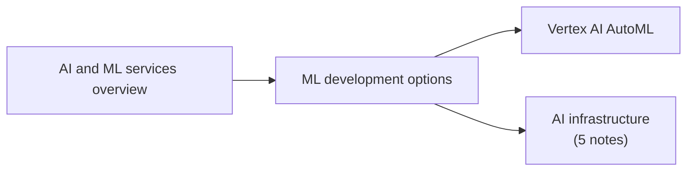

# AI and machine learning

Building, training, deploying and operating AI and ML on Google Cloud: pre-trained APIs, BigQuery ML, AutoML, custom training on Vertex AI, generative AI and the infrastructure underneath.

**Naming change.** At Google Cloud Next '26 (April 2026) Google made Vertex AI part of the new *Gemini Enterprise Agent Platform*; for example Vertex AI Studio became Agent Studio, and the Vertex AI documentation now lives under `docs.cloud.google.com/gemini-enterprise-agent-platform`. The notes in this area were migrated from material written before the change and still use the Vertex AI names. Checked against the Gemini Enterprise Agent Platform release notes and news coverage, 2026-11.

TODO: Update product and feature names in this area to the Gemini Enterprise Agent Platform names, keeping the Vertex AI names as aliases.

## Map of the area

Read the overview and the development options first; they decide which of the deeper notes matter for a given problem.

## Notes and subareas in reading order

1. [AI and ML services overview](ai-and-ml-services-overview.md): Vertex AI, Model Garden, pre-trained APIs, Workbench, TPUs, Vertex AI Studio and Dialogflow.
2. [ML development options](ml-development-options.md): pre-trained APIs, BigQuery ML, AutoML and custom training compared.
3. [Vertex AI AutoML](vertex-ai-automl.md): phases, techniques, workflow and limits.
4. [AI infrastructure](ai-infrastructure/README.md): platforms, accelerators, storage, patterns, security and MLOps.

## Planned topics

- Gemini Enterprise Agent Platform: what changed from Vertex AI
- Generative AI on Vertex AI: Gemini API, prompting, grounding
- Model tuning and evaluation
- Vertex AI Pipelines in depth
- Vertex AI Feature Store
- Document AI
- Conversational agents (Dialogflow CX)
- Responsible AI and Vertex Explainable AI
- Agent development (Agent Builder, Agent Development Kit)
