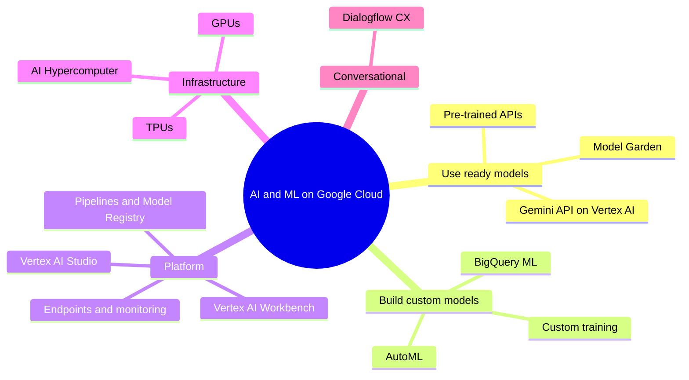

# AI and ML services overview

## Summary

Google Cloud supports AI and machine learning at three levels of effort: *pre-trained APIs* (vision, speech, language, translation) that work without training, *AutoML* that trains custom models from your data without code, and *custom training* with full control on Vertex AI. Around them sit Vertex AI as the unified platform (Model Garden, Vertex AI Studio for generative AI, Workbench notebooks, pipelines, model registry and monitoring), accelerators (GPUs and TPUs), BigQuery ML for SQL users and Dialogflow for conversational agents. The choice depends on the expertise of the team, the data available and how custom the model must be.

## Prerequisites

- [Google Cloud overview](../foundations/google-cloud-overview.md).
- Basic ML vocabulary: training, inference, model, dataset, fine-tuning.

## Core concepts

### Audiences

- Business users and analysts without ML expertise.
- Data scientists and ML engineers who build models.
- DevOps and platform teams who operationalize and automate ML pipelines (MLOps).

### Map of the portfolio

### Products

**Vertex AI** (since April 2026 part of Gemini Enterprise Agent Platform, see the [area README](README.md)). Unified platform for the ML lifecycle from data to deployed model: AutoML, custom training and foundation models; Feature Store, Model Registry and Model Monitoring; Workbench notebooks; pipelines for CI/CD of ML; monitoring of drift, training logs and prediction latency; integration with BigQuery, Cloud Storage, Cloud Logging and Cloud Build.

**AutoML (in Vertex AI).** No-code training for image, text, tabular and video tasks with neural architecture search, transfer learning and ensembles. Ideal for low-code teams and MVPs; training cost grows with data size. See [Vertex AI AutoML](vertex-ai-automl.md).

**Vertex AI Model Garden.** A catalog of Google foundation models (Gemini, Imagen and others; the original notes mention PaLM, which has been superseded by Gemini), partner models and open models that can be evaluated, tuned and deployed. Use for chatbots, summarization and multimodal tasks; mind token-based billing, prompt engineering and output validation.

**Pre-trained AI APIs.** Fully managed REST APIs: Vision AI, Speech-to-Text, Text-to-Speech, Natural Language, Translation, Video Intelligence, Document AI. No training needed; in production handle rate limits, quotas, latency monitoring, authentication and errors.

**Vertex AI Workbench.** Managed Jupyter notebooks integrated with BigQuery, Cloud Storage, Git and AI APIs, supporting Python, TensorFlow, scikit-learn and PyTorch, with GPU and TPU acceleration; idle shutdown controls cost.

**AI Platform Prediction (legacy).** The older model hosting service, replaced by Vertex AI endpoints; migrate remaining workloads.

**Cloud TPUs.** Google's ML accelerators for training and inference of deep neural networks, usable from Vertex AI, GKE and Compute Engine. Choose the generation by workload; TPUs need framework support (JAX, TensorFlow, PyTorch/XLA) and are not a drop-in GPU replacement. See [AI accelerators](ai-infrastructure/ai-accelerators.md).

**Vertex AI Studio** (formerly Generative AI Studio). A console and SDK environment to prototype prompts, tune models, generate embeddings and test multimodal models; move to production through Vertex AI endpoints and APIs.

**Dialogflow CX.** Visual, flow-based builder for chatbots and voicebots (customer service, contact center virtual agents), with telephony and web channels, webhooks to backends, IAM and Cloud Logging. Now part of Conversational Agents.

TODO: Verify current naming.

### Summary table

| Product | Type | Use case | Notes for DevOps and architects |
| --- | --- | --- | --- |
| Vertex AI | ML platform | End-to-end ML lifecycle | Pipelines, registry, MLOps tooling |
| AutoML | No-code ML | Custom models by point and click | Budget-aware training |
| Model Garden | Foundation and open models | LLMs, multimodal | API access, tuning, deployment |
| Pre-trained APIs | Serverless ML APIs | Vision, speech, language, translation | Plug and play |
| Workbench | Notebooks | Interactive development | BigQuery integration, idle shutdown |
| AI Platform Prediction | Legacy hosting | Old TensorFlow models | Migrate to Vertex AI |
| TPUs | Accelerators | Deep learning training and serving | Framework support needed |
| Vertex AI Studio | Generative AI tooling | Prompt design, tuning | Prototype then deploy |
| Dialogflow CX | Conversational AI | Chat and voice agents | Webhook integration |

## Worked example

Three requests to an AI team:

1. "Extract text and totals from scanned invoices." Use Document AI's invoice processor (pre-trained); no training data needed.
2. "Predict which customers will churn, from data already in BigQuery." Use BigQuery ML (`CREATE MODEL ... OPTIONS(model_type='BOOSTED_TREE_CLASSIFIER')`) so analysts stay in SQL.
3. "Classify defects in photos of our own products." Use AutoML image classification with a few thousand labeled photos; move to custom training only if accuracy is not sufficient.

See [ML development options](ml-development-options.md) for the decision in detail.

## Trade offs and when to use it

- More control means more expertise, time and cost.
- Generative models are billed per token or per deployed endpoint; budget and quota them.
- Data residency and security requirements (VPC Service Controls, CMEK) may limit regions and models.

## Common mistakes

- **Training a model when a pre-trained API would do.**
- **Notebooks running GPUs overnight.** Enable idle shutdown.
- **No monitoring after deployment.** Models drift as data changes.

## Practice

1. Name the three main approaches to ML on Google Cloud in order of increasing control.
2. Which product would you use to prototype prompts for a summarization feature?
3. What should replace AI Platform Prediction?

Answers: 1. Pre-trained APIs, AutoML, custom training. 2. Vertex AI Studio. 3. Vertex AI endpoints.

## Further reading

- [Vertex AI overview](https://docs.cloud.google.com/gemini-enterprise-agent-platform/machine-learning), Google Cloud documentation. Platform components.
- [Model Garden overview](https://docs.cloud.google.com/gemini-enterprise-agent-platform/models/model-garden/explore-models), Google Cloud documentation. Available models.
- [AI and machine learning products](https://cloud.google.com/products/ai), Google Cloud. Product catalog.
- [Gemini Enterprise Agent Platform release notes](https://docs.cloud.google.com/gemini-enterprise-agent-platform/release-notes), Google Cloud documentation. The renaming of Vertex AI features and later changes.
