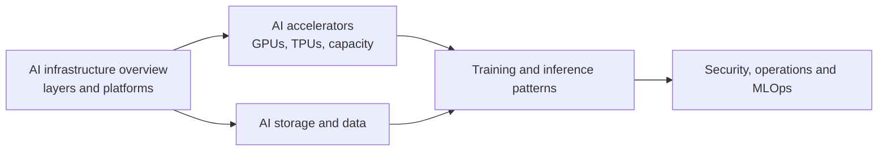

# AI infrastructure

The infrastructure behind AI and ML workloads: runtime platforms, accelerators, storage, training and inference patterns, security, operations and MLOps.

## Map of the subarea

## Notes in reading order

1. [AI infrastructure overview](ai-infrastructure-overview.md): the layers and the choice between Vertex AI, GKE, Cloud Run and Compute Engine.
2. [AI accelerators](ai-accelerators.md): GPU and TPU families, selection logic and capacity models.
3. [AI storage and data](ai-storage-and-data.md): Cloud Storage FUSE, Hyperdisk ML, Managed Lustre, Parallelstore and the data layer.
4. [AI training and inference patterns](ai-training-and-inference-patterns.md): patterns, reference architectures including RAG, and pitfalls.
5. [AI security, operations and MLOps](ai-security-operations-and-mlops.md): security domains, observability layers and the MLOps loop.

## Planned topics

- GKE Inference Gateway and model-aware routing
- Kueue and Dynamic Workload Scheduler
- Ray on GKE and Ray on Vertex AI
- Vertex AI Vector Search in depth
- Checkpointing strategies for preemptible training
