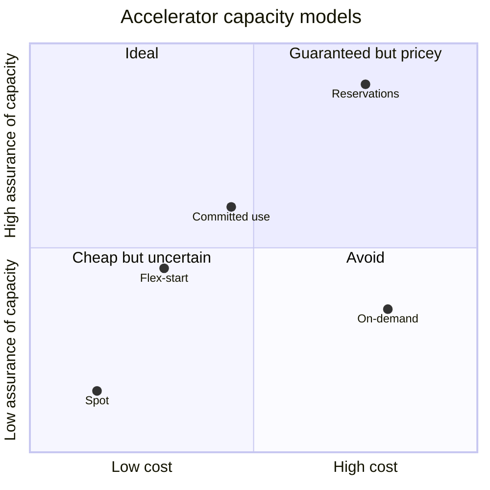

# AI accelerators

## Summary

Google Cloud offers two families of ML accelerators: NVIDIA GPUs on accelerator-optimized Compute Engine machines (A-series for training and large serving, G-series for smaller inference and graphics) and Google's own Tensor Processing Units (TPUs), application-specific chips for tensor math. GPUs give the broadest framework and tooling ecosystem; TPUs give strong price-performance for workloads that run well on JAX, TensorFlow or PyTorch/XLA. Whatever the chip, the practical constraints are memory, interconnect, regional availability, quota and capacity, which is why capacity models (reservations, Spot, Flex-start) are part of accelerator selection.

## Prerequisites

- [AI infrastructure overview](ai-infrastructure-overview.md).
- Basic deep learning terms: parameters, batch size, precision, data and model parallelism.

## Core concepts

### CPUs still matter

Not every workload needs accelerators. CPUs handle preprocessing, feature engineering, orchestration, classical ML, evaluation, pipelines and small model serving, on Compute Engine, GKE, Cloud Run, Dataflow, BigQuery or Spark. Expensive accelerators often sit idle because input pipelines, storage throughput, tokenization, checkpointing or CPU preprocessing are too slow. A balanced design uses CPUs for the data path and accelerators for dense math.

### GPU families

Machine families as documented by Google, taken from the original notes and not yet re-checked:

| Family | Typical role | Notes |
| --- | --- | --- |
| A4X Max, A4X | Very large training and serving, foundation models | NVIDIA GB300 and GB200 class systems |
| A4 | Large model training and serving | NVIDIA B200 |
| A3 Ultra, Mega, High, Edge | Large-scale training and serving | Ultra: H200; Mega, High, Edge: H100 variants |
| A2 Ultra, Standard | Training, fine-tuning, inference | NVIDIA A100 |
| G4, G2 | Smaller models, single-host inference, graphics, video | G4: RTX PRO 6000 class; G2: L4 |
| N1 with attached GPUs | Legacy and compatibility | T4, P4, V100, P100 |

TODO: Verify the GPU families against the GPU machine types page and record the check date.

Dimensions to evaluate:

| Dimension | Why it matters |
| --- | --- |
| GPU memory | Whether model, batch, optimizer state, key-value cache and shards fit |
| Interconnect and networking | Distributed training (all-reduce, tensor and pipeline parallelism) and multi-node serving |
| Local SSD | Checkpoint staging, temporary datasets |
| Host CPU and memory | Tokenization, data loading, preprocessing |
| Regional availability | Not every type exists in every region or zone |
| Quota and capacity | Regional and global GPU quotas; high-end GPUs often need reservations |
| Software stack | Drivers, CUDA, NCCL, framework versions, images, agents |
| Cost model | On-demand, committed use, reservations, Spot, Flex-start |

### Cloud TPU

TPUs are Google's application-specific integrated circuits for ML, available from Compute Engine, GKE and Vertex AI. They are not "Google GPUs": programming model (XLA compilation), topology (slices and pods connected by inter-chip interconnect), memory and scaling behave differently.

| Generation | Main role | Notes |
| --- | --- | --- |
| TPU7x (Ironwood) | Latest large-scale training and inference | Seventh generation; the original notes state it requires GKE |
| TPU v6e (Trillium) | Training, fine-tuning, serving of transformers and diffusion models | JAX and PyTorch/XLA |
| TPU v5p | Very large-scale training | Pods with thousands of chips |
| TPU v5e | Cost-efficient training and inference | Single-host and multi-host |

TODO: Verify generation details and platform support with a check date. The original notes list older v2, v3 and v4 generations in the product overview; these are being retired.

### GPU or TPU

| Choose GPUs when | Choose TPUs when |
| --- | --- |
| You need maximum framework flexibility, CUDA libraries or custom kernels | The workload maps well to XLA and TPU-optimized execution |
| You rely on PyTorch/CUDA-native libraries or NVIDIA tooling | You use JAX, TensorFlow or PyTorch/XLA, or Google TPU recipes |
| You use vLLM, TensorRT-LLM, Triton or Hugging Face runtimes on GPU | You want large pod-scale training or TPU-optimized serving |
| You need portability across clouds | You optimize for Google's TPU price-performance |
| You serve on Cloud Run GPU or GKE GPU nodes | You build on GKE TPU, Vertex AI TPU training or Cloud TPU VMs |

The answer is workload-specific: model type, framework, scaling pattern, precision, memory pressure, latency, team skills, capacity and cost.

### Capacity and cost models

Capacity is a first-class design concern: the question is often whether you can obtain the required accelerators in the right region, topology and time window.

| Model | Best for | Risk |
| --- | --- | --- |
| On-demand | Development, experiments, unpredictable use | Capacity may be unavailable; highest unit price |
| Reservations | Production, planned training runs | Commitment and planning |
| Committed use discounts | Predictable long-term usage | Less flexible |
| Spot VMs | Fault-tolerant batch and training with checkpoints | Preemption at any time |
| Flex-start (Dynamic Workload Scheduler) | Discounted access to scarce GPUs and TPUs within a time window | Start is not immediate; limited run duration |
| Future and calendar reservations | Planned large training events | Forecasting needed |

The positions are qualitative, from the risks in the table: Spot is cheapest and least assured, reservations are the most assured. They are not measured values.

## Worked example

Will a 70B-parameter model fit for inference?

- Weights in 16-bit precision: 70 x 10^9 x 2 bytes = 140 GB.
- One H100 has 80 GB of memory, so at least two are needed for weights alone; with key-value cache and activations, four H100 (320 GB) or two H200 (141 GB each, 282 GB) is a realistic starting point; an A3 High machine has eight H100.
- With 8-bit quantization (70 GB of weights), two H100 may suffice, at some accuracy risk.

Training needs far more: weights, gradients and optimizer state (Adam keeps two extra values per parameter) are roughly 16 bytes per parameter in mixed precision, about 1.1 TB for 70B parameters before activations, which means many nodes and sharding (FSDP, ZeRO).

## Trade offs and when to use it

- High-end accelerators are scarce: plan quota and reservations early, before the architecture is final.
- Spot and Flex-start cut cost dramatically for interruptible jobs, which then need checkpointing and restart logic.
- TPUs can lower cost for supported models but tie code to XLA-friendly frameworks.

## Common mistakes

- **Ignoring quota and region** until deployment week.
- **Idle accelerators** waiting for data; profile the input pipeline.
- **Choosing the biggest GPU** when a smaller one with quantization meets the latency target.

## Practice

1. Estimate the memory for the weights of a 13B model in 16-bit precision.
2. Name two reasons to pick a TPU over a GPU.
3. Which capacity model fits a two-week training run that must start on a fixed date?

Answers: 1. 13 x 10^9 x 2 bytes = 26 GB. 2. The model runs well on JAX or PyTorch/XLA, and TPU price-performance or pod-scale training is attractive. 3. A future (calendar) reservation.

## Further reading

- [GPU machine types](https://docs.cloud.google.com/compute/docs/gpus), Google Cloud documentation. Families and GPU models.
- [Cloud TPU introduction](https://docs.cloud.google.com/tpu/docs/intro-to-tpu), Google Cloud documentation. Architecture and versions.
- [Consumption options for AI Hypercomputer](https://docs.cloud.google.com/ai-hypercomputer/docs/consumption-models), Google Cloud documentation. Reservations, Spot and Flex-start.
