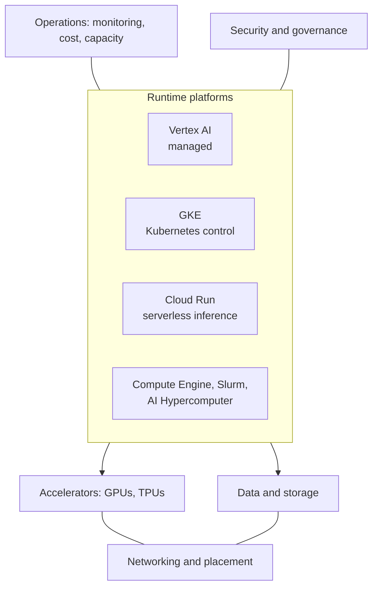
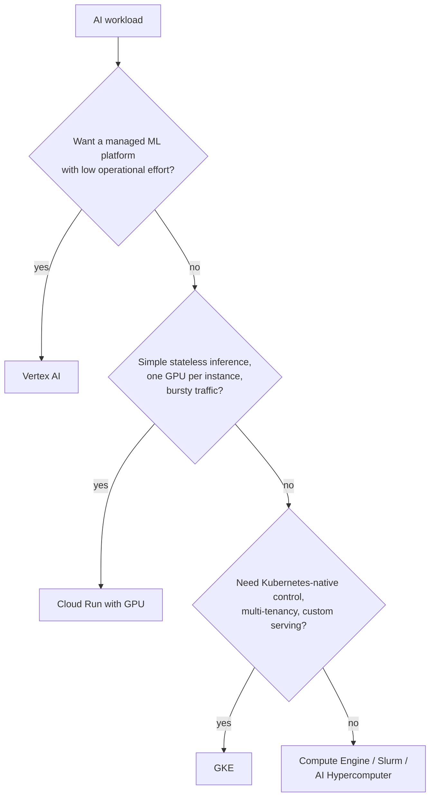

# AI infrastructure overview

## Summary

AI and ML infrastructure on Google Cloud is not a single product but a layered stack: accelerator hardware (GPUs and TPUs), compute platforms (Compute Engine, GKE, Cloud Run), the managed ML platform (Vertex AI), data and storage systems, networking, security and operations. The central architectural decision is not "which GPU", but which workload pattern you run, how much control you need, what latency or throughput you must meet, and how much infrastructure responsibility you want to own. Vertex AI is the default managed choice, GKE gives Kubernetes-level control, Cloud Run gives serverless inference, and Compute Engine with AI Hypercomputer serves the largest, most specialized jobs.

## Prerequisites

- [AI and ML services overview](../ai-and-ml-services-overview.md).
- [Compute services overview](../../compute/compute-services-overview.md).

## Core concepts

### The layers

| Layer | Main capabilities | Purpose |
| --- | --- | --- |
| AI supercomputing | AI Hypercomputer, GPU superclusters, Cloud TPU, high performance networking and scheduling | Large-scale training, fine-tuning, serving, HPC |
| Compute | Compute Engine accelerator-optimized VMs, Cloud TPU, GKE, Cloud Run with GPUs | Execution for training, inference, preprocessing |
| Managed ML | Vertex AI Training and Prediction, Pipelines, Model Garden, Vector Search | Managed development, deployment, MLOps, generative AI |
| Container orchestration | GKE Autopilot and Standard, Kueue, Ray on GKE, Inference Gateway | Custom and multi-tenant ML platforms |
| Serverless inference | Cloud Run with GPU support | Containerized inference with scale to zero |
| Data and storage | Cloud Storage and Cloud Storage FUSE, Hyperdisk ML, Managed Lustre, Parallelstore, BigQuery, Dataflow, Spark | Datasets, artifacts, checkpoints, features, processing |
| Security and governance | IAM, VPC Service Controls, Private Service Connect, encryption, audit logs, Model Armor, Artifact Registry, Binary Authorization | Protect data, models, pipelines, supply chain and runtime |
| Operations | Cloud Monitoring and Logging, Vertex AI Experiments and TensorBoard, GPU metrics, labels, reservations, Dynamic Workload Scheduler | Observability, capacity, cost |

AI Hypercomputer is Google's umbrella term for its supercomputing system that combines performance-optimized hardware, open software, ML frameworks and flexible consumption models.

### The core architectural question

| Execution model | Best for | You manage | Google manages |
| --- | --- | --- | --- |
| Vertex AI | Managed ML workflows, AutoML, custom training, registry, endpoints, pipelines, batch prediction, governance | Code, model, data, configuration | Training and endpoint infrastructure, platform services |
| GKE | Custom and multi-tenant ML platforms, advanced inference, large distributed training | Workloads, node pools, scheduling, platform design | Control plane and managed cluster features |
| Cloud Run | Serverless containerized inference with variable traffic and scale to zero | Image, code, model loading | Infrastructure, autoscaling, routing |
| Compute Engine, AI Hypercomputer, Slurm | Low-level cluster control, HPC, special topologies | VMs, images, drivers, schedulers, cluster lifecycle | Hardware capacity, network and storage primitives |

Expert design chooses the lowest operational complexity that still meets the requirements.

### Runtime platforms

**Vertex AI** supports training (AutoML, serverless custom training in containers, hyperparameter tuning, training pipelines, training clusters for very large jobs, Ray on Vertex AI) and inference (online prediction on endpoints with autoscaling between minimum and maximum replicas, batch prediction, Gemini and other generative APIs, Model Garden deployments, dedicated endpoints). It is the right default for managed training, endpoints, registry and experiments, AutoML and Model Garden, governance and batch prediction at scale. Vertex AI Pipelines (Kubeflow Pipelines or TFX definitions) make workflows reproducible and governed.

**GKE** fits multi-tenant ML platforms (namespaces, quotas, policies, workload identity), large distributed training (GPU and TPU node pools, Kueue, topology-aware placement), high throughput inference (autoscaling, model-aware routing with GKE Inference Gateway, custom servers), platform engineering and open source stacks (Ray, Kubeflow, KServe, vLLM, Triton). Autopilot manages nodes and baseline security; Standard gives direct control over node pools and accelerator tuning.

**Cloud Run** runs GPU containers (NVIDIA L4 and RTX PRO 6000 class GPUs, one GPU per instance, no driver installation, scale to zero). It fits open or custom models in containers with variable traffic, HTTPS inference without Kubernetes, when startup and model loading time are acceptable for the SLO. See [Cloud Run](../../compute/cloud-run.md).

**Compute Engine, Slurm and AI Hypercomputer** give direct access to accelerator-optimized machine families, custom images, local SSD and low-level cluster configuration, with managed Slurm clusters for A4X, A4 and A3 machines. They fit HPC migrations, existing Slurm users, jobs with explicit topology needs, large reservations and custom distributed stacks.

### Notes in this subarea

- [AI accelerators](ai-accelerators.md): GPUs, TPUs and capacity models.
- [AI storage and data](ai-storage-and-data.md): storage choices across the ML lifecycle.
- [AI training and inference patterns](ai-training-and-inference-patterns.md): patterns, reference architectures and pitfalls.
- [AI security, operations and MLOps](ai-security-operations-and-mlops.md): security domains, observability and MLOps.

## Worked example

A company wants to serve an open 8B-parameter model for an internal assistant with about 20 requests per minute during office hours and none at night.

- Vertex AI endpoint: managed, but minimum one replica is always billed.
- GKE with vLLM: full control, but a cluster and GPU node pool to operate for a small workload.
- Cloud Run with an L4 GPU: scales to zero at night, no cluster, one GPU is enough for an 8B model in 16-bit precision (about 16 GB of weights in the 24 GB of GPU memory, leaving room for the key-value cache).

Cloud Run fits best, with model weights loaded from Cloud Storage and a minimum of one instance during office hours to avoid cold starts.

TODO: Measure cold start time with a real model and record it.

## Trade offs and when to use it

- Managed platforms reduce effort but constrain hardware and runtime choices.
- GKE maximizes flexibility and sharing of accelerators across teams, at the cost of platform engineering.
- Regional availability and quota of accelerators often decide the platform and region more than technical preference.

## Common mistakes

- **Starting from hardware.** Ask about model, batch size, precision, latency and throughput targets, framework, storage and scaling first.
- **Overengineering.** Building a Kubernetes ML platform for one model.
- **Underusing managed services** for standard workflows that Vertex AI covers.

## Practice

1. Which platform would you choose for a multi-team ML platform with shared GPU pools and custom schedulers?
2. When is Vertex AI the right default?
3. What does Cloud Run require of an inference service to be a good fit?

Answers: 1. GKE (Standard, with Kueue). 2. When you want managed training, endpoints, registry, pipelines and governance with low operational overhead. 3. A stateless container, one GPU per instance, acceptable startup and model loading time, and variable traffic.

Specialist checklist (from the original notes), questions to answer without guessing: which platform and accelerator, regional availability and quota, where data lives and how it reaches the accelerator fast enough, checkpointing and interruption handling, model artifact storage and versioning, service accounts for training and serving, safe logging of prompts and outputs, endpoint exposure, drift detection, utilization monitoring, cost attribution, rollback, disaster recovery and compliance evidence.

## Further reading

- [AI Hypercomputer overview](https://docs.cloud.google.com/ai-hypercomputer/docs/overview), Google Cloud documentation. The supercomputing stack.
- [Vertex AI training overview](https://docs.cloud.google.com/gemini-enterprise-agent-platform/machine-learning/training/overview), Google Cloud documentation. Training options.
- [AI/ML on GKE](https://docs.cloud.google.com/kubernetes-engine/docs/integrations/ai-infra), Google Cloud documentation. GKE features for AI workloads.
- [AI and ML resources](https://docs.cloud.google.com/architecture/ai-ml), Google Cloud Architecture Center. Reference architectures and guides, including choosing a runtime for models.
