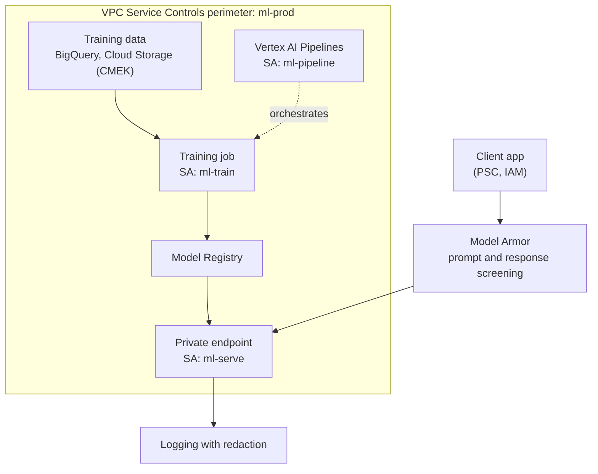
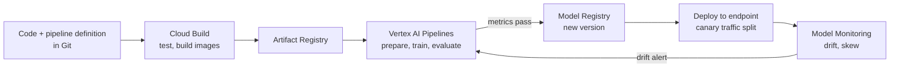

# AI security, operations and MLOps

## Summary

An AI system has more to protect and observe than a normal application: training data, prompts, embeddings, model weights, pipelines, containers, endpoints and generated outputs. Security follows a holistic approach across ideation, development, deployment and operations, with least privilege identities per stage, VPC Service Controls against data exfiltration, private endpoints, secret management, supply chain controls and safe logging. Operations add layers of monitoring (infrastructure, training, inference, data, model quality, cost, security). MLOps ties it together with pipelines, a model registry and automated deployment so that models are reproducible, governed and can be rolled back.

## Prerequisites

- [AI training and inference patterns](ai-training-and-inference-patterns.md).
- [VPC Service Controls](../../networking/vpc/vpc-service-controls.md) and [service accounts](../../security-and-identity/identity-and-access/service-accounts.md).

## Core concepts

### Security domains

| Domain | What to secure |
| --- | --- |
| Identity | Users, service accounts, workload identities, pipeline and runtime identities |
| Data | Training and validation data, prompts, outputs, embeddings, checkpoints |
| Models | Weights, adapters, fine-tuned models, evaluation results |
| Pipelines | CI/CD, Vertex AI Pipelines, Kubeflow, Dataflow, build systems |
| Containers | Base images, dependencies, vulnerabilities, signatures, permissions |
| Networks | Private endpoints, VPC boundaries, perimeters, ingress and egress |
| Secrets | API keys, database credentials, tokens, model provider keys |
| Runtime | GKE Pods, Cloud Run services, Vertex AI endpoints, VMs |
| Observability | Logs, traces, metrics, audit trails, redaction of sensitive outputs |
| Governance | Policies, lineage, approvals, model risk, compliance evidence |

### Data exfiltration defense

VPC Service Controls for Vertex AI put training data, models, prediction requests and results inside a perimeter. Google Cloud APIs are reachable from the internet by default (with IAM authorization); a perimeter adds context restrictions on top.

Security baseline:

- Least privilege IAM; a dedicated service account per workload or pipeline stage; no broad project-level roles.
- VPC Service Controls for sensitive ML projects; private access patterns; restricted public endpoints.
- Secrets in Secret Manager, never in code, images or notebooks.
- Images in Artifact Registry, scanned and hardened; Binary Authorization where possible.
- CMEK where required; audit logging and monitoring; organization policies as guardrails.
- Model and prompt protection (Model Armor screens prompts and responses for injection, jailbreaks and sensitive data).
- Separate development, staging and production environments.

### Observability layers

| Layer | What to monitor |
| --- | --- |
| Infrastructure | GPU and TPU utilization and memory, CPU, RAM, disk, network, node health |
| Training | Loss, accuracy, throughput, step time, checkpoint duration, data loading time |
| Inference | Latency, throughput, queue depth, errors, cold starts, model load time, tokens per second |
| Data | Drift, schema changes, missing values, freshness, feature distributions |
| Model | Quality metrics, fairness, hallucination rate, evaluation scores |
| Cost | Accelerator hours, idle time, egress, endpoint replicas, pipeline cost |
| Security | Audit logs, denied requests, unusual access, exfiltration attempts, vulnerabilities |

GPU metrics come from the Ops Agent with NVIDIA DCGM and NVML integrations into Cloud Monitoring. Billing labels on Vertex AI Pipelines runs connect cost to pipelines in the BigQuery billing export.

Questions an operationally mature team can answer: Are accelerators fully used? Where is the bottleneck? How long does a checkpoint take? What happens when a Spot VM is preempted, and can the job resume? Which team owns the cost? Which model version is deployed and which data trained it? Which service account read the training data? Do inference logs leak prompts or outputs? Can the deployment be rolled back?

### MLOps

| Capability | Google Cloud options |
| --- | --- |
| Source control | GitHub, GitLab, Secure Source Manager |
| Build | Cloud Build, Artifact Registry, scanning |
| Orchestration | Vertex AI Pipelines (Kubeflow Pipelines, TFX) |
| Data processing | BigQuery, Dataflow, Dataproc |
| Training | Vertex AI Training, GKE, Compute Engine, Cloud TPU |
| Experiments | Vertex AI Experiments, TensorBoard |
| Model registry | Vertex AI Model Registry |
| Deployment | Vertex AI endpoints, GKE, Cloud Run |
| Batch prediction | Vertex AI batch prediction, Dataflow |
| Monitoring | Cloud Monitoring, Cloud Logging, Vertex AI Model Monitoring |
| Governance | IAM, audit logs, VPC Service Controls, metadata, labels, policies |

The loop closes when monitoring triggers retraining; every model version can be traced to code, data and pipeline run.

## Worked example

TODO: Build a minimal Vertex AI pipeline (data from BigQuery, training, evaluation gate, registration, deployment with a 10 percent traffic split) and record the pipeline YAML, the service accounts used per step and the Model Monitoring alert configuration.

## Trade offs and when to use it

- Perimeters and private endpoints add friction for data scientists; provide sanctioned workbench environments inside the perimeter.
- Logging full prompts helps debugging and evaluation but risks storing personal data; log metadata by default and sample redacted content.
- Full MLOps automation pays off once models are retrained regularly; for one-off models, lighter processes suffice.

## Common mistakes

- **One service account for everything** (notebooks, training, serving).
- **Notebooks with broad access** to production data outside any perimeter.
- **No lineage**: nobody knows which data trained the deployed model.
- **Monitoring infrastructure only**, not model quality or drift.

## Practice

1. Name three things specific to AI systems that must be secured beyond a normal web app.
2. Which Google Cloud control limits where training data and predictions can be sent?
3. What closes the MLOps loop?

Answers: 1. For example training data, model weights, prompts and generated outputs (also embeddings, checkpoints, pipelines). 2. VPC Service Controls. 3. Monitoring of drift or quality that triggers retraining through the pipeline.

Learning path for this area (modules from the original notes): foundations for AI (hierarchy, IAM, VPC, private access, storage, Artifact Registry, logging, billing and quotas); accelerators; Vertex AI; GKE for AI; AI storage and data pipelines; inference engineering; security, governance and compliance; cost and reliability engineering. Each module ends with a deliverable, for example a secure project structure for ML environments, an accelerator selection matrix, a full Vertex AI pipeline, a multi-tenant GKE AI platform design, a storage architecture for training and RAG, a three-way deployment comparison, a hardened reference architecture and a cost model.

## Further reading

- [VPC Service Controls with Vertex AI](https://docs.cloud.google.com/gemini-enterprise-agent-platform/machine-learning/general/vpc-service-controls), Google Cloud documentation. Perimeters for ML resources.
- [Model Armor overview](https://docs.cloud.google.com/security-command-center/docs/model-armor-overview), Google Cloud documentation. Prompt and response screening.
- [MLOps: continuous delivery and automation pipelines in machine learning](https://docs.cloud.google.com/architecture/mlops-continuous-delivery-and-automation-pipelines-in-machine-learning), Google Cloud Architecture Center. MLOps maturity levels.
- [Monitor GPU performance](https://docs.cloud.google.com/compute/docs/gpus/monitor-gpus), Google Cloud documentation. Ops Agent and DCGM metrics.
