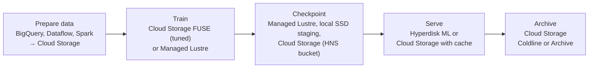
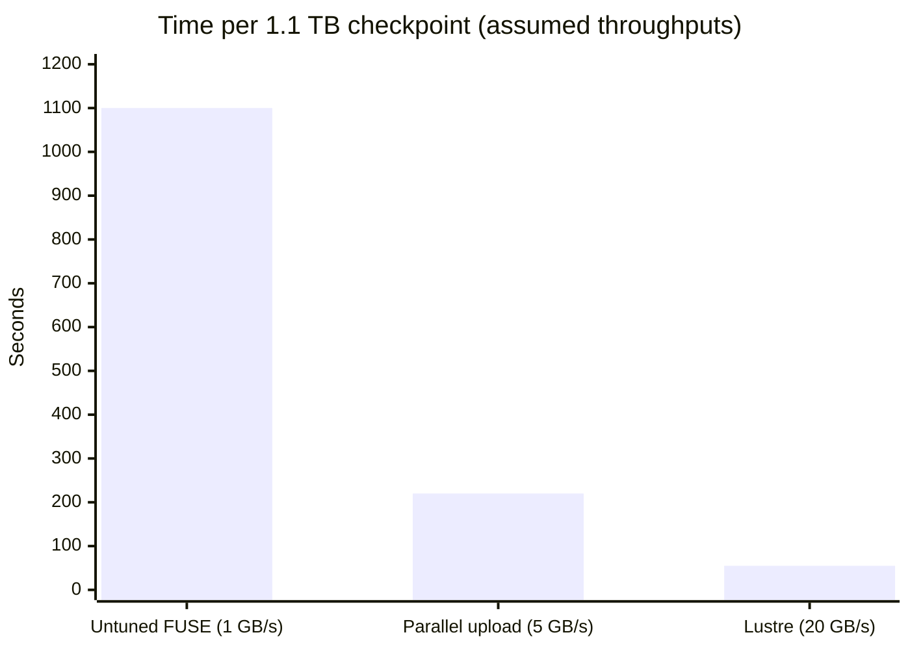

# AI storage and data

## Summary

Storage design decides whether expensive GPUs and TPUs are busy or waiting. Each phase of the ML lifecycle (preparing data, training, checkpointing, serving, archiving) needs different capacity, throughput, latency and consistency. Cloud Storage is the durable source of truth for datasets and artifacts, Cloud Storage FUSE exposes it as files, Hyperdisk ML serves model weights at very high read throughput, Managed Lustre and Parallelstore provide parallel POSIX file systems for training and scratch, and BigQuery, Dataflow, Spark and Vector Search form the data layer around them.

## Prerequisites

- [AI infrastructure overview](ai-infrastructure-overview.md).
- [Cloud Storage](../../storage-and-databases/cloud-storage.md).

## Core concepts

### Storage options

| Service | Best for | Key characteristics |
| --- | --- | --- |
| Cloud Storage | Datasets, model artifacts, logs, checkpoints, archives | Highly durable object store; foundation of ML data lakes |
| Cloud Storage FUSE | Mounting buckets as paths for frameworks that expect files | Convenient; needs tuning; object semantics underneath |
| Cloud Storage FUSE with caching (Rapid Cache, Anywhere Cache) | Repeated reads, model serving | Higher throughput and lower latency for read-heavy AI workloads |
| Hyperdisk ML | Model weights and immutable datasets read by many nodes | Highest read throughput of Hyperdisk; read-only-many attachment |
| Managed Lustre | Shared high-throughput training data and checkpoints | Managed, POSIX, parallel, multi-petabyte, encrypted |
| Parallelstore | Low-latency scratch for training and HPC | High metadata performance, POSIX, CSI driver; not long-term storage; the original notes record it as invitation-only |
| BigQuery | Analytics, feature exploration, BigQuery ML | Warehouse with ML |
| Dataflow | Batch and streaming preprocessing and inference pipelines | Managed Beam, Dataflow ML |
| Managed Spark (Dataproc) | Spark ETL and preprocessing | Open source Spark |
| Vertex AI Vector Search | Embedding search for RAG, recommendations, semantic search | Managed, uses Google's ScaNN |

TODO: Verify the availability status of Parallelstore and the current names of Cloud Storage caching features.

### Choosing by lifecycle stage

Google's AI storage guide proposes three steps: define workload requirements, review the options, and select storage per workflow stage.

### Cloud Storage and Cloud Storage FUSE

- Use Cloud Storage as the durable, regional or multi-regional store.
- Use FUSE when frameworks need file paths, and tune it per profile (training, serving, checkpointing): caching, parallel downloads, metadata cache.
- Object storage is not POSIX: no atomic renames in flat buckets, no in-place updates, different listing behavior.
- **Hierarchical namespace** buckets give higher initial queries per second and atomic folder renames, useful for checkpointing.

### Hyperdisk ML

Use it for fast repeated reads of model weights, large models served on many nodes, reducing accelerator idle time during model loading, block storage performance, and immutable, read-heavy data. On GKE it can be attached read-only to many nodes to load weights quickly.

### Managed Lustre and Parallelstore

- **Managed Lustre**: a real POSIX parallel file system for high-throughput shared access, reliable checkpoint throughput and predictable performance, integrated with Compute Engine and GKE and able to import from and export to Cloud Storage.
- **Parallelstore**: fast scratch with high metadata performance; durability must come from Cloud Storage.

## Worked example

Checkpoint time for a 70B-parameter model in training. A full checkpoint with optimizer state is roughly 1.1 TB (see [AI accelerators](ai-accelerators.md#worked-example)).

| Storage for checkpoints | Assumed sustained write throughput | Time per checkpoint |
| --- | --- | --- |
| Cloud Storage through untuned FUSE | 1 GB/s | about 1,100 s (18 min) |
| Cloud Storage with parallel uploads | 5 GB/s | about 220 s (4 min) |
| Managed Lustre | 20 GB/s | about 55 s |

The throughputs are assumptions for illustration, not measurements. The conclusion holds generally: with a checkpoint every 30 minutes, an 18 minute write stalls the accelerators for most of the interval, while under a minute is acceptable.

TODO: Replace with measured values from a benchmark and record the setup.

## Trade offs and when to use it

- Cloud Storage is cheapest and most durable but slowest for small-file random access.
- Parallel file systems are fast and POSIX but cost more per GB; use them for hot data only and keep the source of truth in Cloud Storage.
- Co-locate storage with accelerators in the same region (and zone for file systems) to avoid latency and egress.

## Common mistakes

- **Treating Cloud Storage FUSE as a local disk.** Tune it or use a parallel file system.
- **Millions of tiny files.** Pack them into larger shards (TFRecord, WebDataset, Parquet).
- **Model weights inside container images** for large models; startup becomes slow. Load from Cloud Storage or Hyperdisk ML.
- **No checkpoint strategy** for long or preemptible jobs.

## Practice

1. Which storage fits model weights read by 100 serving nodes at startup?
2. Why are hierarchical namespace buckets useful for checkpoints?
3. Where should the durable copy of training data live?

Answers: 1. Hyperdisk ML (read-only-many) or Cloud Storage with caching. 2. They support atomic folder renames and higher initial request rates. 3. In Cloud Storage.

## Further reading

- [Design storage for AI and ML workloads](https://docs.cloud.google.com/architecture/ai-ml/storage-for-ai-ml), Google Cloud Architecture Center. Lifecycle-based storage selection.
- [Cloud Storage FUSE performance tuning](https://docs.cloud.google.com/storage/docs/cloud-storage-fuse/performance), Google Cloud documentation. Profiles for training, serving and checkpointing.
- [Managed Lustre overview](https://docs.cloud.google.com/managed-lustre/docs/overview), Google Cloud documentation. Parallel file system features.
- [Hyperdisk ML](https://docs.cloud.google.com/compute/docs/disks/hd-types/hyperdisk-ml), Google Cloud documentation. Read-optimized block storage.
