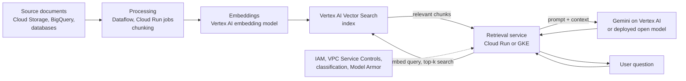

# AI training and inference patterns

## Summary

Most AI systems on Google Cloud follow a small set of patterns. For training: AutoML on Vertex AI, custom training on Vertex AI, distributed training on GKE, and very large training on AI Hypercomputer with Slurm. For inference: Vertex AI online and batch prediction, model serving on GKE, and serverless inference on Cloud Run with GPUs. These combine into reference architectures (managed ML platform, Kubernetes AI platform, serverless inference, large-scale training, retrieval-augmented generation). Knowing the patterns and their pitfalls lets you pick a design quickly and defend it.

## Prerequisites

- [AI infrastructure overview](ai-infrastructure-overview.md), [AI accelerators](ai-accelerators.md), [AI storage and data](ai-storage-and-data.md).

## Core concepts

### Training patterns

| Pattern | Best for | Risks or notes |
| --- | --- | --- |
| AutoML on Vertex AI | Supported tasks, limited ML engineering capacity, quick baselines, business prototypes | Less flexibility and control |
| Custom training on Vertex AI | Your code in a container (PyTorch, TensorFlow, JAX, XGBoost), single or distributed, GPUs or TPUs, integration with Experiments, Registry, Pipelines | Secure with dedicated service accounts, Artifact Registry images, Secret Manager, CMEK, private networking |
| Distributed training on GKE | Internal ML platforms, Ray, Kubeflow, Kueue, multi-team accelerator sharing, fine control of nodes and topology | Platform engineering effort |
| AI Hypercomputer and Slurm | Foundation model pre-training, research and HPC teams, Slurm users, large reservations, topology-sensitive jobs | Requires specialized infrastructure skills |

### Inference patterns

| Pattern | Best for | Risks |
| --- | --- | --- |
| Vertex AI online prediction | Managed production APIs with registry integration and autoscaling endpoints | Minimum replicas billed continuously |
| Vertex AI batch prediction | Asynchronous scoring: recommendations refresh, fraud scoring, churn, document processing, bulk embeddings | Not for interactive latency |
| GKE model serving | Custom servers (vLLM, Triton, KServe, TGI, JetStream), multi-model routing, model-aware load balancing with Inference Gateway, GPU or TPU serving | Cluster operations |
| Cloud Run GPU | Bursty internal APIs, small and medium open models, embeddings, vision, stateless serving | Cold start and model loading, one GPU per instance, cost of minimum instances, concurrency tuning |

### Reference architectures

**Managed ML platform.** Data in BigQuery and Cloud Storage; features prepared with BigQuery, Dataflow or Spark; Vertex AI custom training; Model Registry; Vertex AI endpoint; monitoring; Vertex AI Pipelines; IAM, VPC Service Controls, private access, encryption and audit logs. For enterprise and regulated teams that value governance and repeatability.

**Kubernetes AI platform.** Private GKE cluster, namespaces per team, GPU and TPU node pools, Kueue, Workload Identity Federation, Artifact Registry, Cloud Storage or Hyperdisk ML or Lustre for data and models, Inference Gateway or KServe or vLLM for serving, Monitoring and Logging, policies, network policies and optional service mesh. For platform teams and multi-tenant accelerator sharing.

**Serverless inference.** Model artifacts in Cloud Storage (or in the image for small models), image in Artifact Registry, Cloud Run service with GPU, identity-restricted HTTPS endpoint, optional minimum instances, Secret Manager, VPC access to backends. For internal tools, embedding APIs, lightweight LLM serving and bursty traffic.

**Large-scale training.** AI Hypercomputer or accelerator-optimized Compute Engine or GKE, high-end GPUs or TPUs, reservations or scheduler-managed capacity, topology-aware scheduling, high throughput storage, distributed frameworks (PyTorch, JAX, XLA, Ray, Slurm), frequent checkpoints, preemption handling and deep observability.

**Retrieval-augmented generation (RAG).**

Grounding answers in retrieved private data reduces hallucination and keeps the model generic; the security layer controls what data can be retrieved and what is logged.

### Common pitfalls

1. **Starting with hardware instead of requirements.** Ask about model, batch size, precision, latency and throughput targets, framework, storage and scaling.
2. **Ignoring quota and regional availability.** Plan accelerators early.
3. **Treating Cloud Storage FUSE as a universal POSIX file system.** Tune it per workload profile.
4. **Underestimating model loading.** It dominates cold starts on Cloud Run and multi-replica GKE scaling.
5. **No checkpointing strategy.** Assume interruption; design checkpoint frequency, throughput and resume logic.
6. **Weak service account design.** Dedicated identities per pipeline stage, not one broad account for notebooks, jobs and endpoints.
7. **Sensitive data in logs.** Prompts, outputs, features and labels can contain personal data.
8. **Overusing managed platforms or overengineering Kubernetes.** Choose the lowest complexity that meets the requirements.

## Worked example

Comparing deployment of one model three ways (an exercise from the original learning path): deploy the same model on a Vertex AI endpoint, on GKE with vLLM and on Cloud Run with an L4 GPU, then compare cost per 1,000 requests, p95 latency, cold start, security controls and operational effort.

TODO: Run the comparison with a small open model and record results in a table and chart.

## Trade offs and when to use it

- Patterns can be mixed: train on Vertex AI, serve on GKE; batch-score on Vertex AI, serve online on Cloud Run.
- Online serving needs latency SLOs and autoscaling; batch needs throughput and cost efficiency.

## Common mistakes

See the pitfalls above; the most frequent in practice are missing checkpoints, ignored quotas and logging of sensitive prompts.

## Practice

1. Which pattern fits nightly scoring of 50 million customers?
2. Name the components of a RAG system on Google Cloud.
3. Why does model loading matter more on Cloud Run than on a fixed GKE deployment?

Answers: 1. Vertex AI batch prediction (or Dataflow ML). 2. Document store, processing and chunking, embedding model, Vector Search index, retrieval service, LLM, security controls. 3. Cloud Run scales instances up from zero frequently, and each new instance must load the model before serving.

## Further reading

- [Vertex AI inference overview](https://docs.cloud.google.com/gemini-enterprise-agent-platform/machine-learning/predictions), Google Cloud documentation. Online and batch inference.
- [Serve open models on GKE](https://docs.cloud.google.com/kubernetes-engine/docs/concepts/machine-learning/inference), Google Cloud documentation. Inference on GKE.
- [RAG reference architectures](https://docs.cloud.google.com/architecture/rag-reference-architectures), Google Cloud Architecture Center. RAG designs with Vertex AI.
- [Cloud Run GPU best practices](https://docs.cloud.google.com/run/docs/configuring/services/gpu-best-practices), Google Cloud documentation. Model loading and concurrency.
