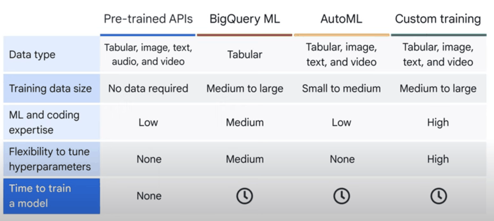
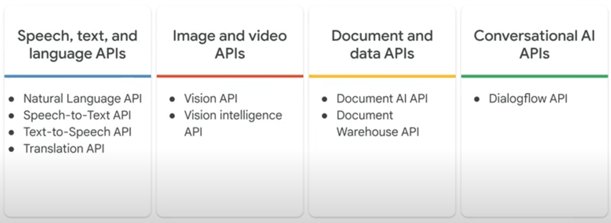
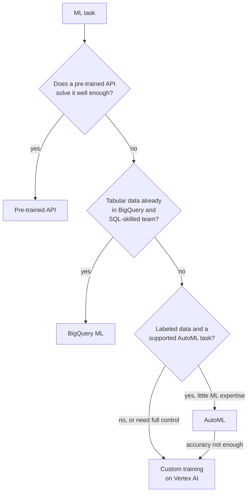

# ML development options

## Summary

Google Cloud offers four ways to get a model: *pre-trained APIs* (no data, no ML skills), *BigQuery ML* (SQL on tabular data), *AutoML* (custom models without code) and *custom training* (full control with your own code on Vertex AI). They form a spectrum from ease of use to flexibility. The right choice follows from three inputs: how much labeled data you have, how much ML expertise the team has, and how specific the task is.

## Prerequisites

- [AI and ML services overview](ai-and-ml-services-overview.md).

## Core concepts



### Pre-trained APIs

Best for developers and businesses with little or no ML experience who want AI features quickly.



- Vision API (image classification, object detection, OCR), Natural Language API (entities, sentiment), Speech-to-Text and Text-to-Speech, Translation API, Video Intelligence API, Document AI, and generative models through the Gemini API.
- Advantages: no ML expertise, no training data, instant results.
- Limits: only the predefined tasks; no control over training or tuning (beyond what the API offers).

### BigQuery ML

Best for analysts and engineers who know SQL and work with tabular data in BigQuery.

- Models are created and used with SQL (`CREATE MODEL`, `ML.PREDICT`), without moving data out of BigQuery or writing Python.
- Advantages: works where the data is, automated feature preprocessing, quick training.
- Limits: mostly tabular data (plus remote models on Vertex AI), less control over architectures, SQL knowledge required.

### AutoML

Best for business users, analysts or developers who need a custom model but lack deep ML knowledge.

- Upload labeled data; AutoML preprocesses, searches architectures and tunes hyperparameters automatically, for image, text, tabular and video data.
- Advantages: no code, custom models, transfer learning for accuracy with less data.
- Limits: less flexible than custom training, hyperparameters cannot be tuned by hand, training data is required. See [Vertex AI AutoML](vertex-ai-automl.md).

### Custom training

Best for ML engineers and data scientists who need full control.

- Your own code with TensorFlow, PyTorch, JAX, scikit-learn or XGBoost, developed in Vertex AI Workbench and run as Vertex AI training jobs (or on GKE).
- Advantages: maximum flexibility, any architecture (CNNs, RNNs, transformers), manual hyperparameter tuning, distributed training on GPUs and TPUs.
- Limits: high expertise, longer development, higher compute cost, infrastructure choices. See [AI infrastructure](ai-infrastructure/README.md).

### Comparison

| Feature | Pre-trained APIs | BigQuery ML | AutoML | Custom training |
| --- | --- | --- | --- | --- |
| ML skill needed | None | SQL | Low | High |
| Custom model | No | Limited | Yes | Yes |
| Data types | Image, text, audio, video | Tabular | Image, text, tabular, video | Any |
| Training data needed | None | Medium to large | Small to medium | Medium to large |
| Control over training | None | Some tuning | Limited | Full |
| Best use case | AI features such as sentiment or OCR | SQL-based ML for business insights | Custom models with low code | Complex, custom ML |



Start at the top and stop at the first option that meets the requirement; each step down adds control, cost and required skill.

### Ecosystem

- **Vertex AI** unifies training, deployment and MLOps (notebooks, model registry, feature store, monitoring).
- **TensorFlow, PyTorch and JAX** run on Google Cloud GPUs and TPUs.
- **AI infrastructure**: GPUs, TPUs and BigQuery ML for scale.
- **Responsible AI and governance**: explainability (Vertex Explainable AI), evaluation, bias detection and model governance.

## Worked example

Churn prediction in BigQuery ML (untested):

```sql
CREATE OR REPLACE MODEL analytics.churn_model
OPTIONS (model_type = 'BOOSTED_TREE_CLASSIFIER', input_label_cols = ['churned']) AS
SELECT tenure_months, monthly_spend, support_tickets, plan, churned
FROM analytics.customers_training;

SELECT * FROM ML.EVALUATE(MODEL analytics.churn_model);

SELECT customer_id, predicted_churned_probs
FROM ML.PREDICT(MODEL analytics.churn_model, TABLE analytics.customers_current);
```

`ML.EVALUATE` returns precision, recall, accuracy and ROC AUC; if they are not good enough, the next step is AutoML Tabular or custom training with the same data.

## Trade offs and when to use it

- Pre-trained and BigQuery ML give results in hours; custom training in weeks.
- AutoML and generative model tuning can be costly at large data volumes; estimate before training.
- Custom models need MLOps (pipelines, monitoring, retraining) to stay useful.

## Common mistakes

- **Jumping to custom training.** Try simpler options first; they set a baseline.
- **Moving data out of BigQuery** just to train a simple tabular model.
- **No evaluation baseline** to compare approaches.

## Practice

1. A team of analysts wants to forecast weekly sales from BigQuery tables. Which option fits?
2. What does AutoML need that pre-trained APIs do not?
3. When is custom training the right choice?

Answers: 1. BigQuery ML (for example an ARIMA_PLUS model). 2. Labeled training data. 3. When the task needs a custom architecture, full control of training, or accuracy that simpler options cannot reach, and the team has the expertise.

## Further reading

- [Choose a model development approach](https://docs.cloud.google.com/gemini-enterprise-agent-platform/machine-learning/start/training-methods), Google Cloud documentation. Training methods compared.
- [BigQuery ML introduction](https://docs.cloud.google.com/bigquery/docs/bqml-introduction), Google Cloud documentation. Supported models.
- [AI APIs](https://cloud.google.com/products/ai#ai-apis), Google Cloud. Pre-trained API catalog.
