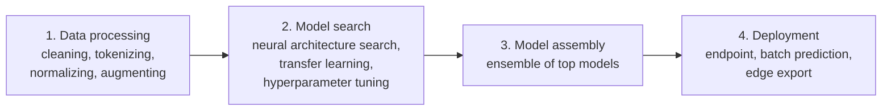

# Vertex AI AutoML

## Summary

AutoML (automated machine learning) automates the steps of building a model: data preprocessing, feature engineering, architecture selection, hyperparameter tuning and ensembling. On Google Cloud it is part of Vertex AI and lets users with little ML expertise train custom models on their own image, text, tabular or video data through the console, SDK or API. It relies on transfer learning, neural architecture search and ensemble learning, and produces models that can be deployed to Vertex AI endpoints or, for some tasks, exported for edge devices.

## Prerequisites

- [ML development options](ml-development-options.md).
- Basic ML concepts: training and test data, labels, evaluation metrics.

## Core concepts

### The four phases



1. **Data processing.** AutoML prepares the dataset: text is tokenized and vectorized, numbers and dates normalized for tabular models, images augmented and preprocessed. Feature engineering is automated.
2. **Model selection and tuning.** *Neural architecture search (NAS)* explores architectures and keeps the best performers, replacing manual trial and error. *Transfer learning* starts from pre-trained models, so less data is needed; for example a model pre-trained on general images or text is adapted to a specific domain.
3. **Model assembly.** The best models (the original notes say typically around ten) are combined in an ensemble; averaging or voting improves accuracy and reduces overfitting.
4. **Deployment and prediction.** The final model is deployed to a Vertex AI endpoint for online predictions, used for batch predictions, or exported (for some image models) for on-device use.

### Techniques

- **Transfer learning** speeds up training and gives good accuracy with smaller datasets; used for text classification, image recognition and speech.
- **Neural architecture search** automates the search for architectures and hyperparameters.
- **Ensemble learning** combines several models by voting or averaging for better generalization.

### AutoML compared with traditional ML development

| Feature | AutoML | Traditional ML |
| --- | --- | --- |
| ML expertise | Minimal | High |
| Preprocessing and feature engineering | Automated | Manual |
| Model selection | Automatic search | Manual |
| Hyperparameter tuning | Automatic | Manual |
| Development time | Hours to days | Weeks to months |
| Accuracy | Often strong baselines | Depends on the expert |
| Flexibility | Limited | High |

### Use cases

| Industry | Use case | Example |
| --- | --- | --- |
| Retail | Product recommendation | Personalized shopping |
| Healthcare | Medical image analysis | Tumor detection support |
| Finance | Fraud detection | Card fraud alerts |
| Manufacturing | Predictive maintenance | Machine fault prediction |
| Media | Content moderation | Offensive content detection |
| Customer support | Sentiment analysis | Ticket routing |

## Worked example

Training a tabular classification model:

1. **Prepare data** in Cloud Storage (CSV) or BigQuery; create a Vertex AI dataset.
2. **Choose the task type**: tabular classification or regression, image classification or object detection, text classification or entity extraction, video classification or action recognition. The original notes use the legacy product names AutoML Tables, Vision, Natural Language and Video Intelligence, which are now task types in Vertex AI. Note that Google has moved some AutoML text tasks to Gemini-based tuning.
3. **Train** with a budget in node hours.
4. **Evaluate** with precision, recall, confusion matrix and feature importance; add data or retrain if needed.
5. **Deploy** to an endpoint for online prediction, or run batch predictions.

TODO: Verify which AutoML data types are still offered for new models.

```python
# Vertex AI SDK for Python (untested sketch)
from google.cloud import aiplatform

aiplatform.init(project="PROJECT_ID", location="europe-west4")
ds = aiplatform.TabularDataset.create(
    display_name="churn", bq_source="bq://PROJECT_ID.analytics.customers_training")
job = aiplatform.AutoMLTabularTrainingJob(
    display_name="churn-automl", optimization_prediction_type="classification")
model = job.run(dataset=ds, target_column="churned", budget_milli_node_hours=1000)
endpoint = model.deploy(machine_type="n1-standard-4")
print(endpoint.predict([{"tenure_months": "3", "monthly_spend": "49", "plan": "basic"}]))
```

`budget_milli_node_hours=1000` limits training to one node hour, which caps cost for a first baseline.

## Trade offs and when to use it

- **Benefits.** No ML expertise needed, development in hours or days, strong accuracy through transfer learning and search, easy deployment.
- **Pricing.** Training per node hour, deployment per node hour of the endpoint, batch prediction per node hour; data storage separate. Check the Vertex AI pricing page.
- **Limits.** No control over architecture; training can be costly for large datasets; models are harder to interpret than simple models.

## Common mistakes

- **Unbalanced or leaky training data.** AutoML cannot fix bad labels or features that reveal the answer.
- **Leaving endpoints deployed.** Undeploy idle models; endpoints bill per hour.
- **Skipping evaluation slices.** Check performance per segment, not only overall.

## Practice

1. Which two techniques let AutoML reach good accuracy with little data and no manual tuning?
2. What does ensembling add?
3. Name one cost risk of AutoML.

Answers: 1. Transfer learning and neural architecture search (with automated hyperparameter tuning). 2. Better accuracy and less overfitting by combining several models. 3. Large training budgets on big datasets, or endpoints left deployed.

## Further reading

- [AutoML beginner's guide](https://docs.cloud.google.com/gemini-enterprise-agent-platform/machine-learning/beginner/beginners-guide), Google Cloud documentation. Concepts and workflow.
- [Vertex AI pricing](https://cloud.google.com/vertex-ai/pricing), Google Cloud. Training and prediction costs.
- [Learning Transferable Architectures for Scalable Image Recognition](https://arxiv.org/abs/1707.07012), Zoph and others, 2017. Neural architecture search from Google Brain.
