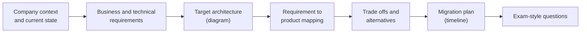

# Case studies

Architecture case studies that combine many products into one design: the business and technical requirements, the chosen architecture, the trade offs and the products used, with links to the product notes. They are the place to practice thinking like a cloud architect.

## How a case study note is written

Every case study follows the note skeleton defined in `GUIDELINE.md` (section 4), with these parts inside "Core concepts" and "Worked example":

- Summarize the case in your own words and link the official source; do not copy it.
- Map every requirement to a product and link the product's note.
- Show the target architecture as a diagram and the migration as a `timeline`.
- End with practice questions in the style of the Professional Cloud Architect exam.

## Professional Cloud Architect case studies

The Professional Cloud Architect exam guide (version 6.1, released October 2025) lists four case studies. Third-party guides report that an exam draws two of them.

TODO: Confirm the case study list and download links against the official exam guide.

## Planned topics

- Altostrat Media (generative AI for media content, moderation and summarization)
- Cymbal Retail (generative AI catalog enrichment and conversational commerce)
- EHR Healthcare (healthcare SaaS migrating from colocation to Google Cloud)
- KnightMotives Automotive
- Reference architecture: three-tier web application with high availability
- Reference architecture: secure landing zone
- Reference architecture: event-driven data platform
- Reference architecture: retrieval-augmented generation application
- Earlier exam case studies (Mountkirk Games, TerramEarth, Helicopter Racing League) for practice
