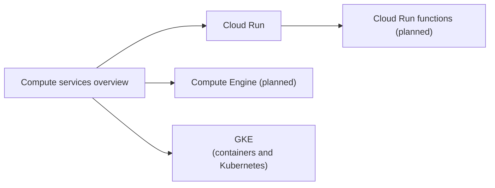

# Compute

Services that run code: virtual machines, serverless containers and functions, platform as a service and batch scheduling. Kubernetes has its own area, [containers and Kubernetes](../containers-and-kubernetes/README.md).

## Map of the area

Start with the overview, which explains how to choose between the products, then read the product notes.

## Notes in reading order

1. [Compute services overview](compute-services-overview.md): Compute Engine, GKE, Cloud Run, Cloud Run functions, App Engine and Batch compared, with a decision tree.
2. [Cloud Run](cloud-run.md): scaling, limits, container lifecycle, IAM, revisions and traffic splitting.

## Planned topics

- Compute Engine machine families and machine types
- Managed instance groups, autoscaling and autohealing
- Spot VMs and preemption handling
- Instance templates, images and startup scripts
- Cloud Run functions
- Cloud Run jobs and worker pools
- App Engine standard and flexible environments
- Batch
- VM Manager and OS patching
- Sole-tenant nodes and committed use discounts
