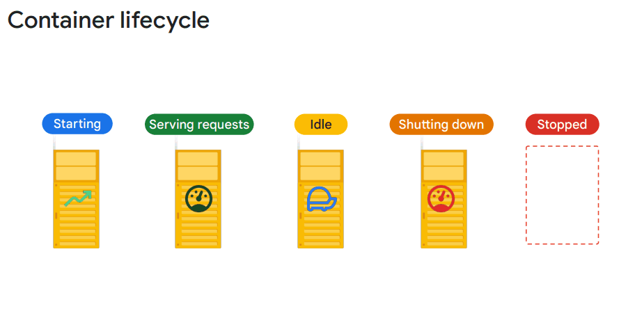
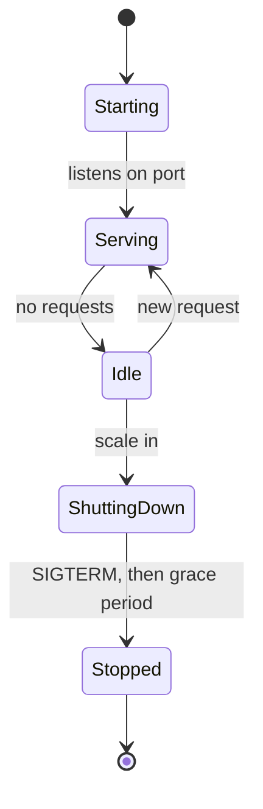
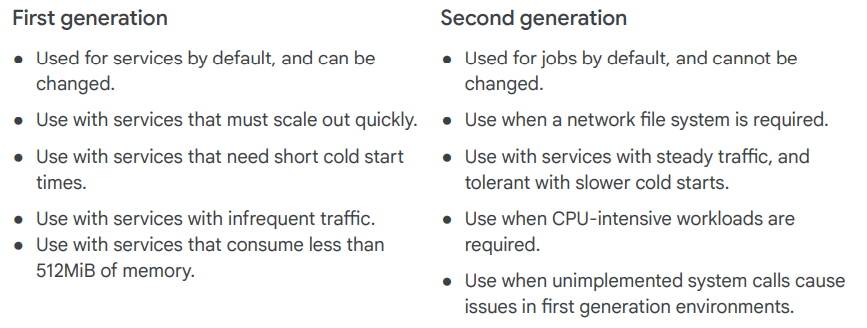
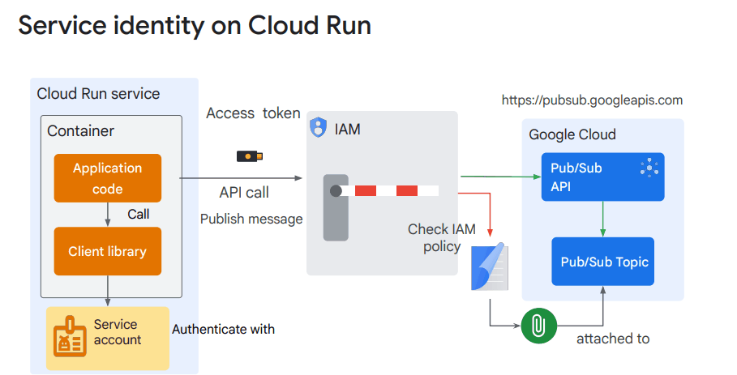
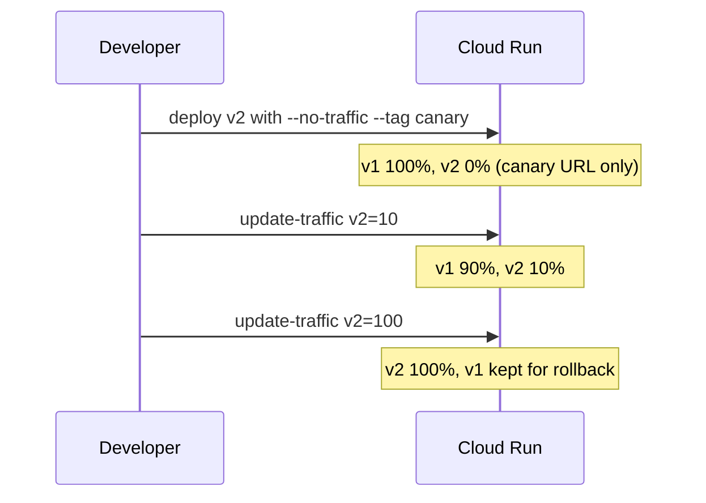

# Cloud Run

## Summary

Cloud Run is a fully managed platform that runs container images without servers or clusters to manage. A *service* answers HTTP requests and scales the number of container instances with traffic, down to zero when idle. Every deployment creates an immutable *revision*, and traffic can be split between revisions for canary releases and instant rollbacks. Access is controlled in two layers: IAM decides who may deploy and invoke, and each service runs as a service account that decides what the service may call.

## Prerequisites

- Containers and container images.
- [Compute services overview](compute-services-overview.md) for where Cloud Run fits.
- [Service accounts](../security-and-identity/identity-and-access/service-accounts.md) for runtime identity.

## Core concepts

### Resource model

- **Service.** A long-lived endpoint with a stable URL that serves HTTP, gRPC or WebSocket requests.
- **Revision.** An immutable snapshot of the service configuration: image, environment variables, CPU and memory, concurrency, service account. Each deploy creates a new revision.
- **Instance.** A running container of a revision. Cloud Run adds and removes instances automatically.
- **Job.** A container that runs to completion (one or many parallel tasks), not request driven.

Use cases are APIs and web services, event-driven processing with Pub/Sub, Cloud Tasks or Cloud Scheduler, webhooks and lightweight backends, and deployment targets for CI/CD pipelines.

### Scaling

Cloud Run scales horizontally: it adds instances when requests arrive faster than existing instances can serve them, and removes idle instances, down to zero.

- **Concurrency.** The maximum number of simultaneous requests one instance handles. The default is 80, the maximum is 1000. A value of 1 isolates requests but needs more instances and costs more.
- **Cold start.** When a new instance starts, Cloud Run pulls the image (if not cached), starts the container and waits for it to listen on the port. Cold starts add latency, especially for services that often scale to zero. Small images, lazy initialization and minimum instances reduce them.
- **Minimum instances.** Keeps a number of instances warm. They are billed even when idle.
- **Maximum instances.** Caps scaling to protect downstream systems (for example a database with limited connections) and the budget.
- **CPU allocation.** With request based billing, CPU is allocated only while a request is processed and throttled between requests. With instance based billing ("CPU always allocated"), instances keep CPU between requests, which allows background work at a higher cost.
- **Statelessness.** Instances can be stopped at any time. Session state and files belong in an external store (Firestore, Memorystore, Cloud SQL, Cloud Storage).

TODO: Verify the default concurrency value in the current documentation.

Scaling speed depends on container startup time, image size and regional capacity.

### Limits

Checked against the Cloud Run quotas and limits page, 2026-11:

| Aspect | Limit |
| --- | --- |
| vCPU per instance | Up to 8 |
| Memory per instance | Up to 32 GiB |
| Concurrency per instance | Up to 1000 |
| Maximum instances | Configurable; the default ceiling per service is a regional quota that can be raised |
| GPUs | Supported for services, jobs and worker pools: one GPU per instance, for example NVIDIA L4 (minimum 4 vCPU and 16 GiB memory) |
| Vertical autoscaling | None; CPU and memory are fixed per revision |

The original notes listed 4 vCPU, 16 GiB and no GPU support. These limits were raised; always check the current page.

### Container lifecycle





During *shutting down*, Cloud Run sends `SIGTERM` and waits up to 10 seconds before `SIGKILL`. Handling `SIGTERM` lets the app flush logs and close connections.

### Execution environments



The first generation environment starts faster and suits small, spiky services. The second generation gives full Linux compatibility, network file systems and better sustained CPU performance.

TODO: Verify the current defaults for services and jobs.

### IAM and access control

Cloud Run uses two separate layers:

1. **Service level IAM** controls who can deploy, update, delete or invoke a service.
2. **Runtime identity** is the service account the service runs as. It decides what the code can access.

| Role | Purpose |
| --- | --- |
| `roles/run.admin` | Full control over Cloud Run resources, including IAM on them |
| `roles/run.developer` | Deploy and update services, without changing IAM |
| `roles/run.invoker` | Call (invoke) a service |
| `roles/run.viewer` | Read-only access to Cloud Run resources |

By default a service requires authentication: only principals with `roles/run.invoker` can call it. Making a service public means granting `roles/run.invoker` to `allUsers`. That is normal for a public website, and risky for internal tools unless they are behind a load balancer with Identity-Aware Proxy.

**Service to service calls.** A calling service fetches a Google-signed OIDC ID token for the target URL from the metadata server, sends it in the `Authorization` header, and the target checks the token and the caller's `roles/run.invoker`. This gives identity-based, zero trust access between services.



**Service accounts.** If no service account is set, the service runs as the Compute Engine default service account, which historically has the broad Editor role. In production, create one user-managed service account per service and grant it only the roles it needs.

### Revisions and traffic management

| Property | Description |
| --- | --- |
| Immutable | A revision cannot be changed. A new deploy creates a new revision |
| Versioned history | Old revisions are kept until deleted and can receive traffic again |
| Stateless | A revision stores configuration only, not runtime state |
| Shared URL | All revisions share the service URL; tags add revision-specific URLs |

- By default, a new revision gets 100 percent of traffic as soon as it is ready.
- **Traffic splitting** assigns percentages to revisions, for example 90 percent to `v1` and 10 percent to `v2`, for canary releases and A/B tests.
- **Tags** give a revision its own URL (`https://canary---my-service-abc123.a.run.app`) for testing without live traffic.
- **Rollback** is a routing change: send 100 percent back to a known good revision. No rebuild is needed.
- **Pinning.** Deploying with `--no-traffic` or assigning traffic to named revisions keeps traffic on a known good revision while new ones are deployed. The opposite is "latest", where the newest revision automatically gets traffic.

| Feature | Serve latest (rolling) | Pinned revisions |
| --- | --- | --- |
| Traffic distribution | Moves to the newest revision | Stays on chosen revisions |
| Default behavior | 100 percent to the new revision | Unchanged until you move it |
| Control | Low | Full manual control |



## Worked example

Canary release of a container image. Untested commands; region and names are placeholders.

```bash
# Deploy the new image as a revision that gets no traffic yet
gcloud run deploy orders-api \
  --image=europe-west1-docker.pkg.dev/PROJECT_ID/apps/orders-api:2.0.0 \
  --region=europe-west1 \
  --service-account=orders-api@PROJECT_ID.iam.gserviceaccount.com \
  --no-traffic --tag=canary

# Send 10 percent of traffic to the tagged revision
gcloud run services update-traffic orders-api --region=europe-west1 \
  --to-tags=canary=10

# Roll forward, or roll back by sending 100 percent to the previous revision
gcloud run services update-traffic orders-api --region=europe-west1 --to-latest
```

While the canary runs, compare error rate and latency of both revisions in Cloud Monitoring before moving more traffic.

## Trade offs and when to use it

- **Good fit.** Stateless HTTP services, APIs, webhooks, event processing, small inference services, spiky or unpredictable traffic.
- **Poor fit.** Workloads that need local persistent state, more than 8 vCPU or 32 GiB per instance, custom kernels, or Kubernetes-specific features. Use GKE or Compute Engine.
- **Cost.** Billing is based on CPU and memory time (and requests with request based billing). High concurrency lowers cost; high minimum instances or concurrency 1 raise it.
- **Latency.** Cold starts are the main risk. Minimum instances solve it at a cost.

## Common mistakes

- **Using the default service account.** It has broad permissions. Use a dedicated least privilege account per service.
- **Granting `allUsers` invoker to an internal service.** Keep authentication required and use ID tokens between services.
- **Keeping state in memory or on local disk.** It disappears when the instance stops.
- **No maximum instances.** A traffic spike can exhaust database connections. Set a cap that matches the backend.
- **Ignoring `SIGTERM`.** Logs and in-flight work are lost on shutdown.

## Practice

1. What creates a new revision, and can a revision be changed later?
2. How do you roll back a bad deployment without rebuilding the image?
3. Which IAM role does a calling service need on the target service, and what does it send in the request?
4. A service needs to process messages in a background thread after the response is sent. What setting is needed?

Answers: 1. Every deploy or configuration change; no, revisions are immutable. 2. Move 100 percent of traffic to the previous revision. 3. `roles/run.invoker`; an OIDC ID token for the target URL. 4. Instance based billing (CPU always allocated), otherwise CPU is throttled after the response.

## Further reading

- [Cloud Run quotas and limits](https://docs.cloud.google.com/run/quotas), Google Cloud documentation. Source of the limits table (checked 2026-11).
- [GPU support for services](https://docs.cloud.google.com/run/docs/configuring/services/gpu), Google Cloud documentation. GPU types and minimum CPU and memory.
- [Rollbacks, gradual rollouts and traffic migration](https://docs.cloud.google.com/run/docs/rollouts-rollbacks-traffic-migration), Google Cloud documentation. Traffic splitting and tags.
- [Authenticating service-to-service](https://docs.cloud.google.com/run/docs/authenticating/service-to-service), Google Cloud documentation. ID token flow between services.
- [Container runtime contract](https://docs.cloud.google.com/run/docs/container-contract), Google Cloud documentation. Port, lifecycle and `SIGTERM` behavior.
