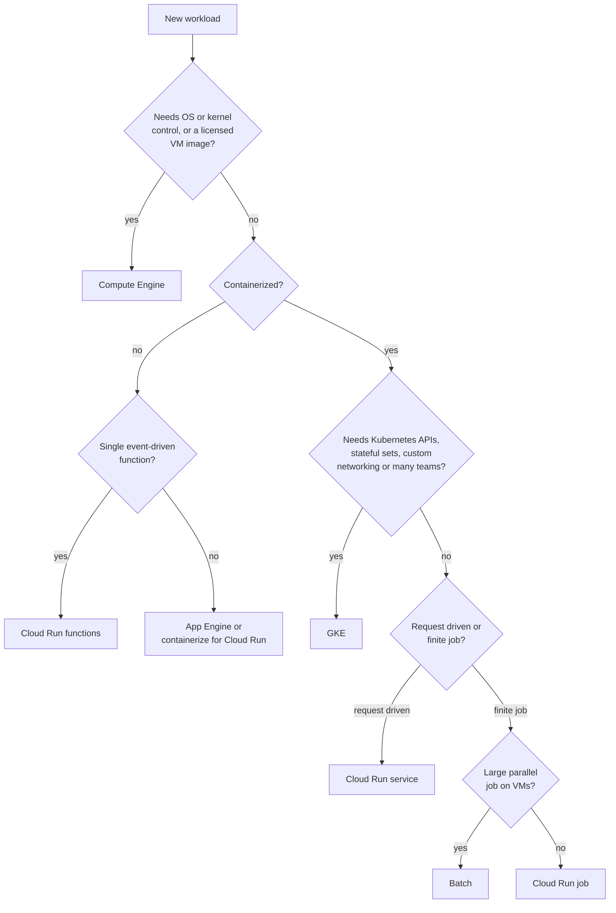

# Compute services overview

## Summary

Google Cloud offers compute at several levels of abstraction: virtual machines (Compute Engine), managed Kubernetes (GKE), serverless containers and functions (Cloud Run and Cloud Run functions), a platform for web apps (App Engine) and a managed batch scheduler (Batch). They all run code, but they differ in how much infrastructure you manage, how they scale and how they are billed. Choosing compute means matching the workload (stateful or stateless, long running or event driven, steady or spiky) to the level of control the team needs.

## Prerequisites

- [Google Cloud overview](../foundations/google-cloud-overview.md) for service models.
- [Global infrastructure](../foundations/global-infrastructure.md) for zones and regions.

## Core concepts

### The products

**Compute Engine** is infrastructure as a service: you create VMs on demand. Use cases are lift and shift of legacy applications, custom workloads, high performance computing and containers that need full control of the host. Key features:

- Predefined and custom machine types, GPUs, local SSDs and custom images.
- Spot VMs (the successor of preemptible VMs) for large discounts on interruptible work.
- Instance templates and managed instance groups (MIGs) with autoscaling and autohealing.
- Startup scripts and the metadata server for configuration.
- OS patching and policies through VM Manager (OS Config), telemetry through the Ops Agent.

**Google Kubernetes Engine (GKE)** is managed Kubernetes. Use cases are microservices, continuous deployment, hybrid and multi-cloud container platforms and multi-tenant clusters. Key features: Autopilot mode (Google manages nodes), Standard mode (you manage node pools), auto-upgrade and auto-repair, horizontal pod autoscaling, node pools with taints and affinity, Workload Identity Federation for GKE, network policies and Binary Authorization. GKE has its own area: [containers and Kubernetes](../containers-and-kubernetes/README.md).

**Cloud Run functions** (formerly Cloud Functions) run single-purpose functions in response to events: HTTP calls, Cloud Storage changes, Pub/Sub messages, Firestore changes. They scale from zero to many instances and are billed per use. Cold starts can add latency. The Functions Framework lets you run them locally. Since 2024 they are deployed on Cloud Run infrastructure.

TODO: Write a note on Cloud Run functions and verify the current trigger list.

**Cloud Run** runs stateless containers over HTTP, scales to zero and supports traffic splitting between revisions. It is the default choice for containerized APIs and web services that do not need Kubernetes. See [Cloud Run](cloud-run.md).

**App Engine** is the original platform as a service. The *standard environment* runs specific language runtimes in a sandbox, starts fast and scales to zero. The *flexible environment* runs containers on Compute Engine VMs, is more customizable and does not scale to zero. App Engine supports versions, traffic splitting and built-in cron. For new projects Google recommends Cloud Run.

TODO: Verify the current App Engine positioning.

**Batch** schedules and runs batch jobs (scripts or containers) on Compute Engine VMs it creates for you, including Spot VMs. Use cases are rendering, ETL, genomics, financial simulations and other parallel, non-interactive work. It supports job dependencies and queuing.

### Choosing a compute service

The decision below starts from the workload and ends at a product.

The questions are ordered by how strongly they constrain the choice: OS control rules out everything except Compute Engine, and Kubernetes requirements rule out everything except GKE.

### Summary table

| Product | Best use case | Level of control | Deployment style | Scales to zero |
| --- | --- | --- | --- | --- |
| Compute Engine | Legacy apps, custom VM workloads | High | VM images, templates, scripts | No |
| GKE | Scalable containers and microservices | Medium to high | Kubernetes manifests | Nodes no (Autopilot bills per Pod) |
| Cloud Run functions | Event-driven logic | Low | Function source | Yes |
| Cloud Run | Stateless containerized services | Medium | Container image | Yes |
| App Engine | Managed web apps and APIs | Low to medium | App source and `app.yaml` | Standard yes, flexible no |
| Batch | Batch and parallel workloads | Medium | Job definition | Yes (no idle VMs) |

## Worked example

Three workloads in one company:

1. **Nightly PDF rendering of 20,000 invoices**, each taking about 30 seconds of CPU. This is a finite, parallel, interruption tolerant job. Batch with Spot VMs fits; a Cloud Run job is an alternative if each task fits its limits.
2. **Public REST API with traffic from 0 to 300 requests per second.** Stateless and spiky: Cloud Run with a minimum of one instance to avoid cold starts.
3. **A vendor database that requires a specific Linux kernel module.** Only Compute Engine allows that; run it in a regional managed instance group or as a pair of VMs with replication.

TODO: Add a cost comparison for workload 2 on Cloud Run and on a small MIG, with current prices and the date checked.

## Trade offs and when to use it

- **More control means more operations.** Compute Engine needs patching, scaling policies and image management. Serverless removes them but adds platform limits.
- **Kubernetes is a platform, not a requirement.** GKE pays off with many services, many teams or special scheduling needs. For a handful of stateless services, Cloud Run is simpler.
- **Billing model.** VMs are billed per second while running. Cloud Run bills per instance time while serving (or per instance lifetime with instance based billing). Steady high load can be cheaper on VMs with committed use discounts.

## Common mistakes

- **Choosing GKE by default.** Start from requirements and choose the simplest product that meets them.
- **Running stateful data on serverless instances.** Instances can be stopped at any time. Keep state in a database or Cloud Storage.
- **Ignoring Spot VMs for batch.** Interruptible work on standard VMs costs much more than needed.

## Practice

1. Which compute product would you choose for a webhook that resizes images uploaded to a bucket, and why?
2. What is the difference between App Engine standard and flexible environments?
3. Why is GKE not the default answer for running containers?

Answers: 1. Cloud Run functions (or Cloud Run with an Eventarc trigger): event-driven, short, scales to zero. 2. Standard runs specific runtimes in a sandbox and scales to zero; flexible runs containers on VMs, is customizable and keeps at least one instance. 3. It adds cluster operations; Cloud Run runs containers without a cluster.

## Further reading

- [Choose a compute option](https://docs.cloud.google.com/architecture/framework/system-design/compute), Google Cloud Architecture Framework. Google's own selection guidance.
- [Compute Engine documentation](https://docs.cloud.google.com/compute/docs), Google Cloud. Machine families, MIGs, Spot VMs.
- [Batch documentation](https://docs.cloud.google.com/batch/docs/get-started), Google Cloud. Job model and provisioning.
