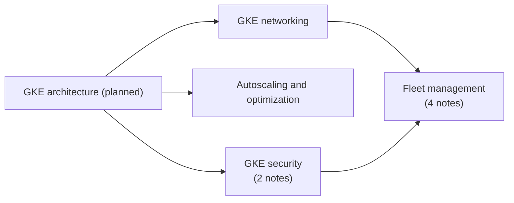

# Containers and Kubernetes

Google Kubernetes Engine (GKE): cluster networking, autoscaling and cost optimization, security hardening, and multi-cluster management with fleets. Container image storage and CI/CD are in [developer and DevOps tools](../developer-and-devops-tools/README.md); serverless containers are in [Cloud Run](../compute/cloud-run.md).

## Map of the area

Networking and security are the base for single clusters; fleet management extends them to many clusters.

## Notes and subareas in reading order

1. [GKE networking](gke-networking.md): VPC-native Pods, Services, Ingress, NEGs, network policies and DNS.
2. [GKE autoscaling and optimization](gke-autoscaling-and-optimization.md): HPA, VPA, cluster autoscaler, node auto-provisioning and over-provisioning.
3. [GKE security](gke-security/README.md): hardening and Binary Authorization.
4. [Fleet management](fleet-management/README.md): fleets, Policy Controller, Config Sync and Cloud Service Mesh.

## Planned topics

- GKE architecture: control plane, nodes, Autopilot and Standard modes
- Node pools, machine types, Spot nodes and GPUs
- Release channels and upgrade strategies
- Storage for GKE: persistent volumes, Filestore, Cloud Storage FUSE
- GKE observability: Managed Service for Prometheus
- Backup for GKE
- Workload deployment patterns on GKE
