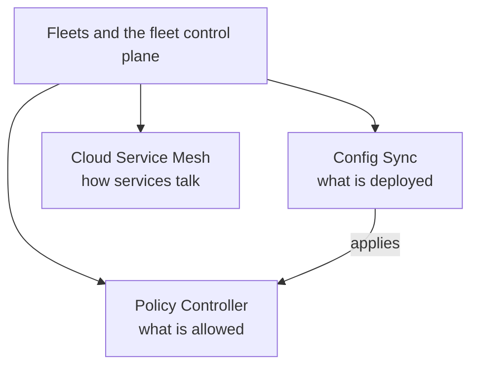

# Fleet management

Managing many Kubernetes clusters as one platform: fleets, policy as code, GitOps configuration and the service mesh. This is the multi-cluster part of GKE Enterprise.

## Map of the subarea

Config Sync applies configuration from Git, and Policy Controller validates what it applies; together they form a closed governance loop. The mesh handles runtime traffic.

## Notes in reading order

1. [GKE fleets and the fleet control plane](gke-fleet-and-hub.md): fleets, memberships, the Connect Agent and fleet features.
2. [Policy Controller](policy-controller.md): OPA Gatekeeper, Rego, constraint templates and enforcement modes.
3. [Config Sync](config-sync.md): GitOps with RootSync and RepoSync, drift correction and repository layout.
4. [Cloud Service Mesh](cloud-service-mesh.md): Envoy, mTLS, traffic management and observability.

## Planned topics

- Multi-cluster Services and multi-cluster Gateway
- Fleet team management and scopes
- GKE attached clusters (EKS, AKS)
- GKE Enterprise editions and pricing
