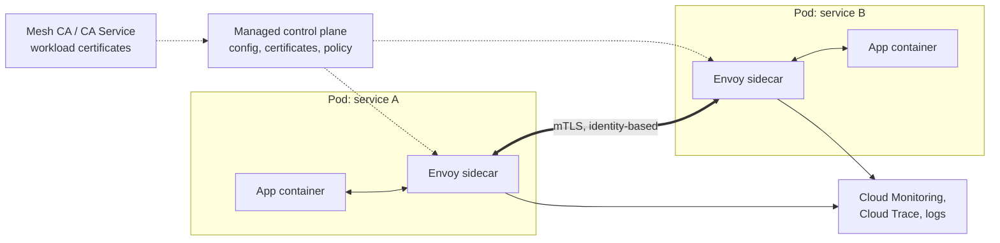

# Cloud Service Mesh

## Summary

Cloud Service Mesh is Google Cloud's managed service mesh, based on Istio APIs with Envoy proxies (or proxyless gRPC) in the data plane. It moves service-to-service concerns out of application code: mutual TLS (mTLS) encryption and workload identity, authorization policies, traffic management (canaries, retries, timeouts, circuit breaking) and uniform telemetry. It works within a cluster, across clusters of a fleet, and for VMs. It is a strong tool for zero trust and progressive delivery, and an unnecessary cost for small or simple systems. It unifies the former Anthos Service Mesh and Traffic Director.

## Prerequisites

- [GKE fleets and the fleet control plane](gke-fleet-and-hub.md).
- [GKE networking](../gke-networking.md).
- TLS and the idea of a sidecar proxy.

## Core concepts

### Why a mesh

In microservices, services talk over the network: TLS is optional and inconsistent, retry logic is copied into every service, visibility is fragmented and traffic control is manual. A mesh makes security the default, networking policy-driven and observability automatic, and simplifies application code.

### Architecture



- **Data plane.** An Envoy sidecar (or a node-level proxy in some modes) intercepts traffic of each Pod: encryption, routing, metrics and logs.
- **Control plane.** Managed by Google: distributes configuration, issues and rotates certificates, pushes policy.
- **Fleet integration.** One mesh spans member clusters with a shared trust domain and identity.

### Capabilities

**Zero trust security.** mTLS encrypts all service-to-service traffic; identity is a cryptographic workload identity (SPIFFE style, from the service account), not an IP address; certificates are issued by the mesh CA and rotated automatically. Authorization policies allow or deny calls by source identity, path and method.

| Threat | Mitigation |
| --- | --- |
| Lateral movement | mTLS plus identity-based authorization |
| Service impersonation | Cryptographic workload identity |
| Eavesdropping on internal traffic | Encryption in transit |
| Man in the middle | Certificate validation |

**Traffic management** without code changes: canary releases, blue-green, traffic splitting, A/B tests, fault injection, header-based routing.

**Resilience**: retries, timeouts, circuit breakers, outlier detection, load balancing policies.

**Observability**: golden signals (latency, traffic, errors, saturation) per service, distributed tracing and access logs, generated by the proxies rather than the application.

**Multi-cluster**: cross-cluster service discovery and failover, for example traffic from a failed cluster in the EU routed to the US cluster.

## Worked example

Canary of `reviews` v2 with 10 percent of traffic, and strict mTLS in the namespace (untested):

```yaml
apiVersion: networking.istio.io/v1
kind: DestinationRule
metadata:
  name: reviews
spec:
  host: reviews
  subsets:
  - name: v1
    labels: {version: v1}
  - name: v2
    labels: {version: v2}
---
apiVersion: networking.istio.io/v1
kind: VirtualService
metadata:
  name: reviews
spec:
  hosts: ["reviews"]
  http:
  - route:
    - destination: {host: reviews, subset: v1}
      weight: 90
    - destination: {host: reviews, subset: v2}
      weight: 10
    retries: {attempts: 3, perTryTimeout: 2s}
---
apiVersion: security.istio.io/v1
kind: PeerAuthentication
metadata:
  name: default
  namespace: shop
spec:
  mtls:
    mode: STRICT
```

Pipeline: build, deploy v2, route 10 percent, observe error rate and latency of v2 in the mesh dashboards against the SLO, promote to 100 percent or roll back by changing the weights.

## Trade offs and when to use it

| Aspect | Service mesh | Plain networking |
| --- | --- | --- |
| Security | mTLS by default | Optional, per app |
| Observability | Built in | Manual instrumentation |
| Traffic control | Dynamic, declarative | Static |
| Complexity | Higher | Lower |

- **Use it** for many services with compliance needs (financial systems), multi-region SaaS with canaries and zero trust, and secure edge or IoT hubs.
- **Avoid it** for monoliths, low traffic systems or a handful of services: sidecars add CPU, memory and latency, and the mesh adds operational concepts.
- Start with critical services and expand coverage gradually.

## Common mistakes

- **Partial mTLS** (PERMISSIVE mode forgotten in production).
- **Weak or missing authorization policies**; mTLS alone authenticates but does not authorize.
- **Untuned retries and timeouts**, which amplify outages (retry storms).
- **Ignoring sidecar overhead** in resource requests.

## Practice

1. What gives a workload its identity in the mesh?
2. How do you send 10 percent of traffic to a new version without code changes?
3. Name a situation where a service mesh is not worth it.

Answers: 1. A certificate issued by the mesh CA for its Kubernetes service account. 2. A VirtualService with weighted routes to subsets defined in a DestinationRule. 3. A monolith or a small system with few services and low traffic.

## Further reading

- [Cloud Service Mesh overview](https://docs.cloud.google.com/service-mesh/docs/overview), Google Cloud documentation. Features and supported platforms.
- [Istio traffic management](https://istio.io/latest/docs/concepts/traffic-management/), Istio project. VirtualService and DestinationRule.
- [Istio security](https://istio.io/latest/docs/concepts/security/), Istio project. mTLS, identity and authorization.
