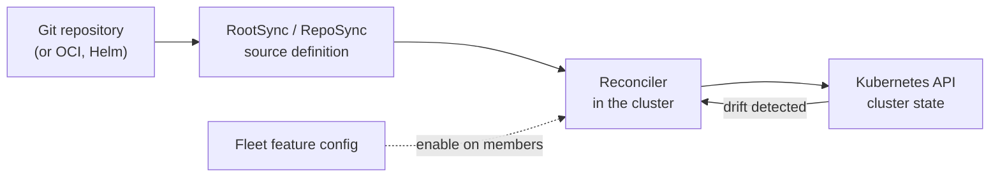
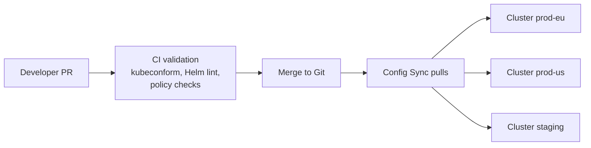

# Config Sync

## Summary

Config Sync is GKE's managed GitOps engine. It continuously pulls Kubernetes configuration from a Git repository (or an OCI image or Helm chart), applies it to clusters and reconciles any drift, so that the cluster state always matches what is declared in Git. Configured per fleet, the same configuration can be rolled out to many clusters with environment-specific overlays. Git becomes the single source of truth and the audit trail for every change.

## Prerequisites

- [GKE fleets and the fleet control plane](gke-fleet-and-hub.md).
- Git workflows (branches, pull requests) and Kubernetes manifests, Kustomize or Helm.

## Core concepts

### GitOps principles

- Declarative configuration.
- Version-controlled desired state.
- Automated reconciliation.
- No manual changes: every change goes through Git.

Config Sync solves configuration drift, manual cluster changes, inconsistent environments and missing auditability.

### Architecture



- **Reconciler.** Runs in the cluster, watches the source, applies manifests and continuously compares actual state with desired state.
- **RootSync.** Cluster-wide configuration source: repository URL, branch or revision, directory, authentication. Managed by the platform team; usually one per cluster.
- **RepoSync.** Namespace-scoped source, so application teams manage their own namespaces from their own repositories (multi-tenancy).
- **Fleet integration.** Config Sync is enabled and configured at fleet level, so new clusters get the same baseline automatically.
- **Hierarchical Namespace Controller (HNC).** Optional namespace inheritance for policy propagation; the original notes mention it.

TODO: Verify whether HNC is still supported with Config Sync.

### Reconciliation and drift

The loop: pull the latest source, compare it with the cluster, apply changes, detect drift, reconcile. If someone runs `kubectl edit deployment my-app`, Config Sync detects the change and restores the Git-defined state. Objects managed by Config Sync can also be protected by an admission webhook that rejects conflicting manual changes.

### Repository structure

```text
repo/
  cluster/            # cluster-scoped objects per environment
    prod/
    staging/
    dev/
  namespaces/         # namespace-scoped config per team
    team-a/
    team-b/
  policies/           # Policy Controller constraints
  platform/           # logging, monitoring, ingress, shared components
  apps/               # application manifests (or separate repos via RepoSync)
```

Separate platform configuration, application configuration and policies; use overlays for environments; avoid one monolithic repository for everything.

### Security model

- **Git is the source of truth.** Enforce signed commits, protected branches and reviews.
- **Authentication to Git.** SSH keys, HTTPS tokens, or Google service account authentication through Workload Identity Federation (preferred, no static secrets) for Secure Source Manager, Artifact Registry or Cloud Source Repositories.
- **RBAC.** Restrict direct cluster write access so that changes go through Git; separate platform and application teams.
- **Policy Controller.** Config Sync applies; Policy Controller validates. Together they form a closed governance loop.
- **Secrets.** Never store secrets in Git. Use Secret Manager, External Secrets Operator or Sealed Secrets.

### Pipeline



## Worked example

Platform baseline for all production clusters (untested):

```yaml
# apply-spec.yaml for: gcloud beta container fleet config-management apply --membership=shop-eu --config=apply-spec.yaml
applySpecVersion: 1
spec:
  configSync:
    enabled: true
    sourceFormat: unstructured
    syncRepo: https://github.com/example-org/platform-config
    syncBranch: main
    policyDir: cluster/prod
    secretType: token
```

After merging a pull request that adds a namespace `payments` with a default `NetworkPolicy` and `ResourceQuota` under `cluster/prod`, both production clusters (EU and US) get them within minutes, and any manual deletion is reverted.

## Trade offs and when to use it

| Feature | Config Sync | Argo CD | Flux |
| --- | --- | --- | --- |
| GKE native and managed | Yes | No | No |
| Fleet integration | Native | Manual | Manual |
| UI | Limited (console status) | Rich | Moderate |
| Flexibility | Medium | High | High |

- Config Sync fits platform baselines across many GKE clusters with minimal operations; Argo CD is popular for application delivery with a strong UI.
- Continuous sync is the default and the point of GitOps; manual sync breaks the model.
- Compliance: Git history gives auditability, traceability and reproducibility (ISO/IEC 27001 change management, SOC 2, NIST configuration management).

## Common mistakes

- **Monolithic repositories** without separation of concerns.
- **Hardcoded Git credentials** and unprotected branches.
- **Allowing manual `kubectl` changes** that are then silently reverted, confusing operators.
- **No CI validation**, so broken manifests reach clusters.

## Practice

1. What happens if an operator edits a Config Sync managed Deployment with `kubectl edit`?
2. When would you use a RepoSync instead of a RootSync?
3. Where should secrets live in a GitOps setup?

Answers: 1. Config Sync detects the drift and restores the Git-defined state. 2. When a team should manage its own namespace from its own repository. 3. In a secret store such as Secret Manager, referenced by tools like External Secrets Operator, never in Git.

## Further reading

- [Config Sync overview](https://docs.cloud.google.com/kubernetes-engine/enterprise/config-sync/docs/overview), Google Cloud documentation. Architecture and features.
- [RootSync and RepoSync fields](https://docs.cloud.google.com/kubernetes-engine/enterprise/config-sync/docs/reference/rootsync-reposync-fields), Google Cloud documentation. Source configuration.
- [OpenGitOps principles](https://opengitops.dev/), CNCF OpenGitOps project. The four GitOps principles.
