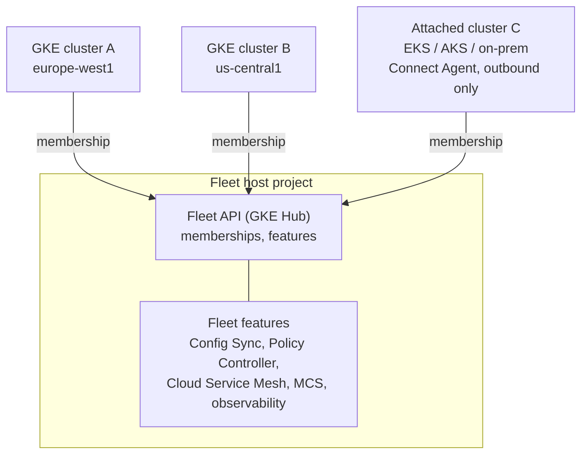

# GKE fleets and the fleet control plane

## Summary

A *fleet* is a logical group of Kubernetes clusters, on Google Cloud, on-premises or in other clouds, that are managed together as one administrative domain. A fleet is not a new kind of cluster: clusters stay autonomous, while fleet-level features (identity, policy, configuration, service mesh, observability, multi-cluster networking) govern them centrally. Clusters join a fleet by *registration*, which creates a *membership*; the registration and feature APIs were historically called *GKE Hub*, and the term still appears in API names (`gkehub.googleapis.com`) and commands. Fleets move management from the cluster level to the platform level.

## Prerequisites

- GKE basics and [GKE security hardening](../gke-security/gke-security-hardening.md).
- [Resource hierarchy](../../foundations/resource-hierarchy.md) for the fleet host project.

## Core concepts

### Why fleets exist

Kubernetes estates grow from one cluster to many: several environments, regions, hybrid and edge sites. Without central management this leads to fragmented security policies, configuration drift, scattered identity and kubeconfig files, no unified observability, and manual per-cluster operations. Fleets solve this by applying the same policies, configuration and identity model to every member.

### Architecture



- **Fleet host project.** The project that owns the fleet, its memberships and features. Treat it as control plane infrastructure: no workloads, strictly limited IAM, audit logs and SCC enabled.
- **Memberships.** Each registered cluster is a membership resource with identity, endpoint metadata, labels (env, region, team) and state. Memberships are the source of truth for fleet topology.
- **Supported clusters.** GKE (Standard and Autopilot), GKE on-premises and bare metal, GKE attached clusters (EKS, AKS, other conformant Kubernetes). GKE clusters on Google Cloud register directly; clusters outside Google Cloud run the **Connect Agent**, which keeps an outbound, authenticated and encrypted connection to Google, so no inbound firewall opening is needed.
- **Feature APIs.** Each fleet feature is enabled at fleet level and enforced in clusters by agents: Config Sync (`configmanagement`), Policy Controller (`policycontroller`), Cloud Service Mesh (`servicemesh`), multi-cluster Services (`multiclusterservicediscovery`), multi-cluster Ingress and Gateway.

### Registration flow

1. Enable the required APIs and grant registration roles.
2. Register the cluster: `gcloud container fleet memberships register` (or create the GKE cluster with `--fleet-project`).
3. For non-GKE clusters, the Connect Agent is installed (namespace `gke-connect`).
4. The cluster identity is bound to the fleet's workload identity pool.
5. The membership appears in the fleet; fleet features can now target it.

### Fleet capabilities

- **Fleet identity.** A shared workload identity pool (`FLEET_PROJECT_ID.svc.id.goog`) across member clusters; IAM-to-RBAC mapping and the Connect gateway give users kubectl access through Google identities without distributing kubeconfig credentials. Revocation is central.
- **Security posture.** Policy Controller enforces policies everywhere; drift and misconfiguration are reported centrally.
- **Configuration management.** Config Sync applies Git-defined configuration to all or selected clusters with overlays per environment.
- **Observability.** Fleet-wide dashboards and logging, without per-cluster silos.
- **Multi-cluster networking.** Service discovery across clusters, cross-cluster service mesh, multi-cluster Gateway with failover and locality-aware routing.
- **Teams and scopes.** Fleet team management lets platform teams give application teams namespaces across clusters.

TODO: Write a note on fleet team management.

### Zero trust alignment

No implicit trust between clusters; every interaction is authenticated, authorized and audited; workloads use federated identities instead of static secrets. This follows NIST zero trust architecture (SP 800-207) and BeyondCorp principles.

### Fleet compared with single clusters

| Aspect | Single cluster | Fleet |
| --- | --- | --- |
| Scope | One cluster | Many clusters, many environments |
| IAM | Per cluster | Central |
| Policies | Local | Global with local enforcement |
| Observability | Fragmented | Unified |
| Security | Reactive | Preventive baselines |

## Worked example

Register two GKE clusters and enable Config Sync and Policy Controller fleet-wide (untested):

```bash
gcloud container fleet memberships register shop-eu \
  --gke-cluster=europe-west1/shop-eu --enable-workload-identity --project=FLEET_HOST
gcloud container fleet memberships register shop-us \
  --gke-cluster=us-central1/shop-us --enable-workload-identity --project=FLEET_HOST

gcloud container fleet config-management enable --project=FLEET_HOST
gcloud container fleet policycontroller enable --project=FLEET_HOST
gcloud container fleet memberships list --project=FLEET_HOST
```

Labels such as `env=prod`, `region=eu`, `team=payments` on memberships let features and rollouts target subsets of clusters.

## Trade offs and when to use it

- **Use cases.** Enterprise platforms with many teams and shared security requirements; SaaS at scale with regional isolation; hybrid and edge (stores, factories) with central governance and local execution.
- **Costs.** Some fleet features are part of GKE Enterprise pricing.
- **Design principles.** Fleet-first thinking, policy over convention, identity before networking, declarative over imperative, secure by default, observability as a baseline, and GitOps as the change path.

TODO: Verify which fleet features need GKE Enterprise.

## Common mistakes

- **Treating the fleet as metadata only.** Without Config Sync and Policy Controller, clusters still drift.
- **Running workloads in the fleet host project** or over-granting `roles/gkehub.admin`.
- **No labeling strategy.** Without labels, targeting and segmentation are impossible.
- **Mixing cluster-level and fleet-level concerns.** Decide which settings are fleet defaults and which are per cluster.

## Practice

1. Does registering a cluster in a fleet change where its control plane runs?
2. How does an EKS cluster communicate with the fleet without inbound firewall rules?
3. What is a membership?

Answers: 1. No, clusters stay autonomous; the fleet adds central management. 2. Through the Connect Agent, which opens an outbound authenticated connection to Google. 3. The fleet resource that represents one registered cluster, with its identity, labels and state.

## Further reading

- [Fleet management overview](https://docs.cloud.google.com/kubernetes-engine/fleet-management/docs), Google Cloud documentation. Concepts and features.
- [Fleet requirements and best practices](https://docs.cloud.google.com/kubernetes-engine/fleet-management/docs/fleet-concepts), Google Cloud documentation. Sameness, host project design.
- [Connect gateway](https://docs.cloud.google.com/kubernetes-engine/enterprise/multicluster-management/gateway), Google Cloud documentation. kubectl access through Google identities.
- [NIST SP 800-207 Zero Trust Architecture](https://csrc.nist.gov/pubs/sp/800/207/final), NIST, 2020. The zero trust reference.
