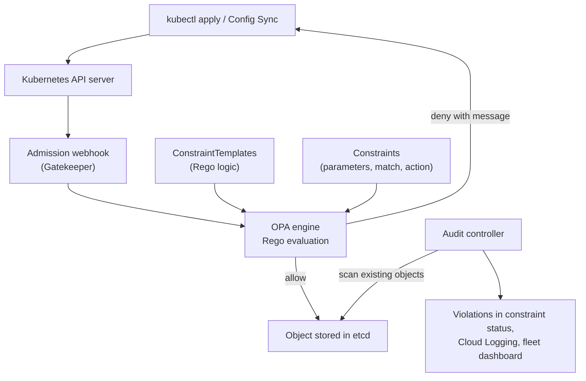
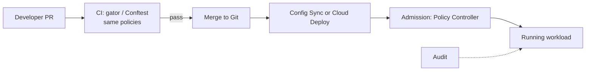

# Policy Controller

## Summary

Policy Controller is GKE's managed policy enforcement for Kubernetes, built on Open Policy Agent (OPA) Gatekeeper. Policies are written once as *constraint templates* (logic in the Rego language) and *constraints* (parameters and scope), distributed to every cluster in a fleet, and enforced by an admission webhook that rejects non-compliant objects before they are stored. An audit controller also scans existing objects for violations. It turns security and compliance rules into version-controlled code and makes Kubernetes security preventive instead of reactive.

## Prerequisites

- [GKE fleets and the fleet control plane](gke-fleet-and-hub.md).
- Kubernetes admission control basics.

## Core concepts

### Purpose

Prevent insecure, non-compliant or misconfigured resources from being deployed, through admission control (real time), continuous audit (drift detection) and central distribution (fleet). Without it, security is reactive, drift is uncontrolled and compliance is manual. With it, policies are versioned artifacts that map to NIST SP 800-53 configuration and access controls, the CIS Kubernetes Benchmark and the OWASP Kubernetes Top 10.

### Architecture



- **Admission webhook.** Intercepts API requests and validates objects before persistence (fail fast). Mutation is available too.
- **OPA engine.** Evaluates Rego policies, stateless and deterministic.
- **ConstraintTemplates.** Reusable policy logic in Rego; comparable to classes.
- **Constraints.** Instances of templates with parameters and a scope (kinds, namespaces, labels) and an enforcement action.
- **Audit controller.** Scans existing resources and records violations.
- **Policy bundles.** Google provides ready bundles such as CIS GKE Benchmark, Pod Security Standards and NIST SP 800-53 mappings, plus a template library.

### Lifecycle

1. Define the logic in a ConstraintTemplate.
2. Apply a Constraint that uses it.
3. The webhook enforces it for new and changed objects.
4. The audit controller reports existing violations.
5. Violations appear centrally in the fleet's Policy Controller dashboard.

### Rego

Rego is a declarative policy language. The *input* is the object under review (`input.review.object`); rules produce *violations*. Example: block privileged containers.

```rego
package k8sblockprivileged

violation[{"msg": msg}] {
  c := input.review.object.spec.containers[_]
  c.securityContext.privileged == true
  msg := sprintf("Privileged container %v is not allowed", [c.name])
}
```

Require CPU limits:

```rego
violation[{"msg": msg}] {
  container := input.review.object.spec.containers[_]
  not container.resources.limits.cpu
  msg := sprintf("Container %v must define a CPU limit", [container.name])
}
```

Restrict image registries:

```rego
violation[{"msg": msg}] {
  image := input.review.object.spec.containers[_].image
  not startswith(image, "europe-west1-docker.pkg.dev/my-project/")
  msg := sprintf("Image %v is not from an approved registry", [image])
}
```

### Enforcement actions

- `deny`: block non-compliant resources (production).
- `dryrun`: record violations in audit only, do not block (rollout and testing).
- `warn`: allow but warn the user.

## Worked example

Enforce non-root containers with a library template (untested):

```yaml
apiVersion: constraints.gatekeeper.sh/v1beta1
kind: K8sPSPAllowedUsers
metadata:
  name: require-non-root
spec:
  enforcementAction: dryrun
  match:
    kinds:
    - apiGroups: [""]
      kinds: ["Pod"]
    excludedNamespaces: ["kube-system"]
  parameters:
    runAsUser:
      rule: MustRunAsNonRoot
```

Rollout strategy: apply in `dryrun`, watch `kubectl get k8spspallowedusers require-non-root -o yaml` for `status.violations` for a week, fix workloads, then switch to `deny`. The original notes use the kind name `K8sPSPNonRootUser`; the library template for this rule is `K8sPSPAllowedUsers`.

TODO: Verify against the current template library.

Shift-left in CI: run the same policies against manifests before merge with `gator test` or Conftest, so most violations never reach the cluster.



## Trade offs and when to use it

- **Benefits.** Preventive security, automated compliance, versioned policies, one policy set for many clusters.
- **Costs.** Rego has a learning curve; complex policies add admission latency; overly strict policies break developer workflows.
- **Alternatives.** Kyverno uses YAML policies (simpler, less flexible); Pod Security Admission covers only the Pod Security Standards.

| Feature | OPA Gatekeeper / Policy Controller | Kyverno |
| --- | --- | --- |
| Language | Rego | YAML |
| Flexibility | Very high | Medium |
| Complexity | Higher | Lower |
| Managed on GKE | Yes, through fleet | No (self-managed) |

## Common mistakes

- **Overly complex Rego** that is slow and hard to review.
- **Policies outside version control.** Keep them in Git with reviews, signed commits and protected branches.
- **Enforcing too early.** Use dryrun first.
- **Bypass risks.** Webhook disabled, wrong scope matches, direct API access; restrict RBAC and consider fail-closed mode for critical policies.
- **Ignoring audit results.**

## Practice

1. What is the difference between a ConstraintTemplate and a Constraint?
2. Which enforcement action would you use when introducing a new policy?
3. Name two places where the same policies can be evaluated.

Answers: 1. The template holds the Rego logic and schema; the constraint instantiates it with parameters, scope and enforcement action. 2. `dryrun` (or `warn`). 3. In CI against manifests (gator, Conftest) and at admission in the cluster.

## Further reading

- [Policy Controller overview](https://docs.cloud.google.com/kubernetes-engine/enterprise/policy-controller/docs/overview), Google Cloud documentation. Features, bundles and dashboard.
- [OPA Gatekeeper documentation](https://open-policy-agent.github.io/gatekeeper/website/docs/), Open Policy Agent project. Templates, constraints and audit.
- [Rego policy language](https://www.openpolicyagent.org/docs/latest/policy-language/), Open Policy Agent project. Syntax and semantics.
