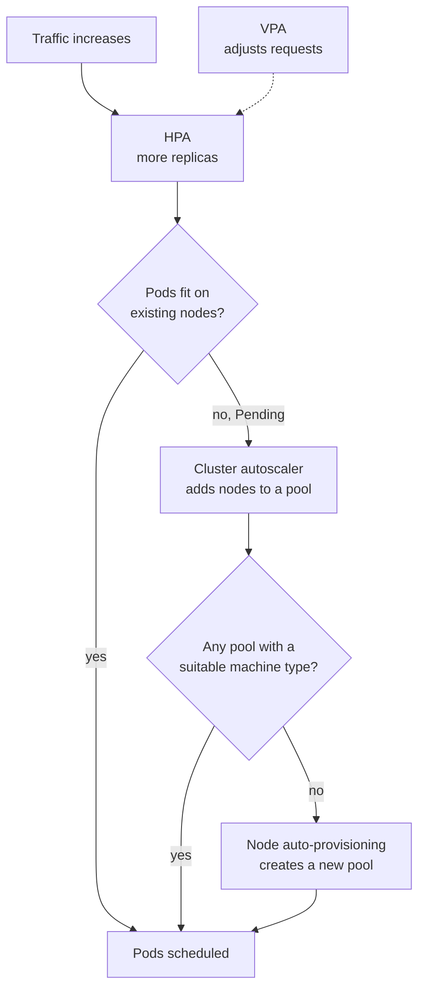
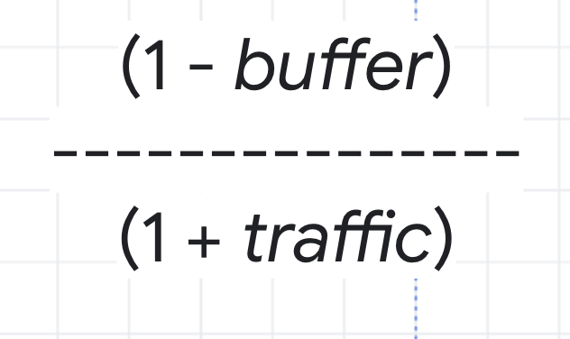
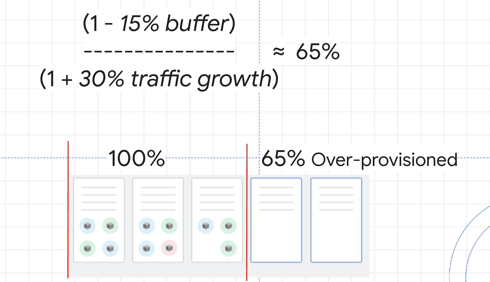
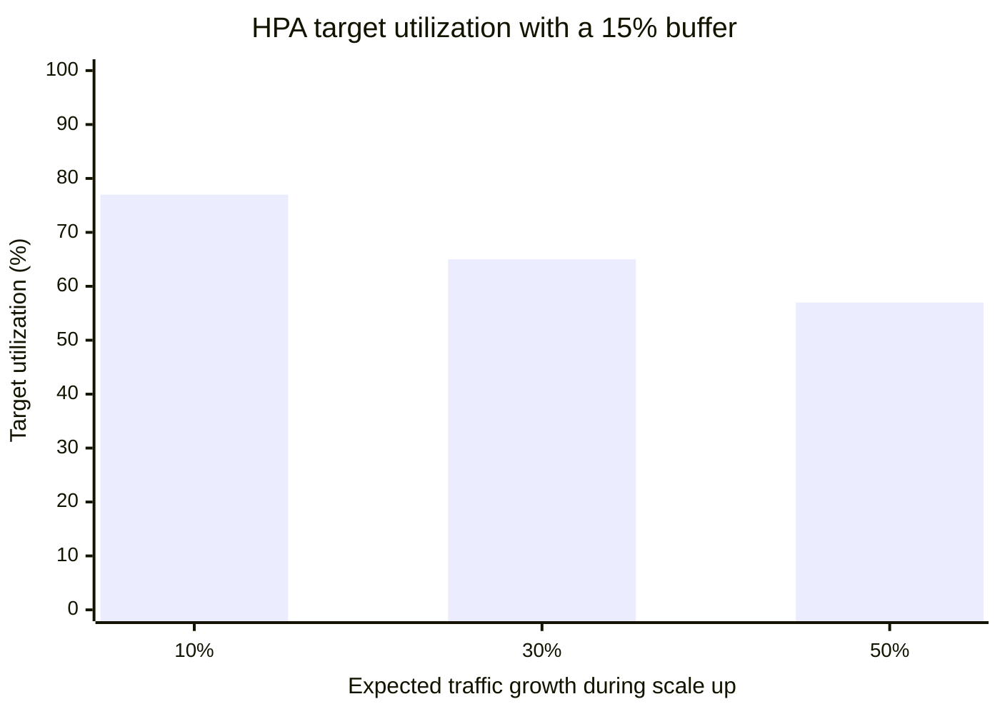

# GKE autoscaling and optimization

## Summary

GKE scales at two levels. Workload autoscalers change Pods: the Horizontal Pod Autoscaler (HPA) changes the number of replicas, and the Vertical Pod Autoscaler (VPA) changes CPU and memory requests. Infrastructure autoscalers change nodes: the cluster autoscaler adds and removes nodes in node pools, and node auto-provisioning creates new node pools. Because adding nodes takes minutes, clusters that must absorb sudden spikes keep a buffer of spare capacity (over-provisioning). All of this depends on accurate resource requests.

## Prerequisites

- Kubernetes Deployments, resource requests and limits.
- [Compute services overview](../compute/compute-services-overview.md) for Spot VMs.

## Core concepts

### Goals of optimization

Reliable performance under variable load, less waste and cost, resilience and elasticity, and automatic adaptation to spikes. Areas: workload autoscaling, cluster and node pool autoscaling, over-provisioning, requests and limits tuning, Spot nodes, and monitoring of cost and performance.

### The autoscalers



Read from the top: the HPA reacts first; nodes are added only when new Pods cannot be scheduled.

**Horizontal Pod Autoscaler.** Scales replicas of a Deployment or StatefulSet based on CPU, memory or custom and external metrics (for example requests per second, queue length from Cloud Monitoring). You set `minReplicas`, `maxReplicas` and a target. It depends on resource requests, because utilization is measured relative to them.

**Vertical Pod Autoscaler.** Recommends or applies CPU and memory requests based on observed usage. Modes: `Off` (recommendations only), `Initial` (set at Pod creation), `Auto` (applies changes, which can restart Pods). Useful for stable workloads such as batch jobs, stateful apps and background services. Do not let VPA and HPA act on the same CPU or memory metric; use VPA in recommendation mode or HPA on custom metrics.

**Cluster autoscaler.** Adds nodes when Pods are pending for lack of resources, removes underutilized nodes after a grace period if their Pods fit elsewhere. Works for zonal and regional clusters, configured per node pool (`--enable-autoscaling --min-nodes --max-nodes`). Priority classes, taints and tolerations, and affinity rules influence what it does.

**Node auto-provisioning (NAP).** Creates and deletes whole node pools with machine types, disks, zones and GPUs matched to pending Pods. Accurate requests help it pick sizes; too many hard constraints limit it.

**Node pool autoscaling.** Separate pools for bursty, GPU or specialized workloads, each with its own machine type and limits.

**Autopilot** handles node provisioning entirely: you are billed for Pod requests, and Google sizes nodes.

### Over-provisioning

The HPA only reacts after utilization rises, and the cluster autoscaler needs one to two minutes or more to bring up nodes. A buffer of spare capacity absorbs the gap.



The target utilization for the HPA follows from two numbers: the safety *buffer* you want to keep, and the expected *traffic growth* during the time it takes to scale.

```text
target utilization = (1 - buffer) / (1 + traffic growth)
```

Implementation options:

1. **Pause Pods (balloon Pods).** Low priority Pods that request CPU and memory but do nothing. When real Pods need room, the scheduler evicts the pause Pods, the real Pods start immediately, and the evicted pause Pods trigger the cluster autoscaler to add a node in the background.
2. **Dedicated buffer node pool,** possibly with Spot VMs for cost.

## Worked example



A service wants a 15 percent safety buffer and expects traffic to grow by up to 30 percent before new nodes are ready.

| Buffer | Traffic growth | Target utilization |
| --- | --- | --- |
| 15 % | 10 % | 0.85 / 1.10 = 77 % |
| 15 % | 30 % | 0.85 / 1.30 = 65 % |
| 15 % | 50 % | 0.85 / 1.50 = 57 % |
| 10 % | 30 % | 0.90 / 1.30 = 69 % |

The chart shows how the target falls as the expected growth rises with a 15 percent buffer (values from the first three rows).



With a 65 percent CPU target, the Deployment runs about 35 percent above current need, so a 30 percent spike lands on capacity that already exists.

```yaml
apiVersion: autoscaling/v2
kind: HorizontalPodAutoscaler
metadata:
  name: web
spec:
  scaleTargetRef:
    apiVersion: apps/v1
    kind: Deployment
    name: web
  minReplicas: 3
  maxReplicas: 50
  metrics:
  - type: Resource
    resource:
      name: cpu
      target:
        type: Utilization
        averageUtilization: 65
```

## Trade offs and when to use it

| Technique | Purpose |
| --- | --- |
| HPA plus cluster autoscaler | Elastic workloads and infrastructure together |
| Spot VMs | Large discounts for stateless and batch workloads that tolerate interruption |
| VPA in recommendation mode | Right-size requests |
| Labels on workloads | Cost allocation (GKE cost allocation, billing export) |
| Autopilot | Fully managed nodes, pay per Pod request |
| Offload event-driven work to Cloud Run | Burst workloads without node capacity |

The original notes state 70 to 80 percent savings for preemptible VMs; Spot VM discounts vary by machine type and region and change over time.

TODO: Record current Spot discount ranges with a check date.

Over-provisioning trades money (idle capacity) for latency during spikes.

## Common mistakes

- **No resource requests.** HPA cannot compute utilization and the scheduler packs Pods badly.
- **VPA and HPA on the same metric.** They fight each other.
- **Monitoring nothing.** Watch Pod CPU and memory, node pool utilization, pending Pods, autoscaler events; alert when Pods are pending longer than a threshold or budgets are exceeded.
- **One huge node pool for everything.** Separate pools for GPU, bursty and system workloads.

## Practice

1. Which autoscaler adds nodes, and what triggers it?
2. Compute the HPA target for a 20 percent buffer and 25 percent expected growth.
3. How do pause Pods make room for real Pods quickly?

Answers: 1. The cluster autoscaler; Pods that are pending because they do not fit. 2. 0.80 / 1.25 = 64 percent. 3. They have low priority, so the scheduler preempts them for real Pods, which start at once; the autoscaler then adds a node for the evicted pause Pods.

## Further reading

- [About GKE cluster autoscaling](https://docs.cloud.google.com/kubernetes-engine/docs/concepts/cluster-autoscaler), Google Cloud documentation. Scale up and scale down behavior.
- [Horizontal Pod autoscaling](https://docs.cloud.google.com/kubernetes-engine/docs/concepts/horizontalpodautoscaler), Google Cloud documentation. Metrics and configuration.
- [Best practices for running cost-optimized Kubernetes applications on GKE](https://docs.cloud.google.com/architecture/best-practices-for-running-cost-effective-kubernetes-applications-on-gke), Google Cloud Architecture Center. Source of the over-provisioning formula.
