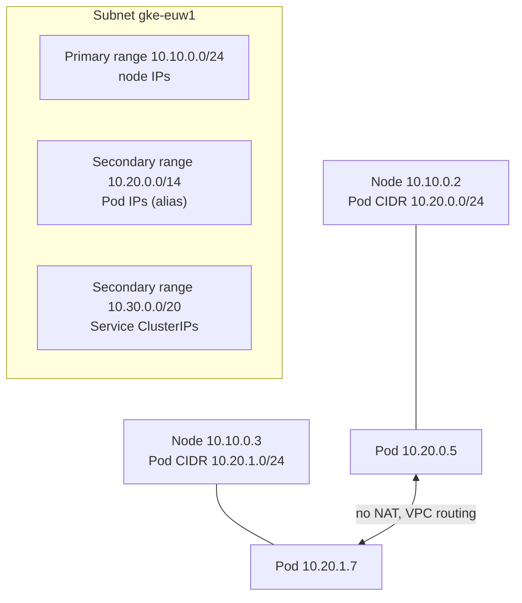
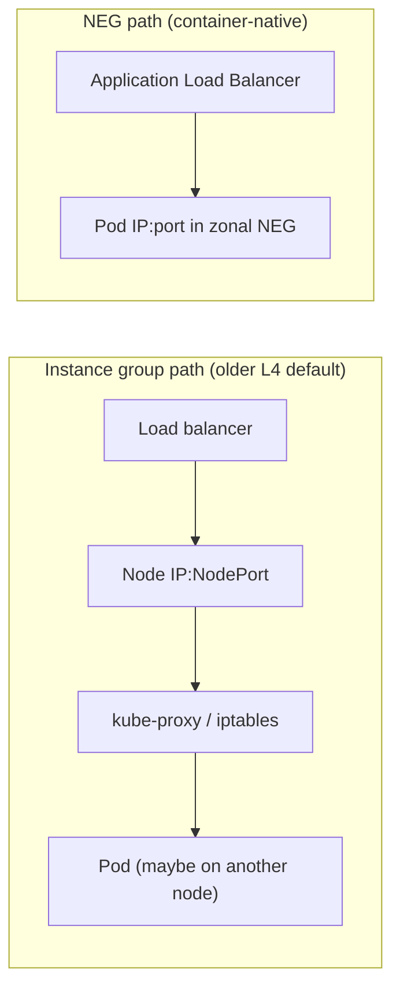

# GKE networking

## Summary

GKE networking implements the Kubernetes network model on Google Cloud's VPC. In a VPC-native cluster, every Pod gets an IP from a secondary range of the node's subnet (alias IPs), so Pods are first-class VPC addresses that routes, firewall rules and Flow Logs understand. Services give stable virtual IPs to sets of Pods; `LoadBalancer` Services create Network Load Balancers; Ingress and the Gateway API create Application Load Balancers that send traffic directly to Pods through network endpoint groups (NEGs). Network policies restrict Pod-to-Pod traffic inside the cluster.

## Prerequisites

- [VPC networks](../networking/vpc/vpc-networks.md) and [VPC firewall](../networking/vpc/vpc-firewall.md).
- [Load balancing](../networking/load-balancing/README.md).
- Kubernetes objects: Pod, Deployment, Service, Ingress.

## Core concepts

### Pod networking model

- **Kubernetes model.** Every Pod has its own IP; containers in a Pod share the network namespace (`localhost`); Pods reach each other without NAT, across nodes.
- **GKE implementation.** VPC-native clusters (the default) give Pods IPs from a secondary subnet range through alias IPs. Each node receives a slice of the Pod range. Routes-based clusters are legacy.
- **Benefits of alias IPs.** Pod IPs are routable in the VPC and over peering and hybrid links, fine-grained firewall rules and Flow Logs work per Pod, and no overlay network (Flannel, Calico VXLAN) is needed because Google's SDN routes the ranges.



### Services and kube-proxy

kube-proxy (iptables or IPVS) or, with GKE Dataplane V2, eBPF programs translate Service virtual IPs to Pod IPs selected by labels.

| Service type | Behavior |
| --- | --- |
| ClusterIP (default) | Internal virtual IP reachable inside the cluster |
| NodePort | Opens the same port on every node; traffic to any node is forwarded to a Pod |
| LoadBalancer | Creates a passthrough Network Load Balancer (external, or internal with an annotation) |
| Headless (`clusterIP: None`) | DNS returns Pod IPs directly; used with StatefulSets |

### Ingress and Gateway

- **GKE Ingress controller.** An `Ingress` object creates an Application Load Balancer with URL map, backend services, health checks and optionally Google-managed certificates.
- **Gateway API.** The newer, role-oriented API (GatewayClass, Gateway, HTTPRoute) supported by GKE for external and internal ALBs and multi-cluster gateways.
- **Benefits.** Global load balancing, path and host routing, TLS termination, autoscaling and health checks.

TODO: Write a note on GKE Gateway.

### NEGs and container-native load balancing



With instance groups, traffic lands on any node and kube-proxy forwards it, sometimes to another node (an extra hop). With zonal NEGs, the load balancer sends traffic directly to Pod IPs: fewer hops, accurate health checks per Pod and better load distribution. Serverless NEGs serve Cloud Run and functions, not Pods.

### Masquerading and egress

- The **IP masquerade agent** decides which destinations get source NAT to the node IP. Traffic to ranges in its non-masquerade list keeps the Pod IP.
- Pod traffic to the internet from private nodes goes through **Cloud NAT**.

### Firewall rules and network policies

- VPC firewall rules filter traffic between nodes and Pods at the VPC level; GKE creates some rules automatically. Custom ingress rules should have higher priority than GKE's defaults when they must override them.
- **Network policies** filter Pod-to-Pod and Pod egress traffic inside the cluster by labels and namespaces. They are enforced by GKE Dataplane V2 (Cilium-based, eBPF) or by Calico on older clusters. They are required for zero trust designs.

### Internal load balancing and DNS

- A `LoadBalancer` Service with the annotation `networking.gke.io/load-balancer-type: "Internal"` creates an internal passthrough NLB for private and hybrid access.
- DNS: kube-dns or Cloud DNS for GKE. Services resolve as `myservice.mynamespace.svc.cluster.local`.

## Worked example

Traffic flow from a user to a Pod through Ingress:

1. The user resolves `shop.example.com` to the global ALB's anycast IP.
2. The ALB's URL map selects the backend service created for the Service `web`.
3. The backend service uses a zonal NEG; the request goes directly to a Pod IP such as `10.20.1.7:8080`.
4. The Pod answers through the same path.

From a Pod to the internet: the Pod calls `https://api.example.net`; with private nodes, the IP masquerade agent rewrites the source to the node IP, and Cloud NAT translates it to a public IP.

```yaml
# Network policy: only Pods labeled app=web may reach the database Pods on 5432
apiVersion: networking.k8s.io/v1
kind: NetworkPolicy
metadata:
  name: db-allow-web
  namespace: shop
spec:
  podSelector:
    matchLabels:
      app: db
  policyTypes: ["Ingress"]
  ingress:
  - from:
    - podSelector:
        matchLabels:
          app: web
    ports:
    - protocol: TCP
      port: 5432
```

## Trade offs and when to use it

| Practice | Why it matters |
| --- | --- |
| VPC-native clusters | Alias IPs, granular firewalling, better scale |
| Container-native load balancing | Fewer hops, per-Pod health checks |
| Network policies | Segmentation between workloads |
| Disable legacy metadata endpoints | Prevent credential theft (see [GKE security hardening](gke-security/gke-security-hardening.md)) |
| VPC Flow Logs on node subnets | Visibility of traffic |
| Internal load balancers for internal services | Smaller attack surface |

The cost of VPC-native clusters is IP planning: Pod ranges are large (a `/14` is common) and must not overlap with other networks.

## Common mistakes

- **Pod ranges too small.** The cluster cannot add nodes once the Pod range is exhausted.
- **No network policies.** Every Pod can reach every other Pod.
- **Expecting firewall rules to see Service IPs.** Rules apply to node and Pod IPs, not to ClusterIPs.

## Practice

1. Where do Pod IPs come from in a VPC-native cluster?
2. Why is container-native load balancing more efficient than instance group backends?
3. Which Service type creates a passthrough Network Load Balancer?

Answers: 1. A secondary range of the node subnet, assigned as alias IPs. 2. The load balancer sends traffic directly to Pod IPs through NEGs, avoiding the NodePort and kube-proxy hop. 3. `LoadBalancer`.

## Further reading

- [GKE networking overview](https://docs.cloud.google.com/kubernetes-engine/docs/concepts/network-overview), Google Cloud documentation. Pods, Services and load balancing.
- [VPC-native clusters](https://docs.cloud.google.com/kubernetes-engine/docs/concepts/alias-ips), Google Cloud documentation. Alias IP ranges and sizing.
- [Container-native load balancing](https://docs.cloud.google.com/kubernetes-engine/docs/concepts/container-native-load-balancing), Google Cloud documentation. NEGs for Pods.
- [GKE Dataplane V2](https://docs.cloud.google.com/kubernetes-engine/docs/concepts/dataplane-v2), Google Cloud documentation. eBPF networking and network policy.
