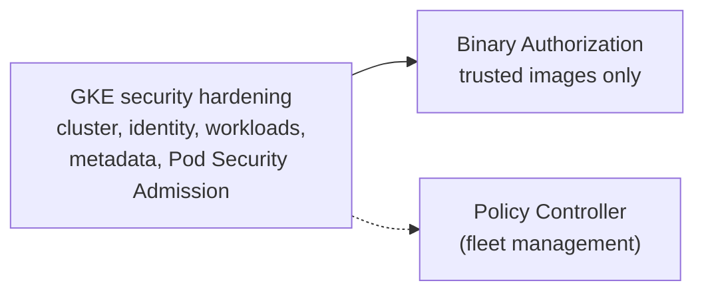

# GKE security

Hardening GKE clusters and controlling what runs on them.

## Map of the subarea

## Notes in reading order

1. [GKE security hardening](gke-security-hardening.md): private nodes, node service accounts, RBAC, Workload Identity Federation for GKE, metadata protection and Pod Security Admission.
2. [Binary Authorization](binary-authorization.md): attestations and admission-time enforcement of trusted images.

## Planned topics

- GKE security posture dashboard
- Confidential GKE nodes
- GKE Sandbox (gVisor)
- Secret Manager add-on for GKE
- Backup for GKE
