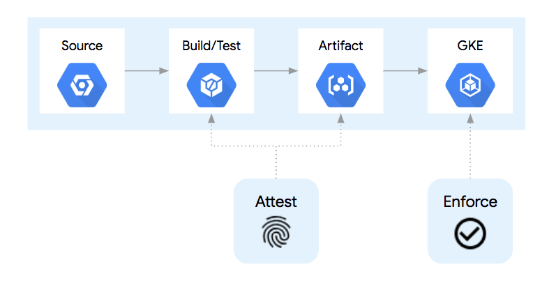
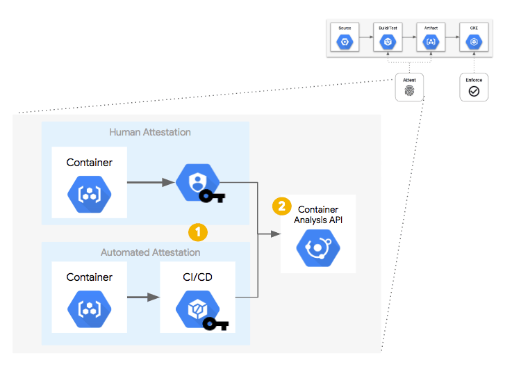
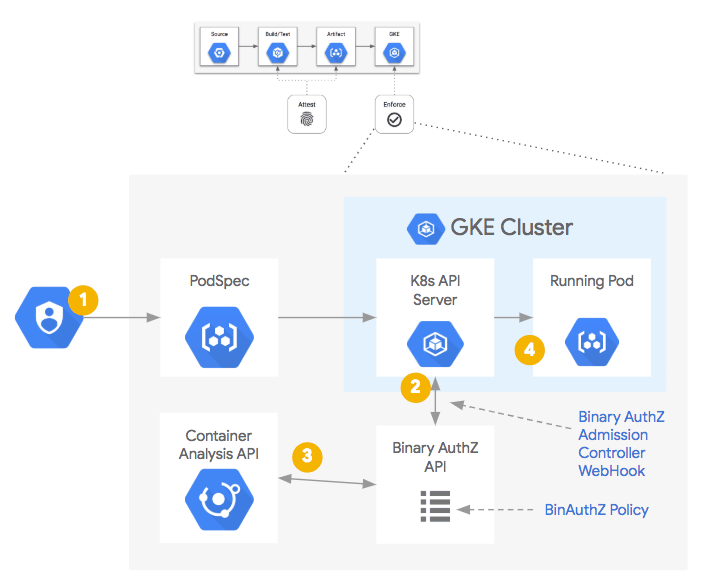
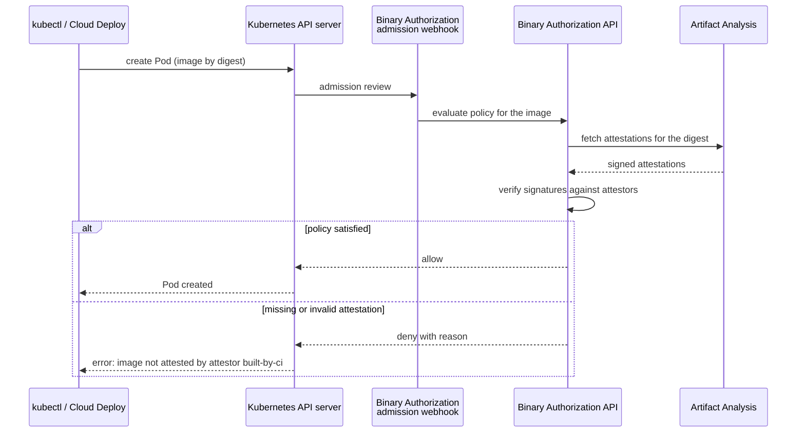

# Binary Authorization

## Summary

Binary Authorization is a deploy-time control that lets only trusted container images run on GKE (and Cloud Run). Trust is expressed with *attestations*: signed statements, created by people or pipeline steps, that an image passed a stage such as build, test or vulnerability scan. When a Pod is created, an admission webhook asks Binary Authorization whether the image meets the *policy*; images without the required attestations are blocked. It turns supply chain checks from advice into enforcement.

## Prerequisites

- [Artifact Registry](../../developer-and-devops-tools/ci-cd/artifact-registry.md) and [Cloud Build](../../developer-and-devops-tools/ci-cd/cloud-build.md).
- [GKE security hardening](gke-security-hardening.md).

## Core concepts

### Architecture

Binary Authorization and the Container Analysis API (now Artifact Analysis) are based on two open source projects:

- **Grafeas** defines an API for storing metadata about software artifacts (container images, VM images, JARs, scripts): notes and occurrences, such as vulnerabilities and attestations.
- **Kritis** defines how a deployment is prevented unless the image conforms to a central policy and has the required attestations.



### The pipeline

A simple container pipeline has four steps: source code in version control; build and test on commit; the image is pushed to a registry; the image is deployed to Kubernetes, where the runtime pulls and runs it. Between steps you can add checks (unit tests, source analysis, license checks, vulnerability scans), and each check can be given the authority to *attest* that it passed.

### Attestation



- An **attestor** represents an authority, for example "QA approved" or "built by CI". It is linked to a public key (PKIX keys, often in Cloud KMS; older setups used PGP keys) and to an attestation note in Artifact Analysis.
- When a step succeeds, it signs the image digest with its private key and stores the signed payload as an *attestation occurrence*.
- Different keys per step let different people, systems or build steps attest independently.

### Enforcement





### Policy

A policy has a default rule and optional rules per cluster, namespace or service account. A rule either allows all images, denies all images, or requires attestations from listed attestors. Exempt image patterns (for example Google system images) and a *dry run* mode (log, do not block) help adoption. Break-glass annotations allow emergency deploys and are logged. Continuous validation re-checks running Pods against the policy.

## Worked example

Require a CI attestation in production (untested sketch):

```bash
# Attestor backed by a Cloud KMS signing key
gcloud container binauthz attestors create built-by-ci \
  --attestation-authority-note=built-by-ci-note \
  --attestation-authority-note-project=PROJECT_ID
gcloud container binauthz attestors public-keys add --attestor=built-by-ci \
  --keyversion=projects/PROJECT_ID/locations/global/keyRings/binauthz/cryptoKeys/ci/cryptoKeyVersions/1

# In the pipeline, after tests pass, sign the image digest
gcloud container binauthz attestations sign-and-create \
  --artifact-url="europe-west1-docker.pkg.dev/PROJECT_ID/apps/web@sha256:DIGEST" \
  --attestor=built-by-ci --attestor-project=PROJECT_ID \
  --keyversion=projects/PROJECT_ID/locations/global/keyRings/binauthz/cryptoKeys/ci/cryptoKeyVersions/1
```

```yaml
# policy.yaml, imported with: gcloud container binauthz policy import policy.yaml
globalPolicyEvaluationMode: ENABLE
defaultAdmissionRule:
  evaluationMode: REQUIRE_ATTESTATION
  enforcementMode: ENFORCED_BLOCK_AND_AUDIT_LOG
  requireAttestationsBy:
  - projects/PROJECT_ID/attestors/built-by-ci
```

Deploying an image built on a laptop fails with an error naming the missing attestor.

## Trade offs and when to use it

- Strong guarantee that only pipeline-built images run, at the cost of key management and pipeline changes.
- Images must be referenced by digest, not by tag, so that attestations apply to exact content.
- Start in dry run mode to find what would be blocked.

## Common mistakes

- **Deploying by tag.** Tags are mutable; policies evaluate digests.
- **One key for all attestors.** Separate keys per authority keep duties separate.
- **No break-glass process.** Define and monitor one, or teams will disable enforcement during incidents.

## Practice

1. What is an attestation, and who creates it?
2. Which component intercepts the Pod creation request?
3. Why must images be deployed by digest?

Answers: 1. A signed statement that an image digest passed a stage; created by a person or pipeline step that holds the attestor's private key. 2. The Binary Authorization admission webhook (admission controller). 3. Attestations are bound to a digest; a tag can point to different content.

## Further reading

- [Binary Authorization overview](https://docs.cloud.google.com/binary-authorization/docs/overview), Google Cloud documentation. Policies, attestors and enforcement.
- [Grafeas](https://grafeas.io/), Grafeas project. The artifact metadata API.
- [Kubernetes admission controllers](https://kubernetes.io/docs/reference/access-authn-authz/admission-controllers/), Kubernetes documentation. How admission webhooks work.
