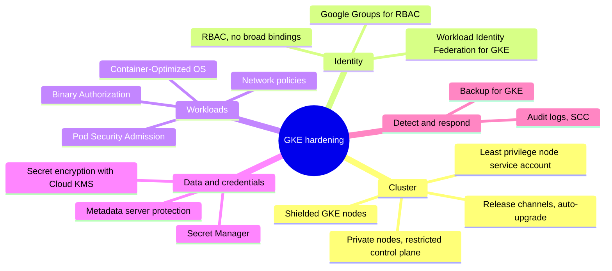
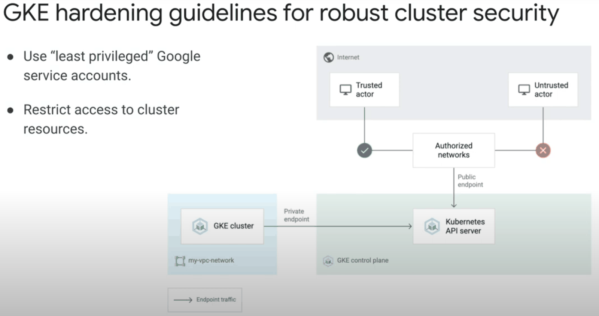
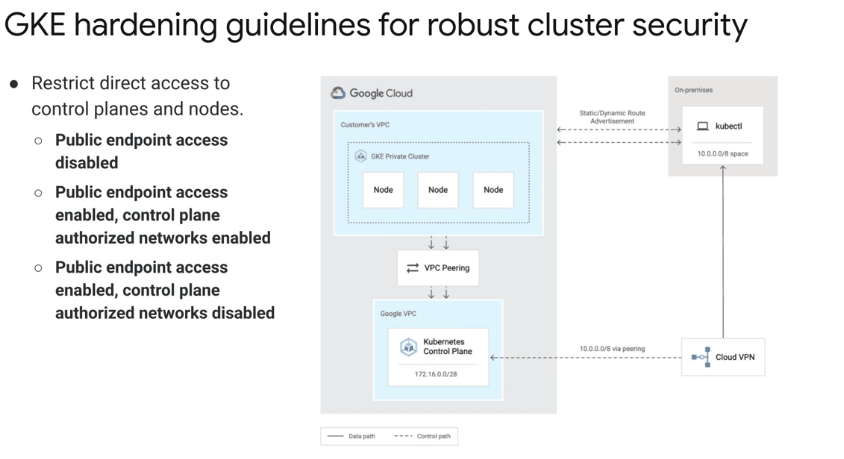
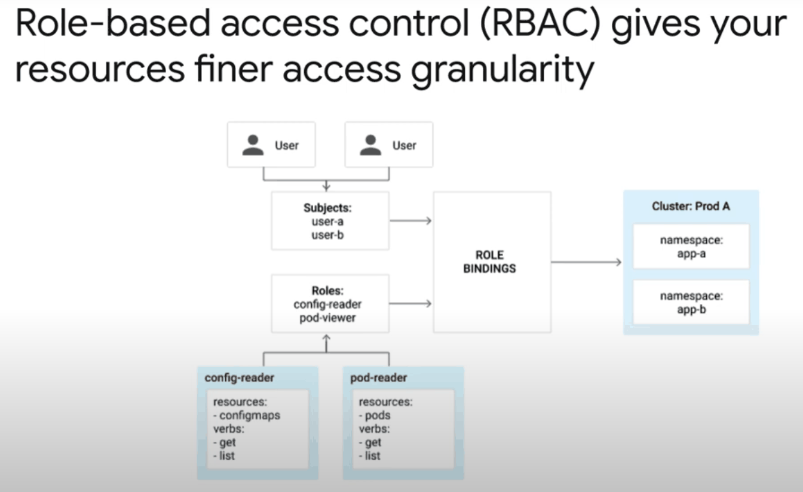

# GKE security hardening

## Summary

Hardening a GKE cluster means protecting four things: the cluster infrastructure (control plane access, nodes, upgrades), identities (Kubernetes RBAC and Workload Identity Federation for GKE), workloads (Pod Security Standards, network policies, trusted images) and the data and credentials they use (secrets, the metadata server). GKE manages the control plane, but configuration is the customer's job. This note collects the hardening measures from the GKE hardening guide, including the metadata protections and Pod Security Admission, and corrects some outdated advice.

## Prerequisites

- [GKE networking](../gke-networking.md).
- [Authentication to Google Cloud APIs](../../security-and-identity/identity-and-access/authentication-to-google-cloud-apis.md) for Workload Identity Federation for GKE.
- Kubernetes basics: Pods, nodes, namespaces, RBAC.

## Core concepts

### Components and their roles

- Applications run in **containers** inside **Pods**; containers in a Pod share network and volumes.
- **Nodes** are VMs that run Pods; a **cluster** is nodes plus a **control plane** (API server, scheduler, etcd), which GKE manages.
- **Kubernetes Secrets** hold credentials and can be encrypted at the application layer with Cloud KMS.
- Kubernetes secrets and Google Cloud credentials are different things; Workload Identity Federation for GKE connects Kubernetes identities to IAM without secrets.

### Layers of hardening



### Secure the cluster

- **Upgrades.** Use release channels (Rapid, Regular, Stable, Extended) and auto-upgrade so security patches arrive automatically.
- **Private nodes.** Nodes without external IPs (`--enable-private-nodes`); outbound through Cloud NAT.
- **Control plane access.** Restrict the API endpoint: disable public endpoint access, or enable it only for authorized networks. GKE now also offers a DNS-based endpoint protected by IAM.
- **Node service account.** Replace the default Compute Engine service account with a minimal one that has only `roles/logging.logWriter`, `roles/monitoring.metricWriter`, `roles/monitoring.viewer` and `roles/stackdriver.resourceMetadata.writer` (or the predefined `roles/container.defaultNodeServiceAccount`).
- **Shielded GKE nodes.** Verifiable node integrity with Secure Boot (unless unsigned third-party kernel modules are needed) and integrity monitoring.

TODO: Verify current control plane endpoint options.

TODO: Verify the role name of the predefined node role.





### Access control

- **RBAC** for fine-grained permissions on Kubernetes objects. Avoid broad `ClusterRoleBindings`, especially to the `system:authenticated` group, which includes every Google account.
- **Google Groups for RBAC** to bind roles to groups managed in the directory.
- **IAM and RBAC together.** IAM controls access to the GKE API and cluster-wide actions; RBAC controls access inside the cluster.
- **Workload Identity Federation for GKE** to give Pods IAM identities with least privilege.



### Protect workloads

- **Network policies** to restrict Pod-to-Pod and egress traffic (or Cloud Service Mesh authorization policies).
- **Binary Authorization** to deploy only trusted, attested images. See [Binary Authorization](binary-authorization.md).
- **Container-Optimized OS** (`cos_containerd`) as a minimal, hardened node image.
- **Image scanning** with Artifact Analysis in Artifact Registry (Container Registry is deprecated).
- **Secrets.** Application-layer encryption of Kubernetes Secrets with Cloud KMS; or keep secrets in Secret Manager (with the Secret Manager CSI add-on) or HashiCorp Vault.
- **Non-root and least privilege.** Security contexts that run as non-root, drop capabilities and use read-only root file systems.

### The metadata server

The Compute Engine metadata server (`metadata.google.internal`, `169.254.169.254`) returns instance metadata and, critically, access tokens of the node's service account. A Pod that can reach it can act as the node. Two historical risks and their current state:

- **Legacy metadata endpoints.** The `v0.1` and `v1beta1` endpoints did not require the `Metadata-Flavor: Google` header, so a server-side request forgery (SSRF, CWE-918) bug in an app could fetch tokens. The original notes recommend setting `disable-legacy-endpoints=true` (written there as `enable-legacy-endpoint=false`). Google has since shut down these legacy endpoints for all VMs; the setting is now a default.
- **Metadata concealment.** An older GKE feature (`--workload-metadata=SECURE`) that ran a proxy on nodes to filter sensitive metadata such as kubelet credentials. It is deprecated. The original notes confuse it with `--workload-metadata=GKE_METADATA`, which is the *GKE metadata server* used by Workload Identity Federation for GKE.

TODO: Verify the shutdown date and current flag name.

The current protection is **Workload Identity Federation for GKE**: the GKE metadata server intercepts metadata requests from Pods and returns tokens for the Pod's own Kubernetes service account identity, never the node's credentials.

```bash
# Enable Workload Identity Federation for GKE on a cluster and use the GKE metadata server on a node pool (untested)
gcloud container clusters update my-cluster --region=europe-west1 \
  --workload-pool=PROJECT_ID.svc.id.goog
gcloud container node-pools update default-pool --cluster=my-cluster \
  --region=europe-west1 --workload-metadata=GKE_METADATA
```

### Pod Security Admission

Pod Security Admission (PSA) is the built-in Kubernetes admission controller that enforces the Pod Security Standards (PSS) per namespace. It replaced PodSecurityPolicy (PSP), which was removed in Kubernetes 1.25.

| Profile | Meaning |
| --- | --- |
| `privileged` | No restrictions; trusted system workloads only |
| `baseline` | Prevents known privilege escalations; fits most workloads |
| `restricted` | Strict hardening: non-root, no privilege escalation, limited capabilities and volumes |

Each namespace can set a mode per profile: `enforce` (reject), `audit` (log) or `warn` (warn the user).

PSA is enabled by default in GKE 1.25 and later; no cluster flag is needed. The original notes show `gcloud container clusters create --enable-pod-security-policy`, which enabled the removed PSP feature and must not be used.

```bash
# Enforce restricted, and warn about restricted violations in another namespace
kubectl label namespace payments pod-security.kubernetes.io/enforce=restricted
kubectl label namespace legacy pod-security.kubernetes.io/warn=restricted \
  pod-security.kubernetes.io/enforce=baseline
```

For rules beyond the three profiles (for example allowed registries), use [Policy Controller](../fleet-management/policy-controller.md).

### Monitor and audit

- Cloud Monitoring and Cloud Logging for cluster metrics and container logs (Logs Explorer).
- Kubernetes audit logs in Cloud Audit Logs; Access Transparency logs for actions by Google personnel.
- Security Health Analytics, GKE security posture dashboard and Container Threat Detection in [Security Command Center](../../security-and-identity/threat-detection-and-posture/security-command-center.md).

### Advanced practices

- **Multi-tenancy.** Separate namespaces or clusters per team and environment for accountability and blast radius.
- **Ingress firewall rules** that allow only specific source ranges, with priorities above GKE's defaults.
- **Hybrid and multicloud consistency** with GKE Enterprise fleet features.
- **Incident readiness.** Back up workloads and state with Backup for GKE (GKE manages etcd backups of the control plane), test restores, and integrate alerts with SIEM workflows.

### CIS benchmarks and scorecards

The CIS GKE Benchmark lists hardening checks for GKE. CFT Scorecard and Security Health Analytics evaluate configurations against such benchmarks and report gaps such as excessive permissions or missing encryption. See [CFT Scorecard](../../security-and-identity/threat-detection-and-posture/cft-scorecard.md).

## Worked example

A hardened Standard cluster (untested):

```bash
gcloud iam service-accounts create gke-nodes
for r in logging.logWriter monitoring.metricWriter monitoring.viewer stackdriver.resourceMetadata.writer; do
  gcloud projects add-iam-policy-binding PROJECT_ID \
    --member="serviceAccount:gke-nodes@PROJECT_ID.iam.gserviceaccount.com" --role="roles/$r"
done

gcloud container clusters create shop-prod --region=europe-west1 \
  --release-channel=regular --enable-ip-alias \
  --enable-private-nodes --master-ipv4-cidr=172.16.0.0/28 \
  --enable-master-authorized-networks --master-authorized-networks=203.0.113.0/24 \
  --service-account=gke-nodes@PROJECT_ID.iam.gserviceaccount.com \
  --shielded-secure-boot --shielded-integrity-monitoring \
  --workload-pool=PROJECT_ID.svc.id.goog \
  --enable-dataplane-v2 --image-type=COS_CONTAINERD \
  --database-encryption-key=projects/PROJECT_ID/locations/europe-west1/keyRings/gke/cryptoKeys/secrets \
  --binauthz-evaluation-mode=PROJECT_SINGLETON_POLICY_ENFORCE
```

Autopilot clusters apply many of these settings by default (Workload Identity Federation, Shielded nodes, COS, restricted node access).

## Trade offs and when to use it

- Private control plane endpoints complicate CI/CD access; use authorized networks, a DNS-based endpoint with IAM, or a private build pool.
- `restricted` PSA breaks many off-the-shelf charts; start with `warn` and `audit` modes.
- Autopilot removes many choices (and risks) at the cost of node-level flexibility.

## Common mistakes

- **Default Compute Engine service account on nodes.** It often has Editor.
- **`ClusterRoleBinding` to `system:authenticated`.**
- **Following outdated guides** that enable PodSecurityPolicy or metadata concealment.
- **Pods using node credentials** because Workload Identity Federation for GKE is not enabled.

## Practice

1. What replaced PodSecurityPolicy, and how is it configured?
2. Why is access to the metadata server from Pods dangerous without Workload Identity Federation for GKE?
3. Which roles does a minimal node service account need?

Answers: 1. Pod Security Admission, configured with namespace labels such as `pod-security.kubernetes.io/enforce=restricted`. 2. Pods could fetch the node service account's access tokens and act with its permissions. 3. Log writer, metric writer, monitoring viewer and resource metadata writer.

## Further reading

- [Harden your cluster's security](https://docs.cloud.google.com/kubernetes-engine/docs/how-to/hardening-your-cluster), Google Cloud documentation. Google's hardening guide.
- [Pod Security Admission](https://kubernetes.io/docs/concepts/security/pod-security-admission/), Kubernetes documentation. Profiles and modes.
- [Protect cluster metadata](https://docs.cloud.google.com/kubernetes-engine/docs/how-to/protecting-cluster-metadata), Google Cloud documentation. Metadata concealment history and Workload Identity Federation for GKE.
- [CIS Google Kubernetes Engine Benchmark](https://www.cisecurity.org/benchmark/kubernetes), Center for Internet Security. Hardening checks.
