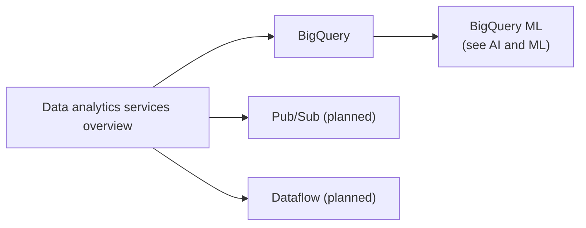

# Data analytics

Ingesting, processing, storing, governing and visualizing data at scale: Pub/Sub, Dataflow, Dataproc, BigQuery, Dataplex and Looker.

## Map of the area

## Notes in reading order

1. [Data analytics services overview](data-analytics-services-overview.md): the pipeline from ingestion to dashboards and every product in it.
2. [BigQuery](bigquery.md): architecture, features, pricing, partitioning and clustering.

## Planned topics

- Pub/Sub in depth (delivery semantics, ordering, exactly-once)
- Dataflow and Apache Beam
- Dataproc and serverless Spark
- Dataplex Universal Catalog
- Looker and Looker Studio
- BigQuery Omni and BigLake
- Datastream and change data capture
- Data mesh on Google Cloud
