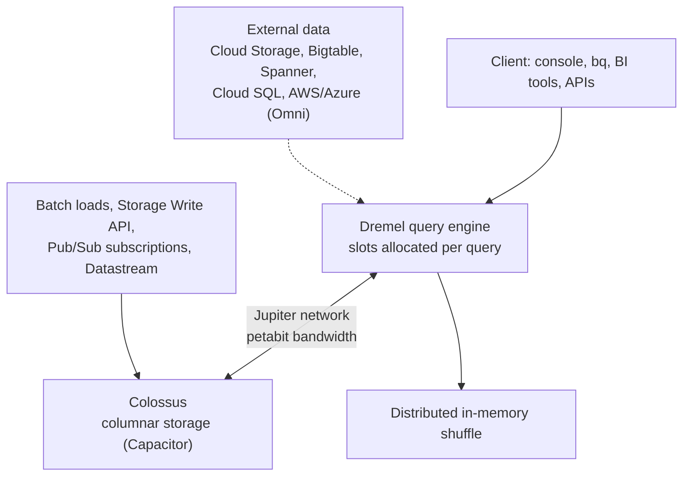
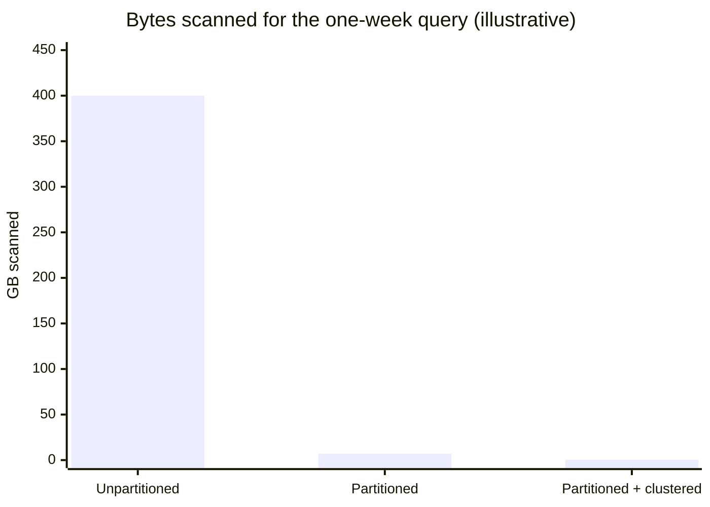

# BigQuery

## Summary

BigQuery is Google Cloud's serverless data warehouse. Data is stored in a columnar format on Colossus and queried with SQL by a distributed engine (Dremel) that allocates compute *slots* on demand; storage and compute scale and are billed separately. It handles petabytes, ingests batch and streaming data, runs machine learning in SQL (BigQuery ML), supports geospatial analysis and federated queries, and secures data down to rows and columns. The main skill is cost and performance control: read less data through partitioning, clustering and selecting only needed columns.

## Prerequisites

- [Data analytics services overview](data-analytics-services-overview.md).
- SQL.

## Core concepts

### Architecture



- **Columnar storage.** Only the columns a query references are read, and columns compress well.
- **Distributed compute.** A query is broken into stages executed in parallel on many slots.
- **Separation of storage and compute.** Each scales and is paid for independently.

### Features

- **SQL.** GoogleSQL (ANSI compliant), nested and repeated fields (STRUCT and ARRAY), scripting, stored procedures, multi-statement transactions.
- **Ingestion.** Batch loads (free with the shared slot pool), the Storage Write API and legacy streaming inserts for near real-time data, Pub/Sub BigQuery subscriptions.
- **BigQuery ML.** Train and run models with SQL: linear and logistic regression, k-means, boosted trees, deep neural networks, time series (ARIMA_PLUS), imported TensorFlow and ONNX models, and remote models on Vertex AI including generative models.
- **BI Engine.** In-memory acceleration for sub-second dashboards.
- **Governance.** IAM at project, dataset, table and view level; authorized views; row-level access policies; column-level security with policy tags and dynamic data masking; CMEK.
- **Geospatial.** `GEOGRAPHY` type and GIS functions.
- **Materialized views** and the query result cache (24 hours) speed up repeated queries.
- **Partitioning and clustering.** Partition tables by date, timestamp, ingestion time or integer range; cluster by up to four columns to sort data inside partitions.

### Pricing

Checked against older notes, prices must be re-verified:

| Component | Model |
| --- | --- |
| Compute, on-demand | Per TiB scanned (the original notes say 5 USD per TB; the on-demand list price was raised in 2023, check the current price), first TiB per month free |
| Compute, capacity | BigQuery editions (Standard, Enterprise, Enterprise Plus) with slot reservations and autoscaling, replacing flat-rate plans |
| Storage | Active and long-term (unmodified for 90 days, about half price); logical or physical (compressed) billing models |
| Streaming | Storage Write API per GB; legacy streaming inserts per 200 MB |
| Other | BigQuery ML training, BI Engine capacity, data egress |

TODO: Record current on-demand, storage and editions prices for one region with the check date.

### Comparison

| Feature | BigQuery | Cloud SQL | Spanner |
| --- | --- | --- | --- |
| Type | Analytical (OLAP) | Relational OLTP | Distributed relational OLTP |
| Use case | Warehousing, analytics, BI | Small to medium apps | Global transactional apps |
| Scaling | Serverless, petabytes | Vertical | Horizontal, global |
| Row updates | Supported (DML), not for high-rate OLTP | Yes | Yes |

The original notes say BigQuery has "no support for transactional workloads or row-level updates". BigQuery supports DML (`UPDATE`, `DELETE`, `MERGE`) and multi-statement transactions, but it is not designed for high-rate, low-latency single-row transactions.

## Worked example

Effect of partitioning and clustering on a 2 TB `events` table with 400 days of data (illustrative numbers, measured with dry runs):

```sql
CREATE TABLE analytics.events_p
PARTITION BY DATE(event_ts)
CLUSTER BY customer_id
AS SELECT * FROM analytics.events;

-- One customer's events for one week, two columns
SELECT event_ts, event_type
FROM analytics.events_p
WHERE DATE(event_ts) BETWEEN '2026-10-01' AND '2026-10-07'
  AND customer_id = 'c-1042';
```

| Query on | `SELECT *` without filters | Two columns, one week | Two columns, one week, one customer |
| --- | --- | --- | --- |
| Unpartitioned table | 2,000 GB | 400 GB (two of ten columns) | 400 GB |
| Partitioned by day | 2,000 GB | about 7 GB | about 7 GB |
| Partitioned and clustered | 2,000 GB | about 7 GB | well under 1 GB (blocks pruned) |



Check the bytes before running with `bq query --dry_run --use_legacy_sql=false '...'`.

TODO: Reproduce with a public dataset and record real byte counts.

## Trade offs and when to use it

- **Use cases.** Central warehouse for BI and reporting, exploratory and ad hoc analysis, real-time analytics (fraud, monitoring, IoT), ML with BigQuery ML, geospatial analysis.
- **Advantages.** No infrastructure, petabyte scale, streaming, SQL for analysts.
- **Limits.** On-demand costs can grow quickly with careless queries; complex transformations may be better in Dataflow or Dataproc; not an OLTP database.
- **Cost control.** Editions with reservations for predictable heavy usage; custom quotas and `maximum_bytes_billed` for on-demand; budgets and billing export dashboards.

## Common mistakes

- **`SELECT *`** on wide tables. Select only needed columns; `LIMIT` does not reduce bytes scanned.
- **No partition filter.** Require one with `require_partition_filter = true`.
- **Raw data only in BigQuery.** Keep raw data in Cloud Storage and curated data in BigQuery.
- **Ignoring table expiration** for temporary and staging datasets.

## Practice

1. Why does `SELECT * ... LIMIT 10` scan the whole table?
2. What is the difference between partitioning and clustering?
3. When are editions with reservations cheaper than on-demand?

Answers: 1. Billing is by columns read, and LIMIT is applied after the scan. 2. Partitioning splits the table into segments by a column (usually date) that whole queries can skip; clustering sorts data inside partitions by up to four columns so blocks can be skipped. 3. When query volume is high and predictable, so reserved slots are well used.

## Further reading

- [BigQuery overview](https://docs.cloud.google.com/bigquery/docs/introduction), Google Cloud documentation. Architecture and features.
- [Introduction to partitioned tables](https://docs.cloud.google.com/bigquery/docs/partitioned-tables), Google Cloud documentation. Partition types and pruning.
- [BigQuery pricing](https://cloud.google.com/bigquery/pricing), Google Cloud. On-demand and editions.
- [Dremel: Interactive Analysis of Web-Scale Datasets](https://research.google/pubs/dremel-interactive-analysis-of-web-scale-datasets-2/), Melnik and others, VLDB 2010. The query engine behind BigQuery.
