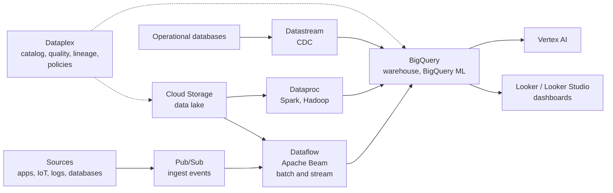

# Data analytics services overview

## Summary

Google Cloud's analytics services cover the whole path of data: ingest (Pub/Sub), process (Dataflow for batch and streaming, Dataproc for Spark and Hadoop), store and analyze (BigQuery), govern (Dataplex and its catalog) and visualize (Looker and Looker Studio). Most of them are serverless, they are integrated with each other and with AI services, and they support batch, streaming and interactive analysis. The usual design is a pipeline from event sources through Pub/Sub and Dataflow into BigQuery, governed by Dataplex and consumed in Looker.

## Prerequisites

- [Storage and database services overview](../storage-and-databases/storage-and-database-services-overview.md).
- Basic data engineering terms: ETL and ELT, batch and stream, data lake and warehouse.

## Core concepts

### Who uses them

Data engineers building pipelines, analysts running interactive queries, data scientists training models, and architects designing real-time or batch analytical systems. Common traits: serverless and scalable (no infrastructure to manage), integrated (storage, compute, AI and security work together) and multimodal (batch, streaming and interactive).

### Reference pipeline

Read the diagram from left to right: events and changes enter, are transformed, land in BigQuery and are consumed. Dataplex governs the stores across the whole path.

### Products

**BigQuery.** Serverless, petabyte-scale data warehouse with SQL, separation of storage and compute, BigQuery ML, geospatial analysis, federated queries and BI Engine for sub-second dashboards. Use partitioning and clustering, IAM and cost controls. See [BigQuery](bigquery.md).

**Dataflow.** Serverless stream and batch processing based on Apache Beam: one programming model for both, autoscaling workers, Streaming Engine for low latency. Use for ETL and ELT, stream ingestion and enrichment, real-time analytics and event-driven or IoT data. Integrates with Pub/Sub, BigQuery and Cloud Storage.

**Dataproc.** Managed Apache Spark, Hadoop, Presto and Flink clusters (and serverless Spark). Use to migrate on-premises Hadoop and Spark, for PySpark and MLlib pipelines and large transformations, when Spark-specific code or libraries are needed. Fast cluster creation, Spot workers, per-job or ephemeral clusters, autoscaling. Cluster-based Dataproc is not serverless: you manage clusters and configuration. Google now also uses the name Managed Service for Apache Spark.

TODO: Verify the current product naming.

**Pub/Sub.** Global messaging for event-driven and streaming architectures: ingest events from IoT devices, apps and systems, decouple microservices, trigger pipelines. Scales to millions of messages per second, push, pull and export subscriptions (directly to BigQuery or Cloud Storage), at-least-once delivery by default, ordering keys, exactly-once delivery for pull subscriptions, dead-letter topics, filtering and replay. The original notes mention exactly-once delivery with Pub/Sub Lite; Pub/Sub Lite is deprecated, and exactly-once delivery is a feature of standard Pub/Sub.

**Dataplex Universal Catalog.** Data governance across lakes and warehouses: unify data in BigQuery and Cloud Storage, central metadata, policy-based access, data quality and profiling, classification, lineage. It absorbed **Data Catalog**, which provided metadata discovery, search, tag templates and PII tagging; Data Catalog is deprecated in favor of Dataplex Universal Catalog.

TODO: Verify Data Catalog shutdown dates.

**Looker.** Enterprise BI platform with a semantic modeling layer (LookML), governed metrics, embedded analytics and an API-first design; native BigQuery support and multicloud data sources. Looker Blocks speed development.

**Looker Studio** (formerly Data Studio). Free, web-based dashboarding with drag and drop, connectors for Google and third-party sources, and sharing. Good for quick reports over BigQuery or Sheets; less governed than Looker.

### Summary table

| Product | Type | Use case | Notes for DevOps and architects |
| --- | --- | --- | --- |
| BigQuery | Serverless warehouse | Ad hoc, batch, real-time SQL analytics | Partitioning, IAM, BigQuery ML, cost controls |
| Dataflow | Serverless processing | Streaming and batch pipelines | Unified model, autoscaling, Pub/Sub integration |
| Dataproc | Managed Spark and Hadoop | Hadoop migration, Spark ML | Ephemeral clusters, needs tuning |
| Pub/Sub | Messaging | Event-driven systems, ingestion | Streaming into Dataflow and BigQuery |
| Dataplex | Governance | Catalog, quality, lineage, policies | Data mesh, integrates with DLP and BigQuery |
| Looker | BI platform | Governed dashboards and modeling | LookML, embedded analytics |
| Looker Studio | Dashboards | Lightweight reporting | Quick, collaborative |

## Worked example

Real-time order analytics for an online shop:

1. The checkout service publishes `order_created` events to a Pub/Sub topic.
2. A Dataflow streaming job validates events, enriches them with product data and writes them to a partitioned BigQuery table; malformed events go to a dead-letter topic.
3. A Looker dashboard shows revenue per minute with BI Engine acceleration.
4. Dataplex profiles the table daily and alerts when the share of null `customer_id` exceeds 1 percent.

Simplest variant: a Pub/Sub BigQuery subscription writes messages straight into BigQuery without Dataflow, when no transformation is needed.

## Trade offs and when to use it

- **Dataflow or Dataproc.** Dataflow for new, serverless pipelines and streaming; Dataproc for existing Spark code and libraries.
- **Pub/Sub or direct writes.** Pub/Sub decouples producers and consumers and buffers spikes, at the cost of another component and at-least-once semantics to handle.
- **Looker or Looker Studio.** Governed metrics and embedding versus free and fast.

## Common mistakes

- **Ignoring duplicates.** At-least-once delivery means consumers must be idempotent.
- **Long-running Dataproc clusters for occasional jobs.** Use ephemeral clusters or serverless Spark.
- **No governance until it is too late.** Catalog and classify data from the start.

## Practice

1. Which service would you use to migrate existing Spark jobs with minimal code changes?
2. What replaced Data Catalog?
3. Why must Pub/Sub consumers be idempotent?

Answers: 1. Dataproc. 2. Dataplex Universal Catalog. 3. Delivery is at least once by default, so a message can arrive more than once.

## Further reading

- [Data analytics products](https://cloud.google.com/solutions/data-analytics-and-ai), Google Cloud. Overview of the portfolio.
- [Pub/Sub overview](https://docs.cloud.google.com/pubsub/docs/overview), Google Cloud documentation. Delivery semantics and subscription types.
- [Dataflow overview](https://docs.cloud.google.com/dataflow/docs/overview), Google Cloud documentation. Beam pipelines and Streaming Engine.
- [Dataplex Universal Catalog overview](https://docs.cloud.google.com/dataplex/docs/introduction), Google Cloud documentation. Governance features.
