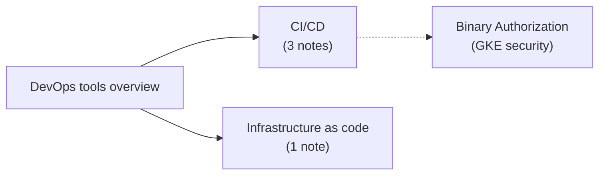

# Developer and DevOps tools

Tools for the software delivery lifecycle on Google Cloud: development, CI/CD, artifact management and infrastructure as code.

## Map of the area

## Notes and subareas in reading order

1. [DevOps tools overview](devops-tools-overview.md): the delivery pipeline and every tool in it, including Cloud Scheduler and Cloud Tasks.
2. [CI/CD](ci-cd/README.md): Artifact Registry, Cloud Build and Cloud Deploy.
3. [Infrastructure as code](infrastructure-as-code/README.md): Terraform, CFT, Cloud Foundation Fabric and Infrastructure Manager.

## Planned topics

- Cloud Code and Gemini Code Assist
- Cloud Workstations
- Firebase App Distribution and mobile CI/CD
- DORA metrics on Google Cloud
