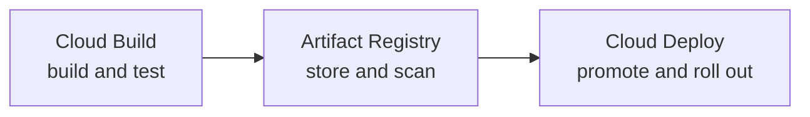

# CI/CD

Continuous integration and delivery on Google Cloud: storing artifacts, building and testing, and promoting releases through environments.

## Map of the subarea

## Notes in reading order

1. [Artifact Registry](artifact-registry.md): formats, standard, remote and virtual repositories, scanning and cleanup.
2. [Cloud Build](cloud-build.md): steps, triggers, private pools, security and an example pipeline.
3. [Cloud Deploy](cloud-deploy.md): delivery pipelines, targets, releases, rollouts, approvals and canaries.

## Planned topics

- Artifact Analysis and software supply chain security
- Secure Source Manager
- GitHub Actions with Workload Identity Federation
- Skaffold in depth
- Cloud Workstations
