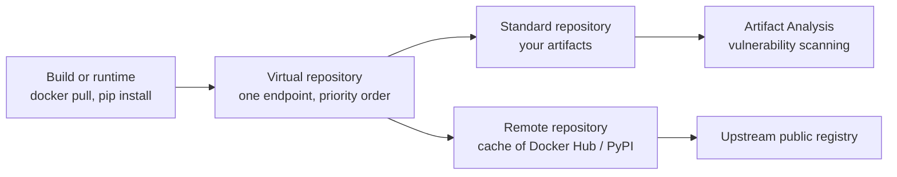

# Artifact Registry

## Summary

Artifact Registry is Google Cloud's managed service for storing and distributing build artifacts: container images, Helm charts, language packages (Maven, npm, Python, Go, and others) and generic files. Repositories are regional or multi-regional, access is controlled with IAM per repository, images are scanned for vulnerabilities by Artifact Analysis, and cleanup policies remove old artifacts. *Remote* repositories cache upstream sources such as Docker Hub or PyPI, and *virtual* repositories combine several repositories behind one endpoint. It replaces Container Registry.

## Prerequisites

- [DevOps tools overview](../devops-tools-overview.md).
- Container images, tags and digests.

## Core concepts

### Formats

Docker and OCI images, Helm charts (OCI), Maven (Java), npm (Node.js), Python (PyPI), Go modules, Apt and Yum (OS packages), Kubeflow pipeline templates and generic artifacts.

### Repository modes



- **Standard**: stores your own artifacts.
- **Remote**: proxies and caches an upstream registry, which reduces external dependency, speeds builds and allows scanning of third-party packages.
- **Virtual**: one URL that searches several repositories in a defined order, which prevents dependency confusion when internal packages take priority.

### Features

- **IAM** with predefined roles (`roles/artifactregistry.reader`, `writer`, `repoAdmin`, `admin`) at project or repository level.
- **Security.** Encryption at rest by default, CMEK, vulnerability scanning with Artifact Analysis (on push and continuously), VPC Service Controls, private access from VPC networks.
- **Locations.** Regional or multi-regional repositories, close to the build and runtime for speed and data residency.
- **CI/CD integration.** Cloud Build, Cloud Deploy, GKE, Cloud Run, Jenkins, GitHub Actions, GitLab CI.
- **Cleanup policies** delete or keep versions by age, tag state or count.
- **Binary Authorization** can require signed images from Artifact Registry before deployment.

Image path format: `LOCATION-docker.pkg.dev/PROJECT_ID/REPOSITORY/IMAGE:TAG`. The original notes show a `gcr.io` path as an example of a Docker repository; `gcr.io` belongs to Container Registry, though Artifact Registry can host `gcr.io` domains for migration.

### Artifact Registry compared with Container Registry

| Feature | Artifact Registry | Container Registry |
| --- | --- | --- |
| Formats | Containers and many package types | Containers only |
| IAM | Per repository | Per storage bucket (coarse) |
| Locations | Many regions and multi-regions | Few multi-regions |
| Scanning | Yes | Yes |
| Status | Current | Deprecated, shut down for writes in 2025 |

TODO: Verify the Container Registry shutdown date.

### Pricing

Storage per GB month (a small free tier), network egress for downloads outside the region or Google Cloud, and vulnerability scanning per image.

TODO: Record current prices.

## Worked example

Create a repository, push an image and keep storage tidy (untested):

```bash
gcloud artifacts repositories create apps --repository-format=docker \
  --location=europe-west1 --description="Application images"

gcloud auth configure-docker europe-west1-docker.pkg.dev
docker build -t europe-west1-docker.pkg.dev/PROJECT_ID/apps/web:1.4.0 .
docker push europe-west1-docker.pkg.dev/PROJECT_ID/apps/web:1.4.0

# Delete untagged images older than 30 days, keep the 10 newest versions
cat > cleanup.json <<'EOF'
[
  {"name": "delete-old-untagged", "action": {"type": "Delete"},
   "condition": {"tagState": "untagged", "olderThan": "2592000s"}},
  {"name": "keep-recent", "action": {"type": "Keep"},
   "mostRecentVersions": {"keepCount": 10}}
]
EOF
gcloud artifacts repositories set-cleanup-policies apps --location=europe-west1 \
  --policy=cleanup.json --no-dry-run

gcloud artifacts docker images list europe-west1-docker.pkg.dev/PROJECT_ID/apps \
  --show-occurrences --format="table(package,version,vuln_count)"
```

## Trade offs and when to use it

- **Use cases.** Container images for GKE and Cloud Run, internal language packages, caching public dependencies, generic build outputs.
- **Organization.** Separate repositories by artifact type or environment (`dev`, `prod`); promote artifacts between them after tests rather than rebuilding.
- **Limits.** Storage and egress costs grow without cleanup; some niche formats are not supported.

## Common mistakes

- **Pulling straight from Docker Hub in production.** Use a remote repository to cache and scan.
- **No cleanup policy.** Thousands of old images accumulate.
- **Project-wide writer roles.** Grant writer only to the CI service account on specific repositories.

## Practice

1. What problem do virtual repositories solve?
2. Write the image path for image `api`, tag `2.0`, in repository `apps` of project `shop-prod` in `europe-west1`.
3. Why use a remote repository for PyPI?

Answers: 1. One endpoint over several repositories with priority, which prevents dependency confusion. 2. `europe-west1-docker.pkg.dev/shop-prod/apps/api:2.0`. 3. To cache packages (faster, resilient to upstream outages) and scan them.

## Further reading

- [Artifact Registry overview](https://docs.cloud.google.com/artifact-registry/docs/overview), Google Cloud documentation. Formats and repository modes.
- [Cleanup policies](https://docs.cloud.google.com/artifact-registry/docs/repositories/cleanup-policy), Google Cloud documentation. Policy syntax.
- [Transition from Container Registry](https://docs.cloud.google.com/artifact-registry/docs/transition/transition-from-gcr), Google Cloud documentation. Migration and deprecation timeline.
