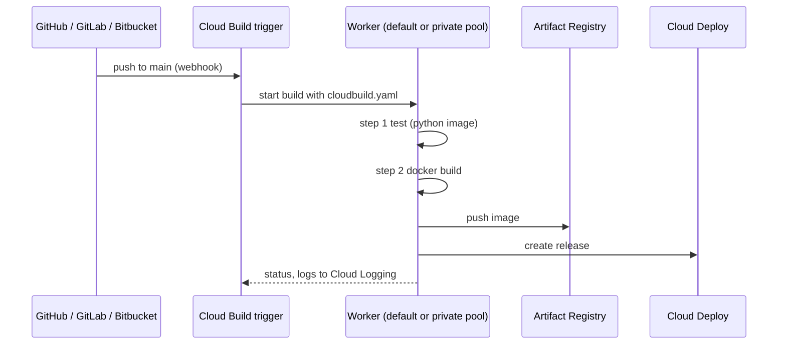

# Cloud Build

## Summary

Cloud Build is a managed service that runs builds on Google Cloud. A build is a list of *steps* defined in YAML or JSON; each step runs in a container image (a *builder*) with a shared workspace, so any language or tool can be used. Builds start from triggers on Git events, from the CLI or from the API, run on Google's default pool or on private pools inside your network, and produce artifacts such as images in Artifact Registry. Combined with Cloud Deploy it forms a complete CI/CD pipeline.

## Prerequisites

- [Artifact Registry](artifact-registry.md).
- Containers and basic CI concepts.

## Core concepts

### How a build runs



### Features

- **Fully managed.** No build servers; scaling, maintenance and updates are Google's.
- **Custom steps.** Any container image can be a step: official builders (`gcr.io/cloud-builders/docker`, `gcloud`, `kubectl`, `npm`, `mvn`, `gradle`, `python`), community builders or your own.
- **Artifacts.** Images to Artifact Registry, files to Cloud Storage, packages to language repositories.
- **Configuration.** YAML or JSON; sequential steps by default, parallel with `waitFor`.
- **Language agnostic.** Any language or framework.
- **Deployment targets.** GKE, Cloud Run, App Engine, Compute Engine, Firebase and others.
- **Security.** Private pools for isolated builds with access to private networks; dedicated service accounts per trigger; Secret Manager integration; SLSA build provenance; encryption at rest and in transit, CMEK; vulnerability scanning through Artifact Analysis.

### Triggers and integration

- **Events.** Pushes to branches, tags, pull requests; also Pub/Sub messages, webhooks and manual triggers.
- **Repositories.** GitHub and GitHub Enterprise, GitLab, Bitbucket Cloud and Data Center, Cloud Source Repositories (legacy).
- **Approvals.** Builds can require manual approval before they run.

### Pricing

Builds are billed per build minute by machine type, with a monthly free allowance on the default pool; private pools are billed separately. The original notes record 120 free build minutes per day and 0.003 USD per minute for standard machines; Google has since changed the free tier and prices.

TODO: Record current pricing with a check date.

### Comparison

| Feature | Cloud Build | Jenkins | GitHub Actions |
| --- | --- | --- | --- |
| Type | Managed CI/CD | Self-hosted | GitHub-integrated |
| Scaling | Automatic | Manual (agents) | Automatic (hosted runners) |
| Google Cloud integration | Native IAM, private pools, provenance | Plugins | Workload Identity Federation actions |
| Operations | None | High | Low |

## Worked example

`cloudbuild.yaml` for a Python service on Cloud Run (untested):

```yaml
steps:
- id: test
  name: python:3.12
  entrypoint: bash
  args: ["-c", "pip install -r requirements.txt && pytest -q"]

- id: build
  name: gcr.io/cloud-builders/docker
  args: ["build", "-t", "europe-west1-docker.pkg.dev/$PROJECT_ID/apps/orders-api:$SHORT_SHA", "."]

- id: push
  name: gcr.io/cloud-builders/docker
  args: ["push", "europe-west1-docker.pkg.dev/$PROJECT_ID/apps/orders-api:$SHORT_SHA"]

- id: release
  name: gcr.io/google.com/cloudsdktool/cloud-sdk
  entrypoint: gcloud
  args: ["deploy", "releases", "create", "rel-$SHORT_SHA",
         "--delivery-pipeline=orders-api", "--region=europe-west1",
         "--images=orders-api=europe-west1-docker.pkg.dev/$PROJECT_ID/apps/orders-api:$SHORT_SHA"]

images: ["europe-west1-docker.pkg.dev/$PROJECT_ID/apps/orders-api:$SHORT_SHA"]
serviceAccount: projects/$PROJECT_ID/serviceAccounts/ci-orders@$PROJECT_ID.iam.gserviceaccount.com
options:
  logging: CLOUD_LOGGING_ONLY
  requestedVerifyOption: VERIFIED   # generate SLSA provenance
```

```bash
gcloud builds triggers create github --name=orders-main \
  --repo-owner=example-org --repo-name=orders-api --branch-pattern='^main$' \
  --build-config=cloudbuild.yaml --region=europe-west1 \
  --service-account=projects/PROJECT_ID/serviceAccounts/ci-orders@PROJECT_ID.iam.gserviceaccount.com
```

The `test` step fails the build before any image is pushed; `SHORT_SHA` ties each image to a commit.

## Trade offs and when to use it

- **Use cases.** Container builds for GKE and Cloud Run, multi-language pipelines, hybrid deployments, compliance checks and scans in CI, mobile builds.
- **Advantages.** No infrastructure, automatic scaling, flexible steps, native integration and security features, real-time logs.
- **Limits.** Free allowance is small for very frequent builds; YAML configuration has a learning curve; tight coupling to Google Cloud.
- **Best practices.** Parallel steps and caching (Kaniko or Docker layer cache) for speed; private pools for sensitive builds; least privilege service accounts; tests in every pipeline; Cloud Deploy for progressive delivery; monitor build duration in Cloud Monitoring.

## Common mistakes

- **Using the legacy default Cloud Build service account**, which had broad project permissions.
- **Secrets as substitution variables**; use `availableSecrets` with Secret Manager.
- **Building the same image again for each environment** instead of promoting one digest.

## Practice

1. How do two steps run in parallel in Cloud Build?
2. Where should a deploy key for a private dependency come from?
3. Why tag images with the commit SHA?

Answers: 1. Give both steps `waitFor: ['-']` (or the same dependency) so they do not wait for each other. 2. Secret Manager, referenced in `availableSecrets`. 3. To trace every image to its exact source and avoid mutable tags.

## Further reading

- [Cloud Build overview](https://docs.cloud.google.com/build/docs/overview), Google Cloud documentation. Builds, steps and triggers.
- [Build configuration file schema](https://docs.cloud.google.com/build/docs/build-config-file-schema), Google Cloud documentation. All fields.
- [Private pools overview](https://docs.cloud.google.com/build/docs/private-pools/private-pools-overview), Google Cloud documentation. Isolated builds with private networking.
- [SLSA](https://slsa.dev/), OpenSSF. Supply chain levels and provenance.
