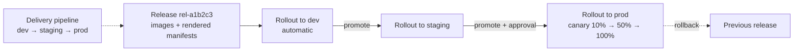

# Cloud Deploy

## Summary

Cloud Deploy is a managed continuous delivery service. A *delivery pipeline* defines an ordered list of *targets* (environments such as dev, staging and prod, each a GKE cluster, Cloud Run service location, attached cluster or custom target). A *release* captures the images and rendered manifests of one version, and a *rollout* deploys a release to one target. Releases are promoted from target to target, optionally after an approval, with canary or blue-green strategies, and can be rolled back. Rendering and deployment use Skaffold, so the same configuration works locally and in the pipeline.

## Prerequisites

- [Cloud Build](cloud-build.md) and [Artifact Registry](artifact-registry.md).
- Kubernetes manifests, Kustomize or Helm, or Cloud Run service YAML.

## Core concepts

### Resource model



- **Delivery pipeline.** The release process: an ordered progression of targets with deployment strategies per stage.
- **Target.** Where a release is deployed: GKE cluster, Cloud Run location, GKE attached cluster, or a custom target (any tool through a container).
- **Release.** An immutable version: image references and rendered configuration.
- **Rollout.** One deployment of a release to one target, with phases and jobs; tracks progress and result.
- **Approvals.** A target can require approval before rollout; integrates with IAM (`roles/clouddeploy.approver`).
- **Automation.** Rules for automatic promotion and phase advancement after conditions (for example time or verification success).
- **Verification.** Run tests in a container after deployment; failure stops the rollout.

### Features

- Managed CD with a single view across environments.
- Kubernetes support through Skaffold with Kustomize, Helm or plain manifests; Cloud Run support with service YAML.
- Canary (by percentage, with service mesh or Gateway API for GKE) and blue-green strategies.
- Rollback to a previous release in one command.
- Integration with Cloud Build, Artifact Registry, Cloud Logging, Cloud Monitoring and Pub/Sub notifications.
- IAM for who can create releases, promote and approve; private targets.

### Pricing

Charged per active delivery pipeline per month, with a free allowance; related services (Cloud Build, Artifact Registry) are billed separately.

TODO: Record current pricing.

### Cloud Deploy compared with Cloud Build

| Feature | Cloud Deploy | Cloud Build |
| --- | --- | --- |
| Purpose | Continuous delivery | Continuous integration |
| Focus | Multi-environment deployment | Building and testing |
| Targets | GKE, Cloud Run, attached clusters, custom | General purpose |
| Approval gates | Built in | Manual approval of builds only |

## Worked example

`clouddeploy.yaml` for a Cloud Run service with a canary in production (untested):

```yaml
apiVersion: deploy.cloud.google.com/v1
kind: DeliveryPipeline
metadata:
  name: orders-api
serialPipeline:
  stages:
  - targetId: dev
  - targetId: staging
  - targetId: prod
    strategy:
      canary:
        runtimeConfig:
          cloudRun:
            automaticTrafficControl: true
        canaryDeployment:
          percentages: [10, 50]
          verify: true
---
apiVersion: deploy.cloud.google.com/v1
kind: Target
metadata:
  name: prod
requireApproval: true
run:
  location: projects/PROJECT_ID/locations/europe-west1
```

```bash
gcloud deploy apply --file=clouddeploy.yaml --region=europe-west1
gcloud deploy releases promote --release=rel-a1b2c3 --delivery-pipeline=orders-api --region=europe-west1
gcloud deploy rollouts approve rel-a1b2c3-to-prod-0001 --release=rel-a1b2c3 \
  --delivery-pipeline=orders-api --region=europe-west1
```

Workflow: define the pipeline, create a release from CI, deploy to dev, promote through staging, approve prod, watch the canary phases, then advance or roll back.

## Trade offs and when to use it

- **Use cases.** Delivery of containerized apps to GKE and Cloud Run, multi-environment promotion with approval gates, progressive delivery, fast rollbacks, auditable deployment processes.
- **Advantages.** Managed, consistent promotion across environments, built-in approvals and rollbacks, visibility.
- **Limits.** Targets other than GKE and Cloud Run need custom targets; Skaffold and YAML have a learning curve.
- **Best practices.** One pipeline per application; all environments in the pipeline; tests and verification before promotion; IAM separation between releasers and approvers; configurations in Git.

## Common mistakes

- **Rebuilding images per environment.** A release must carry the same digest through all targets.
- **Approvers who are also authors** of the change, defeating the gate.
- **No verification step**, so canaries are promoted on time alone.

## Practice

1. What is the difference between a release and a rollout?
2. How do you require a human approval before production?
3. Why is the image digest fixed in a release?

Answers: 1. A release is an immutable version; a rollout is its deployment to one target. 2. Set `requireApproval: true` on the production target and grant `roles/clouddeploy.approver` to approvers. 3. So that exactly the tested artifact reaches production.

## Further reading

- [Cloud Deploy overview](https://docs.cloud.google.com/deploy/docs/overview), Google Cloud documentation. Concepts and supported targets.
- [Deployment strategies](https://docs.cloud.google.com/deploy/docs/deployment-strategies), Google Cloud documentation. Canary and blue-green.
- [Skaffold documentation](https://skaffold.dev/docs/), Skaffold project. Rendering and deployment.
