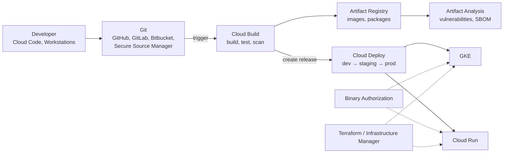

# DevOps tools overview

## Summary

Google Cloud provides tools for the whole DevOps lifecycle: writing code (Cloud Code, Cloud Workstations), continuous integration (Cloud Build), artifact management (Artifact Registry), continuous delivery (Cloud Deploy, Skaffold), infrastructure as code (Terraform, Infrastructure Manager, Config Connector) and supporting services for scheduling and asynchronous work (Cloud Scheduler, Cloud Tasks). The typical pipeline is Git, Cloud Build, Artifact Registry and Cloud Deploy, with security checks (scanning, Binary Authorization, secrets in Secret Manager) built into each step.

## Prerequisites

- [Google Cloud overview](../foundations/google-cloud-overview.md).
- CI/CD and Git basics.

## Core concepts

### Goals

Faster development and release cycles, reliability and reproducibility, enforced policy and security compliance (DevSecOps), and scalable infrastructure automation.

### The delivery pipeline

Read from left to right: code becomes an image in Cloud Build, is stored and scanned in Artifact Registry, and is promoted through environments by Cloud Deploy; Binary Authorization guards the runtime, and Terraform provisions the infrastructure underneath.

### Tools

**Cloud Build.** Managed CI/CD: builds, tests and deployments defined in YAML, steps run in containers, triggers on Git events from GitHub, GitLab and Bitbucket, private pools for isolated builds with private network access, integration with Binary Authorization. See [Cloud Build](ci-cd/cloud-build.md).

**Artifact Registry.** Central repository for container images, Helm charts, Maven, npm, Python, Go and other packages; regional and multi-regional repositories; IAM per repository; vulnerability scanning; remote and virtual repositories. It replaces Container Registry (`gcr.io`), which is deprecated. See [Artifact Registry](ci-cd/artifact-registry.md).

**Cloud Deploy.** Managed continuous delivery to GKE, Cloud Run, GKE attached clusters and custom targets, with promotion across environments, approvals, rollbacks, canary strategies and Skaffold-based rendering. See [Cloud Deploy](ci-cd/cloud-deploy.md).

**Skaffold.** Open source CLI for Kubernetes development: watch mode with automatic rebuild and redeploy, works with Docker, Cloud Build and Kubernetes manifests; used by Cloud Deploy to render and deploy.

**Cloud Source Repositories.** Google-hosted private Git repositories with IAM and mirroring from GitHub or Bitbucket. Closed to new customers since 2024; Secure Source Manager is the newer managed Git service.

TODO: Verify Cloud Source Repositories status and Secure Source Manager features.

**Cloud Code.** IDE extensions for VS Code and JetBrains IDEs to develop, debug and deploy to GKE and Cloud Run, with YAML editing and integrated logs; also includes Gemini Code Assist integration.

**Cloud Scheduler.** Managed cron: triggers HTTP endpoints, Pub/Sub topics or other targets on a schedule, with retries, monitoring and time zones; authenticates with service accounts. Use for nightly jobs, cleanups and timed pipeline steps.

**Cloud Tasks.** Asynchronous task queues that dispatch HTTP tasks to Cloud Run, App Engine or any endpoint, with rate limits, retries with backoff, scheduling and deduplication. Use to offload long work, protect downstream services from overload and decouple services. It also belongs to [integration services](../integration-and-apis/integration-services-overview.md).

**Firebase App Distribution.** Distributes pre-release mobile builds to testers by email or link; integrates with Cloud Build and GitHub Actions; together with Crashlytics closes the feedback loop for mobile DevOps.

### Summary table

| Product | Type | Use case | Notes for DevOps and architects |
| --- | --- | --- | --- |
| Cloud Build | CI | Build, test, deploy | Private pools, Git triggers |
| Cloud Deploy | CD | Promote releases to GKE and Cloud Run | Progressive delivery, approvals |
| Artifact Registry | Artifact storage | Images, packages, charts | IAM, scanning, cleanup policies |
| Skaffold | Dev workflow | Local to cloud Kubernetes loop | Used by Cloud Deploy |
| Cloud Source Repositories | Git hosting | Legacy GCP-native repos | Closed to new customers |
| Cloud Code | IDE plugin | Develop and deploy from the IDE | GKE and Cloud Run |
| Cloud Scheduler | Cron | Scheduled jobs and triggers | IAM, retries, logs |
| Cloud Tasks | Task queue | Async HTTP work | Rate limits, dead-lettering via retries |
| Firebase App Distribution | Mobile testing | Pre-release builds | CI integration |

## Worked example

A full pipeline for a Cloud Run service: a push to `main` triggers Cloud Build, which runs unit tests, builds the image with the commit SHA as tag, pushes it to Artifact Registry, waits for the vulnerability scan, and creates a Cloud Deploy release; Cloud Deploy deploys to `dev` automatically, to `staging` after promotion, and to `prod` after an approval, with a 10 percent canary phase. Secrets come from Secret Manager, every step runs with its own service account, and audit logs record who approved the production rollout.

## Trade offs and when to use it

- Native tools integrate well with IAM, logging and Google Cloud targets; GitHub Actions or GitLab CI with Workload Identity Federation are equally valid when teams already use them.
- Combine Cloud Build, Artifact Registry and Cloud Deploy for a fully managed CI/CD path.
- Use Cloud Tasks with Cloud Run to decouple workloads; enforce IAM, Secret Manager and audit logs in all build and deploy workflows.

## Common mistakes

- **Building on the default Cloud Build service account** with broad permissions; use a dedicated one per trigger.
- **Mutable tags in production** (`latest`); deploy by digest.
- **Secrets in build configs**; reference Secret Manager.

## Practice

1. Which service replaces Container Registry?
2. Which tool promotes a release from staging to production with an approval?
3. When would you use Cloud Tasks instead of calling a service directly?

Answers: 1. Artifact Registry. 2. Cloud Deploy. 3. When work can be done asynchronously and the target must be protected with rate limits and retries.

## Further reading

- [Software delivery on Google Cloud](https://cloud.google.com/solutions/software-delivery), Google Cloud. Overview of the DevOps tools.
- [DORA research](https://dora.dev/), DORA. Evidence on software delivery performance.
- [Cloud Tasks overview](https://docs.cloud.google.com/tasks/docs/dual-overview), Google Cloud documentation. Queues and dispatch.
- [Cloud Scheduler overview](https://docs.cloud.google.com/scheduler/docs/overview), Google Cloud documentation. Cron jobs and targets.
