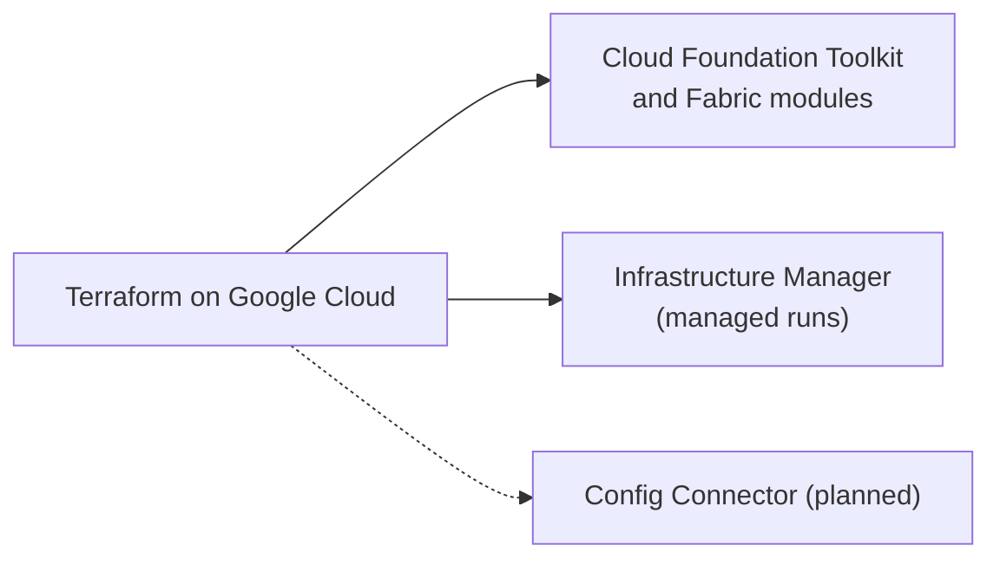

# Infrastructure as code

Describing Google Cloud infrastructure in code and applying it repeatably: Terraform, Google's module libraries, Infrastructure Manager and Kubernetes-style alternatives.

## Map of the subarea

## Notes in reading order

1. [Terraform on Google Cloud](terraform-on-google-cloud.md): provider, state, CFT, Cloud Foundation Fabric, Infrastructure Manager and alternatives.

## Planned topics

- Terraform state and backends in depth
- Landing zone with the enterprise foundations blueprint
- Config Connector and Config Controller
- Policy validation with `gcloud beta terraform vet`
- Migrating from Deployment Manager
