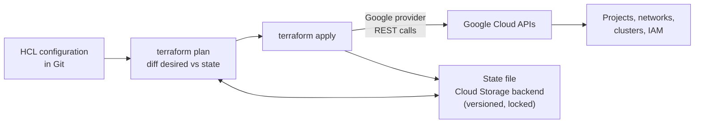

# Terraform on Google Cloud

## Summary

Terraform is an infrastructure as code (IaC) tool: you describe Google Cloud resources in declarative configuration files (HCL), and Terraform calls the Google Cloud APIs to make reality match the description. The Google provider covers almost every Google Cloud service. Google maintains reusable modules and blueprints in the Cloud Foundation Toolkit (CFT) and Cloud Foundation Fabric, and offers Infrastructure Manager, a managed service that runs Terraform for you. Terraform is the most common way to build repeatable landing zones and project setups on Google Cloud.

## Prerequisites

- [Resource hierarchy](../../foundations/resource-hierarchy.md) and [IAM](../../security-and-identity/identity-and-access/iam.md).
- Basic Terraform concepts: provider, resource, module, state, plan, apply.

## Core concepts

### How Terraform works with Google Cloud



- **Provider.** `hashicorp/google` (and `google-beta` for preview features) translates resources into API calls, authenticating with Application Default Credentials or impersonation.
- **State.** Terraform records what it manages; on Google Cloud the state is usually kept in a Cloud Storage bucket with versioning (the `gcs` backend supports locking).
- **Plan and apply.** `plan` shows the difference between configuration and state; `apply` executes it.

### Tools and resources

- **Terraform Registry.** The hub for providers and modules, including verified modules from Google (`terraform-google-modules`) and examples.
- **Cloud Foundation Toolkit (CFT).** Google's Terraform modules (blueprints) that follow Google Cloud best practices for projects, networks, IAM, GKE, Cloud SQL and more; used to build repeatable foundations. Example: manage IAM bindings across several projects in one module.
- **Cloud Foundation Fabric (CFF).** A repository of composable modules and end-to-end blueprints (networking, IAM, data platforms, landing zones), designed for fast prototyping and for adapting into production code.
- **Infrastructure Manager.** A managed service that runs Terraform (plan, apply, state storage, previews) with Cloud Build, so you do not maintain your own runner. It manages infrastructure, not application deployment; use Cloud Build or Cloud Deploy for apps.
- **Policy validation.** `gcloud beta terraform vet` checks a plan against the same policy library used by CFT Scorecard. See [CFT Scorecard](../../security-and-identity/threat-detection-and-posture/cft-scorecard.md).

### Alternatives

- **Deployment Manager**, Google's original IaC service with YAML and Jinja or Python templates, is deprecated; migrate to Terraform or Infrastructure Manager.
- **Config Connector** manages Google Cloud resources as Kubernetes objects (KRM), often with Config Sync; Config Controller is its managed hosting. Best for teams standardized on Kubernetes tooling.
- **Pulumi** uses general-purpose languages with the same Google provider underneath.

TODO: Verify the Deployment Manager end of support date.

## Worked example

Multi-project IAM bindings with a CFT module (version placeholder; untested):

```hcl
terraform {
  backend "gcs" {
    bucket = "example-tf-state"
    prefix = "iam/prod"
  }
  required_providers {
    google = { source = "hashicorp/google", version = "~> 6.0" }
  }
}

module "iam_bindings" {
  source   = "terraform-google-modules/iam/google//modules/projects_iam"
  version  = "X.Y.Z"
  projects = ["project-one", "project-two"]
  mode     = "additive"

  bindings = {
    "roles/compute.networkUser" = [
      "group:network-users@example.com",
    ]
    "roles/appengine.appAdmin" = [
      "group:app-admins@example.com",
    ]
  }
}
```

`mode = "additive"` adds these bindings without removing others; `authoritative` would make Terraform the only owner of those roles, removing anything not in the code. Grants go to groups, not individual users.

Running the same configuration with Infrastructure Manager:

```bash
gcloud infra-manager deployments apply projects/PROJECT_ID/locations/europe-west1/deployments/iam-prod \
  --service-account=projects/PROJECT_ID/serviceAccounts/infra-manager@PROJECT_ID.iam.gserviceaccount.com \
  --local-source=./iam
```

## Trade offs and when to use it

- **Terraform** is the de facto standard, with a large ecosystem and multi-cloud reach; state management and drift need discipline.
- **Infrastructure Manager** removes runner maintenance and keeps state in Google Cloud, at the cost of less flexibility than a self-built pipeline.
- **Config Connector** fits GitOps on Kubernetes but adds a cluster as a dependency.
- Modules speed up work but hide details; pin versions and review upgrades.

## Common mistakes

- **Local state files.** Use a remote, versioned and locked backend.
- **Authoritative IAM resources by accident** (`google_project_iam_policy`), which remove bindings created outside Terraform, sometimes including Google service agents.
- **Long-lived service account keys** for Terraform; use impersonation or Workload Identity Federation in CI.
- **Unpinned provider and module versions.**

## Practice

1. Where should Terraform state live on Google Cloud, and why?
2. What is the difference between additive and authoritative IAM management?
3. What does Infrastructure Manager not do?

Answers: 1. In a versioned Cloud Storage bucket with the `gcs` backend, for sharing, locking and history. 2. Additive adds bindings and leaves others; authoritative makes the code the full truth and removes the rest. 3. It does not deploy applications; it manages infrastructure with Terraform.

## Further reading

- [Terraform on Google Cloud](https://docs.cloud.google.com/docs/terraform), Google Cloud documentation. Getting started, best practices and blueprints.
- [Best practices for using Terraform](https://docs.cloud.google.com/docs/terraform/best-practices/general-style-structure), Google Cloud documentation. Style, structure and state.
- [Cloud Foundation Fabric](https://github.com/GoogleCloudPlatform/cloud-foundation-fabric), Google Cloud on GitHub. Modules and blueprints.
- [Infrastructure Manager overview](https://docs.cloud.google.com/infrastructure-manager/docs/overview), Google Cloud documentation. Managed Terraform runs.
