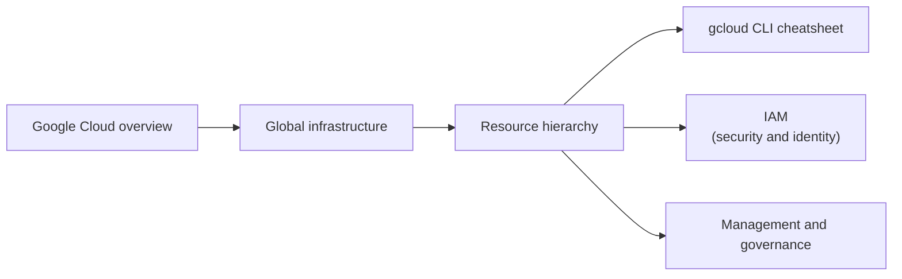

# Foundations

What every other area assumes: what Google Cloud is, where it runs, how resources are organized and which tools are used to work with it.

## Map of the area

Read the notes from left to right. The resource hierarchy leads into IAM and into governance, which have their own areas.

## Notes in reading order

1. [Google Cloud overview](google-cloud-overview.md): product categories, service models and the level of control.
2. [Global infrastructure](global-infrastructure.md): regions, zones, points of presence and resource scope.
3. [Resource hierarchy](resource-hierarchy.md): organization, folders, projects, resources and policy inheritance.
4. [gcloud CLI cheatsheet](gcloud-cli-cheatsheet.md): commands from labs grouped by task.

## Planned topics

- Shared responsibility model
- Google Cloud Architecture Framework
- Ways to access Google Cloud (console, Cloud Shell, APIs, client libraries)
- Pricing model and free tier
- Landing zones and the enterprise foundations blueprint
- Google Cloud certifications and exam guides
