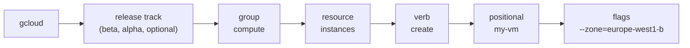

# gcloud CLI cheatsheet

## Summary

The Google Cloud CLI (`gcloud`, plus `gcloud storage`, `bq` and `kubectl`) is the main command line tool for Google Cloud. This note collects commands used in labs for configuration, IAM, networking, VMs, Cloud IDS, Cloud KMS and Cloud Storage, grouped by task. It is a lookup sheet; each command links to the note that explains the concept behind it.

## Prerequisites

- An installed and initialized Google Cloud CLI (`gcloud init`) or Cloud Shell.
- [Resource hierarchy](resource-hierarchy.md) for projects, and [IAM](../security-and-identity/identity-and-access/iam.md) for roles.

## Core concepts

Every `gcloud` command follows the same grammar: a release track (optional), a service group, a resource, a verb and flags.



Knowing the grammar makes most commands guessable: `gcloud compute firewall-rules list`, `gcloud run services describe`, `gcloud iam roles create`.

Placeholders used below: `PROJECT_ID` is the project ID, `$DEVSHELL_PROJECT_ID` is set automatically in Cloud Shell. Commands come from lab work and were not re-run for this note.

TODO: Re-run each block against a sandbox project and record the gcloud version.

### Basics

```bash
# Variables used in later commands
export my_region=us-west1
export my_cluster=autopilot-cluster-1

# kubectl autocompletion in bash
source <(kubectl completion bash)

# Active account and project
gcloud auth list
gcloud config list project

# Fetch credentials for a GKE cluster into kubeconfig
gcloud container clusters get-credentials "$my_cluster" --region "$my_region"
```

### IAM custom roles

See [IAM](../security-and-identity/identity-and-access/iam.md#role-types).

```bash
gcloud iam roles list --project "$DEVSHELL_PROJECT_ID"
gcloud iam roles describe app_viewer --project "$DEVSHELL_PROJECT_ID"
gcloud iam roles create app_viewer --project "$DEVSHELL_PROJECT_ID" --file role.yaml
gcloud iam roles update app_viewer --project "$DEVSHELL_PROJECT_ID" --file update-role.yaml
gcloud iam roles update app_viewer --project "$DEVSHELL_PROJECT_ID" --stage DISABLED
gcloud iam roles delete app_viewer --project "$DEVSHELL_PROJECT_ID"
gcloud iam roles list --project "$DEVSHELL_PROJECT_ID" --show-deleted
gcloud iam roles undelete app_viewer --project "$DEVSHELL_PROJECT_ID"

# Permissions that can be used in custom roles on this project
gcloud iam list-testable-permissions //cloudresourcemanager.googleapis.com/projects/$DEVSHELL_PROJECT_ID
# Roles that can be granted on this project
gcloud iam list-grantable-roles //cloudresourcemanager.googleapis.com/projects/$DEVSHELL_PROJECT_ID
```

`role.yaml`:

```yaml
title: App Viewer
description: Custom role to view apps
stage: ALPHA
includedPermissions:
- compute.instances.get
- compute.instances.list
- appengine.versions.get
- appengine.versions.list
```

### Service accounts

See [service accounts](../security-and-identity/identity-and-access/service-accounts.md).

```bash
gcloud iam service-accounts create my-sa-123 --display-name "my service account"

# Grant a narrow predefined role, not roles/editor, outside of labs
gcloud projects add-iam-policy-binding "$DEVSHELL_PROJECT_ID" \
  --member "serviceAccount:my-sa-123@$DEVSHELL_PROJECT_ID.iam.gserviceaccount.com" \
  --role roles/storage.objectViewer
```

### VPC networks, firewall and NAT

See [VPC networks](../networking/vpc/vpc-networks.md), [VPC firewall](../networking/vpc/vpc-firewall.md) and [VPC Flow Logs](../networking/vpc/vpc-flow-logs.md).

```bash
gcloud compute networks create mynetwork --subnet-mode=auto
gcloud compute networks create privatenet --subnet-mode=custom
gcloud compute networks subnets create privatesubnet \
  --network=privatenet --region=europe-west1 \
  --range=10.0.0.0/24 --enable-private-ip-google-access

# Ingress SSH only from one source range, only to tagged VMs
gcloud compute firewall-rules create mynetwork-ingress-allow-ssh-from-cs \
  --network mynetwork --action ALLOW --direction INGRESS \
  --rules tcp:22 --source-ranges "$ip" --target-tags=lab-ssh

# SSH through Identity-Aware Proxy TCP forwarding (IAP source range)
gcloud compute firewall-rules create allow-iap-proxy \
  --direction=INGRESS --priority=1000 --network=cloud-ids \
  --action=ALLOW --rules=tcp:22 --source-ranges=35.235.240.0/20

# VPC Flow Logs on a subnet
gcloud compute networks subnets update default --region us-central1 \
  --enable-flow-logs --logging-metadata=include-all
gcloud compute networks subnets update default --region europe-west1 \
  --no-enable-flow-logs

# Cloud Router and Cloud NAT for VMs without external IPs
gcloud compute routers create cr-cloud-ids-useast1 --region=us-east1 --network=cloud-ids
gcloud compute routers nats create nat-cloud-ids-useast1 \
  --router=cr-cloud-ids-useast1 --router-region=us-east1 \
  --auto-allocate-nat-external-ips --nat-all-subnet-ip-ranges
```

### Private services access

Reserve a range and peer it with Google's service producer network (used by Cloud SQL, Memorystore, Cloud IDS).

```bash
gcloud services enable servicenetworking.googleapis.com --project="$PROJECT_ID"
gcloud compute addresses create cloud-ids-ips --global --purpose=VPC_PEERING \
  --addresses=10.10.10.0 --prefix-length=24 --network=cloud-ids
gcloud services vpc-peerings connect --service=servicenetworking.googleapis.com \
  --ranges=cloud-ids-ips --network=cloud-ids --project="$PROJECT_ID"
```

### VMs

```bash
gcloud compute instances create default-vm-1 \
  --machine-type e2-micro --zone=europe-west1-d --network=default
gcloud compute instances add-tags mynet-vm-1 --zone europe-west1-d --tags lab-ssh
```

### Cloud IDS and Packet Mirroring

See [Cloud IDS](../security-and-identity/threat-detection-and-posture/cloud-ids.md).

```bash
gcloud services enable ids.googleapis.com --project="$PROJECT_ID"
gcloud ids endpoints create cloud-ids-east1 --network=cloud-ids \
  --zone=us-east1-b --severity=INFORMATIONAL --async
gcloud ids endpoints list --project="$PROJECT_ID"

export FORWARDING_RULE=$(gcloud ids endpoints describe cloud-ids-east1 \
  --zone=us-east1-b --format="value(endpointForwardingRule)")
gcloud compute packet-mirrorings create cloud-ids-packet-mirroring \
  --region=us-east1 --collector-ilb="$FORWARDING_RULE" \
  --network=cloud-ids --mirrored-subnets=cloud-ids-useast1
gcloud compute packet-mirrorings list
```

### Cloud KMS

```bash
gcloud kms keyrings create "$KEYRING_NAME" --location asia-south1
gcloud kms keys create "$CRYPTOKEY_1_NAME" --location asia-south1 \
  --keyring "$KEYRING_NAME" --purpose encryption

# Encrypt and decrypt through the REST API; plaintext must be base64
curl "https://cloudkms.googleapis.com/v1/projects/$DEVSHELL_PROJECT_ID/locations/asia-south1/keyRings/$KEYRING_NAME/cryptoKeys/$CRYPTOKEY_1_NAME:encrypt" \
  -d "{\"plaintext\":\"$PLAIN_TEXT\"}" \
  -H "Authorization:Bearer $(gcloud auth application-default print-access-token)" \
  -H "Content-Type: application/json"

curl "https://cloudkms.googleapis.com/v1/projects/$DEVSHELL_PROJECT_ID/locations/asia-south1/keyRings/$KEYRING_NAME/cryptoKeys/$CRYPTOKEY_1_NAME:decrypt" \
  -d "{\"ciphertext\":\"$(cat data1.encrypted)\"}" \
  -H "Authorization:Bearer $(gcloud auth application-default print-access-token)" \
  -H "Content-Type: application/json" \
  | jq .plaintext -r | base64 -d > data1.decrypted
```

### Cloud Storage with CMEK

`gsutil` is the legacy tool; `gcloud storage` is the current one. Both forms are shown.

TODO: Verify the `gcloud storage` equivalents in a sandbox.

```bash
# Show the default KMS key of a bucket
gsutil kms encryption gs://$DEVSHELL_PROJECT_ID-kms
gcloud storage buckets describe gs://$DEVSHELL_PROJECT_ID-kms --format="value(default_kms_key)"

# Let the Cloud Storage service agent use the key
gsutil kms authorize -p "$DEVSHELL_PROJECT_ID" \
  -k "projects/$DEVSHELL_PROJECT_ID/locations/asia-south1/keyRings/$KEYRING_NAME/cryptoKeys/$CRYPTOKEY_1_NAME"

# Set the default key of a bucket
gsutil kms encryption \
  -k "projects/$DEVSHELL_PROJECT_ID/locations/asia-south1/keyRings/$KEYRING_NAME/cryptoKeys/$CRYPTOKEY_1_NAME" \
  gs://$DEVSHELL_PROJECT_ID-kms
gcloud storage buckets update gs://$DEVSHELL_PROJECT_ID-kms \
  --default-encryption-key="projects/$DEVSHELL_PROJECT_ID/locations/asia-south1/keyRings/$KEYRING_NAME/cryptoKeys/$CRYPTOKEY_1_NAME"

# Upload one object with a different key
gsutil -o "GSUtil:encryption_key=projects/$DEVSHELL_PROJECT_ID/locations/asia-south1/keyRings/$KEYRING_NAME/cryptoKeys/$CRYPTOKEY_2_NAME" \
  cp file3.txt gs://$DEVSHELL_PROJECT_ID-kms
```

## Worked example

TODO: Add an end to end lab: create a custom VPC, a subnet with Private Google Access, an IAP SSH firewall rule, a VM without external IP and Cloud NAT, then connect with `gcloud compute ssh --tunnel-through-iap`, with the real output.

## Trade offs and when to use it

- `gcloud` is best for exploration and one-off tasks. Repeatable infrastructure belongs in Terraform (see [Terraform on Google Cloud](../developer-and-devops-tools/infrastructure-as-code/terraform-on-google-cloud.md)).
- Lab commands often grant `roles/editor` or open `0.0.0.0/0`. Do not copy them into production.

## Common mistakes

- **Wrong active project.** Run `gcloud config list` before destructive commands.
- **`--zone` versus `--region`.** Zonal resources need a zone, regional resources a region.
- **Confusing `gcloud auth login` and `gcloud auth application-default login`.** The first authenticates the CLI, the second creates credentials for client libraries. See [authentication to Google Cloud APIs](../security-and-identity/identity-and-access/authentication-to-google-cloud-apis.md).

## Practice

1. Write the command that lists firewall rules in the current project.
2. Which source range must a firewall rule allow for IAP TCP forwarding?
3. Which command sets a bucket's default encryption key with the current CLI?

Answers: 1. `gcloud compute firewall-rules list`. 2. `35.235.240.0/20`. 3. `gcloud storage buckets update gs://BUCKET --default-encryption-key=KEY_NAME`.

## Further reading

- [gcloud CLI reference](https://docs.cloud.google.com/sdk/gcloud/reference), Google Cloud documentation. The full command reference.
- [gcloud CLI cheat sheet](https://docs.cloud.google.com/sdk/docs/cheatsheet), Google Cloud documentation. Google's own one page summary.
- [Using IAP for TCP forwarding](https://docs.cloud.google.com/iap/docs/using-tcp-forwarding), Google Cloud documentation. Source of the `35.235.240.0/20` range.
