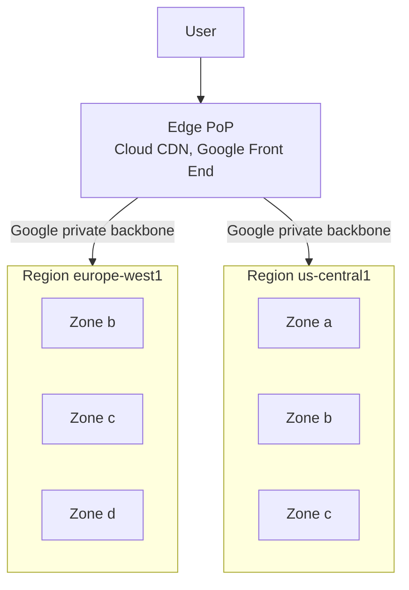

# Global infrastructure

## Summary

Google Cloud runs in *regions* (independent geographic areas) that are split into *zones* (isolated failure domains inside a region). Regions are connected by Google's private fiber network, which reaches users through edge points of presence (PoPs) around the world. Every resource is global, regional or zonal, and that scope decides how it fails and how you make it highly available. A design that spreads a workload across zones survives a zone outage; a design across regions survives a regional one.

## Prerequisites

- [Google Cloud overview](google-cloud-overview.md).
- Basic networking: IP addresses, LAN and WAN, latency.

## Core concepts

### Regions, zones and points of presence

- **Region.** An independent geographic area, for example `europe-west1` (Belgium) or `us-central1` (Iowa). Most regions have three zones. Choosing a region is a decision about latency to users, data residency, price and which products and machine types are available there.
- **Zone.** A deployment area inside a region, for example `europe-west1-b`. A zone is a single failure domain. Zones in a region are connected by low latency links.
- **Multi-region and dual-region.** Some services (Cloud Storage, BigQuery, Spanner, Firestore) can store data in a set of regions, such as `EU` or `US`, and replicate it for you.
- **Edge points of presence (PoPs).** Places where Google's network connects to the internet and to other networks. User traffic enters the Google network at the PoP closest to the user. Cloud CDN caches content there.

The number of regions, zones and PoPs grows every year. Check the current list on the [locations page](https://cloud.google.com/about/locations) instead of memorizing a number.

TODO: Record the current counts with a check date.

The diagram shows the path of a request: it enters Google's network at the nearest PoP and then travels on the private backbone, not on the public internet, to the region that hosts the backend.

### Resource scope

| Scope | Examples | Fails when |
| --- | --- | --- |
| Global | VPC network, firewall rules, global external Application Load Balancer, IAM policies, images | Rare, global control plane incidents |
| Regional | Subnet, regional managed instance group, Cloud Run service, regional Cloud SQL (HA), regional persistent disk | The region is unavailable |
| Zonal | VM instance, zonal persistent disk, zonal GKE cluster control plane | The zone is unavailable |
| Multi-regional | Cloud Storage `EU` bucket, multi-region Spanner instance, BigQuery `US` dataset | Very rare, designed to survive a region loss |

*Analogy.* Think of a hotel chain. A region is a city, zones are separate buildings in the city with their own power, and the private network is the chain's own delivery trucks between cities. Guests (users) check in at the nearest front desk (PoP). The analogy breaks for global resources such as a VPC network: they are not stored in one building but defined once for the whole chain.

### Google's private network

The original networking notes describe the main properties of the network:

- Google has built a private, software-defined network (SDN) since the early 2000s that connects its data centers, regions and PoPs with its own fiber.
- Traffic between regions of the same VPC stays on this backbone.
- Software-defined networking lets Google program routing, load balancing and firewalls centrally; for example, firewall rules are defined once per VPC network but enforced at every VM.
- Data in transit between Google data centers is encrypted.

### Network Service Tiers

Google Cloud offers two network tiers for internet traffic. *Premium Tier* (the default) carries traffic on Google's backbone to the PoP closest to the user. *Standard Tier* hands traffic to the public internet close to the region, which is cheaper but slower and supports only regional load balancers.

TODO: Verify current tier pricing and which load balancers support each tier.

## Worked example

An online shop serves customers in Europe and must keep running if one zone fails.

1. Pick `europe-west1` because users are in Europe and data must stay in the EU.
2. Run the web tier as a regional managed instance group (or a Cloud Run service) across zones `b`, `c` and `d`.
3. Use Cloud SQL with high availability: a primary in one zone and a standby in another zone of the same region.
4. Put a global external Application Load Balancer in front, so users enter Google's network at the nearest PoP.

If zone `b` fails, the load balancer health checks remove its instances, the instance group recreates them in `c` and `d`, and Cloud SQL fails over to the standby. A region outage would still stop the shop; surviving it needs a second region and cross-region data replication, which costs more and is more complex.

## Trade offs and when to use it

- **Single zone.** Cheapest and simplest. Acceptable for development and batch jobs that can be rerun.
- **Multi-zone in one region.** The default for production. Protects against zone failures with little extra latency.
- **Multi-region.** Needed for strict availability targets or global users. Costs more (replication, egress) and requires a data strategy (Spanner, multi-region storage, or asynchronous replication).
- **Region choice.** Not every product or GPU type is available in every region. Check availability before committing.

## Common mistakes

- **Treating a zonal VM as highly available.** Use a regional managed instance group or a regional service.
- **Mixing up regions and zones in commands.** Many `gcloud` commands need `--zone` for zonal resources and `--region` for regional ones.
- **Ignoring egress cost.** Traffic between regions and to the internet is billed. Keep chatty components in the same region.

## Practice

1. What is the location scope of a VPC network, a subnet and a VM?
2. Why does a global external Application Load Balancer usually give users lower latency than a regional one?
3. A workload needs a 99.99 percent availability target. Is a single-zone deployment enough? Explain.

Answers: 1. Global, regional, zonal. 2. Traffic enters Google's network at the PoP closest to the user and travels on the private backbone. 3. No; a single zone is one failure domain, so at least a multi-zone design is needed.

## Further reading

- [Geography and regions](https://docs.cloud.google.com/docs/geography-and-regions), Google Cloud documentation. Definitions of regions, zones and resource scope.
- [Global locations](https://cloud.google.com/about/locations), Google Cloud. Current list of regions and the products available in each.
- [Network Service Tiers overview](https://docs.cloud.google.com/network-tiers/docs/overview), Google Cloud documentation. Premium and Standard Tier routing.
