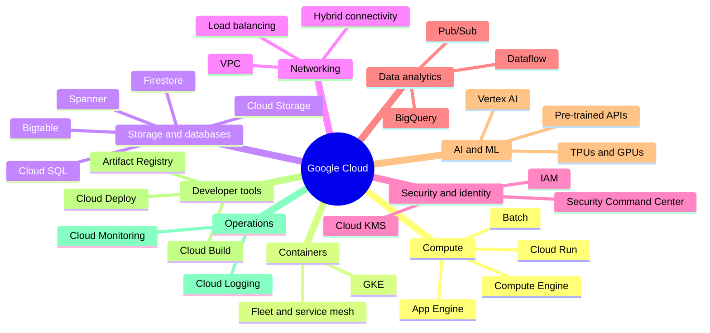
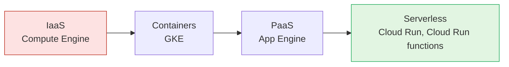

# Google Cloud overview

## Summary

Google Cloud is a public cloud: a large catalog of managed services that run on Google's data centers and private global network. The services are grouped into product categories such as compute, storage and databases, networking, security and identity, data analytics, AI and machine learning, developer tools and operations. This knowledge base follows the same categories. The main skill of a cloud engineer is not knowing every product, but knowing which category solves a problem and which product in it gives the right balance of control, cost and operational effort.

## Prerequisites

- General IT background: virtual machines, networks, databases, HTTP.
- No earlier Google Cloud knowledge is assumed. Read [global infrastructure](global-infrastructure.md) and [resource hierarchy](resource-hierarchy.md) next.

## Core concepts

### Product categories

Google groups its products into categories on the [products page](https://cloud.google.com/products). Each category is one area of this knowledge base. The map below shows the areas and the products that have notes or planned notes here.

### Service models and the level of control

A *service model* says how much of the stack Google manages and how much you manage. The same task, running a web API, can be solved at four levels. The lower the level, the more control you have and the more work you own.

Read the diagram from left to right: control and operational responsibility go down, speed of delivery and automatic scaling go up. The [compute services overview](../compute/compute-services-overview.md) compares the products in detail.

| Model | You manage | Google manages | Example |
| --- | --- | --- | --- |
| Infrastructure as a service | OS, runtime, scaling, patching | Hardware, hypervisor, network | Compute Engine |
| Containers as a service | Containers, Kubernetes objects | Control plane, node lifecycle (Autopilot) | GKE |
| Platform as a service | Code and configuration | Runtime, scaling | App Engine |
| Serverless | Code or container image | Everything else, including scale to zero | Cloud Run |

### Global, regional and zonal resources

Every resource has a location scope. A VPC network is global, a subnet is regional and a VM is zonal. The scope decides what fails together and what you must replicate. See [global infrastructure](global-infrastructure.md).

### The role-based view

The original notes were written from the point of view of a Cloud DevOps engineer and a cloud architect. Both roles need the same mental model:

1. Pick the right level of control (service model).
2. Place resources in the right locations (region, zone, multi-region).
3. Organize them in the [resource hierarchy](resource-hierarchy.md) so that IAM and policies are inherited correctly.
4. Connect them through the network.
5. Secure, observe and automate them.

## Worked example

A team must host a stateless REST API with spiky traffic, a relational database and nightly reports.

| Need | Category | Product | Reason |
| --- | --- | --- | --- |
| Run the API | Compute | Cloud Run | Containers, scale to zero, no cluster to run |
| Store orders | Storage and databases | Cloud SQL for PostgreSQL | Standard relational workload in one region |
| Nightly reports | Data analytics | BigQuery | Serverless SQL over large data |
| Secrets | Security and identity | Secret Manager | No credentials in images |
| CI/CD | Developer tools | Cloud Build, Artifact Registry | Build, scan and store images |
| Logs and alerts | Operations | Cloud Logging, Cloud Monitoring | Built in for Cloud Run |

The same problem on Compute Engine would need instance templates, managed instance groups, a load balancer and OS patching. Both are valid; the choice depends on how much control the team needs.

## Trade offs and when to use it

- Managed and serverless services reduce operational work but add limits (request timeouts, instance sizes, regional availability) and vendor specific APIs.
- IaaS gives full control and easier lift and shift migration, at the cost of patching, scaling and capacity planning.
- Product names change. Use the current name and record the former one, for example "GKE Enterprise (formerly Anthos)".

## Common mistakes

- **Starting from a product instead of a requirement.** Write down the workload shape (traffic, state, latency, compliance) first, then pick the category.
- **Ignoring location scope.** A zonal resource is a single point of failure. Check the scope of every resource in a design.
- **Treating the catalog as stable.** Check the current documentation before relying on a limit or a feature status.

## Practice

1. Name the four service models in order of decreasing control and give one Google Cloud product for each.
2. A legacy application needs a specific kernel module. Which service model fits and why?
3. Which area of this knowledge base is the home of BigQuery, and why is it not in storage and databases?

Answers: 1. IaaS (Compute Engine), containers (GKE), PaaS (App Engine), serverless (Cloud Run). 2. IaaS, because only Compute Engine lets you control the kernel. 3. Data analytics, because Google lists BigQuery as an analytics product; the storage overview links to it.

## Further reading

- [Google Cloud products](https://cloud.google.com/products), Google Cloud. The official list of categories and products used as the structure of this knowledge base.
- [Google Cloud overview](https://docs.cloud.google.com/docs/overview), Google Cloud documentation. Short introduction to resources, locations and access methods.
- [Google Cloud Architecture Framework](https://docs.cloud.google.com/architecture/framework), Google Cloud. The design principles behind the trade offs in this note.
