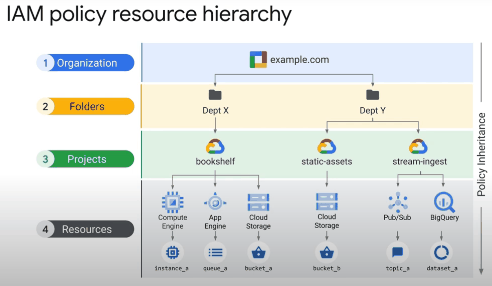
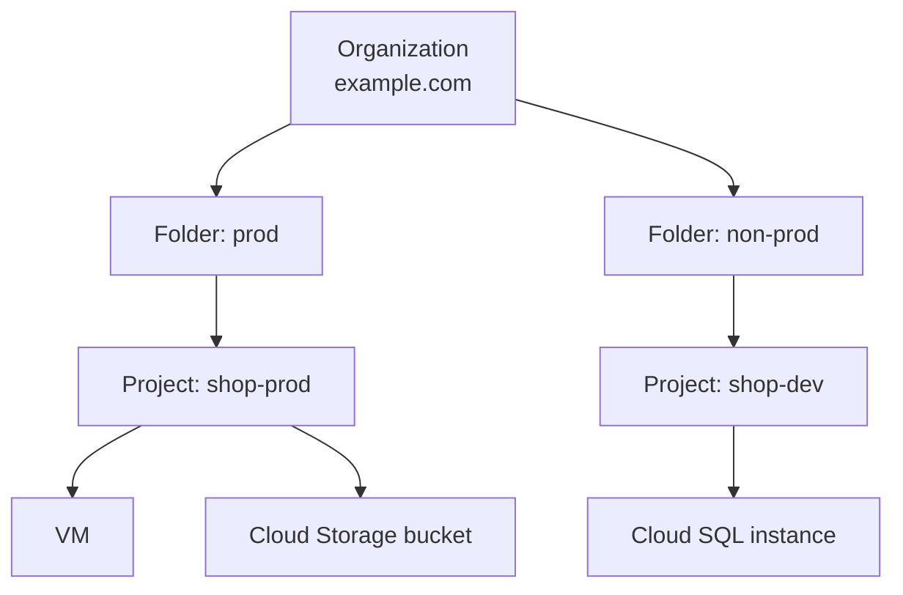

# Resource hierarchy

## Summary

Every Google Cloud resource sits in a tree: an *organization* at the root, optional *folders* below it, *projects* below folders, and resources such as VMs and buckets inside projects. IAM policies and organization policies set on a node are inherited by everything below it. The hierarchy is therefore the main tool for access control, governance and cost attribution, and it should be designed before the first workloads are created.

## Prerequisites

- [Google Cloud overview](google-cloud-overview.md).
- A rough idea of identities and roles. The details are in [Identity and Access Management](../security-and-identity/identity-and-access/iam.md).

## Core concepts

### The four levels

| Level | What it is | Typical owner |
| --- | --- | --- |
| Organization | The root node, tied to one Cloud Identity or Google Workspace domain such as `example.com` | Central cloud or security team |
| Folder | A grouping of projects and other folders, for example by department or environment | Platform team |
| Project | The base unit for enabling APIs, billing, quotas and most IAM grants | Application team |
| Resource | A VM, bucket, dataset, topic and so on, always inside exactly one project | Application team |



The figure shows a real shape: the organization `example.com`, two department folders, three projects and their resources. Policies flow downward along the arrows.



### Project identifiers

A project has three identifiers:

- **Project name.** A display name, can be changed and does not need to be unique.
- **Project ID.** Globally unique, chosen at creation and immutable, for example `shop-prod-4821`. Used in `gcloud` commands and API calls.
- **Project number.** Globally unique, assigned by Google and immutable. Appears in service agent emails such as `PROJECT_NUMBER@cloudservices.gserviceaccount.com`.

### Inheritance

- **IAM allow policies** are additive. The effective permissions on a resource are the union of the policies on the resource and on all its ancestors. A child cannot remove a role granted on a parent.
- **IAM deny policies** are checked before allow policies and can block a permission even if a parent grants it.
- **Organization policies** (constraints such as "no external IPs") are inherited too, but a lower node can override them when the policy allows it.

*Analogy.* The hierarchy is like folders on a shared drive with sharing settings. Sharing a folder with someone shares every file inside it, and you cannot "unshare" a single file while the folder is still shared. The analogy breaks for deny policies and organization policies, which a shared drive usually does not have.

### Labels and tags

- **Labels** are key value pairs on resources, used mainly for cost reports and filtering, for example `team=payments`. They have no effect on access.
- **Tags** (Resource Manager tags) are separate resources with their own IAM. They can be used as conditions in IAM and organization policies and in firewall policies.

## Worked example

A company with two product teams and three environments.

```text
example.com (organization)
  common/
    shared-vpc-host-prod
    logging-central
  prod/
    payments-prod
    shop-prod
  non-prod/
    payments-dev
    shop-dev
```

- The security team gets `roles/securitycenter.admin` on the organization, so it sees every project.
- The organization policy `constraints/compute.vmExternalIpAccess` denies external IPs on the `prod` folder.
- The payments team gets `roles/editor` only on `payments-dev`, and a narrower deploy role on `payments-prod`.
- An organization level log sink in `logging-central` collects audit logs from every project (see [Cloud Logging](../operations/cloud-logging.md)).

Moving `shop-dev` from `non-prod` to `prod` would immediately apply the `prod` organization policies and IAM grants to it, which is why moves should be reviewed.

## Trade offs and when to use it

- **Folders by environment** make it easy to apply stricter policies to production.
- **Folders by team** make delegation easy. Many organizations combine both: team folders with environment subfolders.
- **Many small projects** give strong isolation of quotas, IAM and billing, but increase the number of things to manage. Automate project creation (for example with the Cloud Foundation Toolkit, see [Terraform on Google Cloud](../developer-and-devops-tools/infrastructure-as-code/terraform-on-google-cloud.md)).
- Projects without an organization are possible for individuals, but they cannot use folders, organization policies or hierarchical firewall policies.

## Common mistakes

- **Granting broad roles high in the tree.** `roles/editor` on the organization gives edit access to every project. Grant at the lowest level that works.
- **Relying on a child policy to remove access.** Allow policies only add. Use deny policies or move the grant down.
- **Using labels for security.** Labels do not control access. Use tags with IAM conditions.

## Practice

1. A user has `roles/viewer` on a folder and nothing on a project inside it. What can the user do in the project?
2. Which project identifier can you change after creation?
3. How do you stop a project owner from creating VMs with external IPs?

Answers: 1. View resources, because the folder grant is inherited. 2. The project name. 3. With the organization policy constraint `compute.vmExternalIpAccess` on the project or an ancestor.

## Further reading

- [Resource hierarchy](https://docs.cloud.google.com/resource-manager/docs/cloud-platform-resource-hierarchy), Google Cloud documentation. Definitions of the levels and inheritance rules.
- [Decide a resource hierarchy for your landing zone](https://docs.cloud.google.com/architecture/landing-zones/decide-resource-hierarchy), Google Cloud Architecture Center. Patterns for folder design.
- [Organization Policy Service overview](https://docs.cloud.google.com/resource-manager/docs/organization-policy/overview), Google Cloud documentation. Constraints and inheritance.
