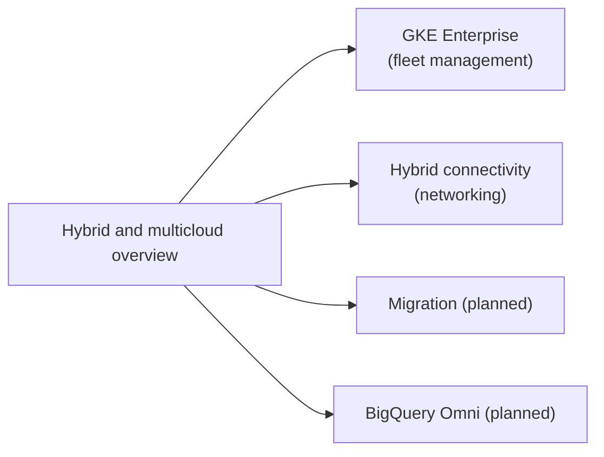

# Hybrid and multicloud

Running and managing workloads across Google Cloud, on-premises and other clouds, and migrating them. Networking for hybrid links lives in [hybrid connectivity](../networking/hybrid-connectivity/README.md); multi-cluster Kubernetes management lives in [fleet management](../containers-and-kubernetes/fleet-management/README.md).

## Map of the area

## Notes in reading order

1. [Hybrid and multicloud overview](hybrid-and-multicloud-overview.md): GKE Enterprise, BigQuery Omni, hybrid networking, service mesh and migration tools.

## Planned topics

- Migration strategy and the Google Cloud migration path (assess, plan, deploy, optimize)
- Migrate to Virtual Machines
- Migrate to Containers
- Google Distributed Cloud (connected and air-gapped)
- GKE multicloud and attached clusters
- BigQuery Omni
- VMware Engine
