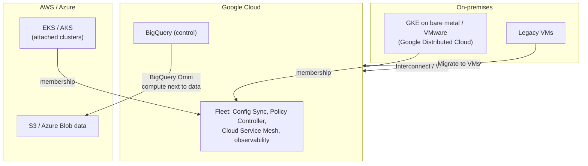

# Hybrid and multicloud overview

## Summary

Hybrid and multicloud services let organizations run and manage workloads consistently across Google Cloud, on-premises data centers and other public clouds. They exist because some workloads must stay on-premises or in another cloud for regulatory, latency or business reasons, while teams still want one way to deploy, secure and observe them. On Google Cloud the pieces are GKE Enterprise (fleet-based Kubernetes management across environments, formerly Anthos), BigQuery Omni (analytics on data in AWS and Azure), hybrid networking (Cloud Interconnect, Cloud VPN, Cloud Service Mesh) and migration tools (Migrate to Virtual Machines, Migrate to Containers).

## Prerequisites

- [Hybrid connectivity](../networking/hybrid-connectivity/README.md).
- [Fleet management](../containers-and-kubernetes/fleet-management/README.md).

## Core concepts

### Why hybrid and multicloud

- Bridge on-premises infrastructure with cloud-native services.
- Portability and consistency across clouds.
- Regulatory, compliance or latency requirements that keep workloads partly on-premises or in another cloud.

### Building blocks

One fleet manages clusters wherever they run; BigQuery Omni moves compute to the data instead of data to the compute; private links connect the networks; migration tools move workloads when it is time.

### Products

**GKE Enterprise (formerly Anthos).** An enterprise Kubernetes platform that manages GKE clusters on Google Cloud, on-premises (Google Distributed Cloud on VMware or bare metal), on AWS and Azure (GKE multicloud) and attached third-party clusters as one fleet. Features: Config Sync (declarative configuration and policy as code, formerly Anthos Config Management), Policy Controller, Cloud Service Mesh (formerly Anthos Service Mesh, based on Istio), fleet-wide identity and observability. It enables GitOps, SRE practices and compliance at scale with a consistent developer experience. See [fleet management](../containers-and-kubernetes/fleet-management/README.md). The original notes describe Anthos and GKE Enterprise as two products; they are the same platform under its old and new name.

TODO: Verify the current GKE Enterprise and GKE multicloud product status.

**BigQuery Omni.** Runs BigQuery SQL on data stored in AWS S3 and Azure Blob Storage, with compute running in the same cloud region as the data; supports cross-cloud joins and transfers of results. Minimizes egress and keeps data in place for residency; combine with Looker for unified BI across clouds.

**Cloud Interconnect** and **Cloud VPN** provide private and encrypted connectivity. Prefer Interconnect for high throughput, low latency hybrid traffic and VPN for smaller needs or as backup; consider redundant VLAN attachments and Private Google Access for on-premises hosts. See [Cloud Interconnect](../networking/hybrid-connectivity/cloud-interconnect.md) and [Cloud VPN](../networking/hybrid-connectivity/cloud-vpn.md).

**Cloud Service Mesh (including the former Traffic Director).** A managed traffic control plane for Envoy proxies and proxyless gRPC across environments: service discovery, global load balancing, canary releases and mTLS for zero trust service-to-service communication. See [Cloud Service Mesh](../containers-and-kubernetes/fleet-management/cloud-service-mesh.md).

**Migrate to Virtual Machines.** Lift and shift of VMs from VMware, AWS, Azure and other sources to Compute Engine, with continuous replication, test clones before cutover and rollback. Simplifies the first migration phase for workloads that are not yet containerized.

**Migrate to Containers.** Extracts applications and their dependencies from VMs into container images and Kubernetes artifacts for GKE or Cloud Run; a step in modernization journeys, combined with Cloud Build and Artifact Registry.

### Summary table

| Product | Purpose | Value |
| --- | --- | --- |
| GKE Enterprise | Kubernetes across hybrid and multicloud | Central governance, GitOps, secure mesh |
| BigQuery Omni | Multicloud analytics | Query AWS and Azure data with BigQuery SQL |
| Cloud Interconnect | High-speed private connectivity | Low latency, high throughput hybrid traffic |
| Cloud VPN | IPsec tunnels | Quick and cheap hybrid connection |
| Cloud Service Mesh | Hybrid service mesh | Discovery, routing, mTLS |
| Migrate to VMs | Lift and shift | Fast cloud onboarding |
| Migrate to Containers | VM to container conversion | Modernization |

## Worked example

A retailer with stores, a data center and AWS:

1. Store clusters (GKE on bare metal) and AWS EKS clusters join the company fleet; Config Sync applies the same baseline (namespaces, network policies, logging) everywhere, Policy Controller blocks privileged Pods.
2. Clickstream data stays in S3; analysts query it with BigQuery Omni and join aggregated results with sales data in BigQuery.
3. The data center connects through two Partner Interconnect attachments, with HA VPN as backup.
4. Legacy order servers move with Migrate to Virtual Machines in phase one, then to containers with Migrate to Containers in phase two.

## Trade offs and when to use it

- A single management plane reduces drift and skills fragmentation but adds licensing and platform cost.
- Multicloud for portability is expensive; most organizations use it for specific needs (acquisitions, data gravity, regulation), not by default.
- Migration in two steps (rehost, then refactor) reduces risk but means operating the intermediate state.

## Common mistakes

- **Treating hybrid connectivity as an afterthought.** Latency and bandwidth decide what can run where.
- **Different security models per environment.** Use fleet-wide policy and identity (Workload Identity Federation) to reduce key rotation and drift.
- **Moving large datasets across clouds** for analysis when Omni or federated queries could leave them in place.

## Practice

1. What is the former name of GKE Enterprise?
2. Where does BigQuery Omni run its compute?
3. In which order would you use Migrate to VMs and Migrate to Containers?

Answers: 1. Anthos. 2. In the other cloud, in the same region as the data. 3. Migrate to VMs first for a fast move, then Migrate to Containers as part of modernization.

## Further reading

- [GKE Enterprise overview](https://docs.cloud.google.com/kubernetes-engine/docs), Google Cloud documentation. Fleet-based multi-environment management.
- [BigQuery Omni introduction](https://docs.cloud.google.com/bigquery/docs/omni-introduction), Google Cloud documentation. Architecture and limits.
- [Migrate to Virtual Machines overview](https://docs.cloud.google.com/migrate/virtual-machines/docs/5.0), Google Cloud documentation. Replication and cutover.
- [Hybrid and multicloud architecture patterns](https://docs.cloud.google.com/architecture/hybrid-multicloud-patterns-and-practices), Google Cloud Architecture Center. Patterns and trade offs.
