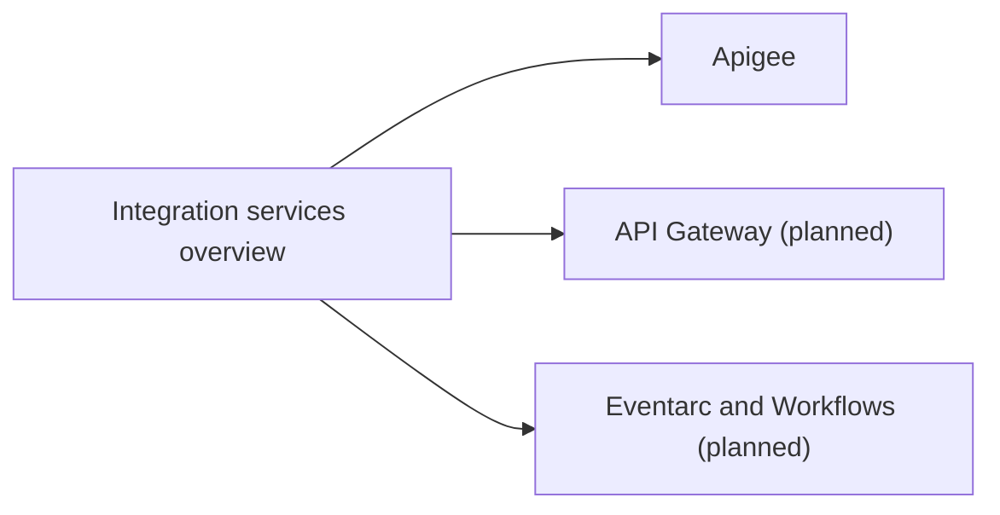

# Integration and APIs

API management, messaging, events, orchestration and connectors: how services and systems talk to each other on Google Cloud.

## Map of the area

## Notes in reading order

1. [Integration services overview](integration-services-overview.md): Apigee, API Gateway, Cloud Tasks, Pub/Sub, Eventarc, Workflows and connectors, with a decision table.
2. [Apigee](apigee.md): planes, building blocks, Apigee X networking, call lifecycle, policies and reference architectures.

## Planned topics

- API Gateway
- Eventarc in depth
- Workflows in depth
- Cloud Tasks patterns
- Application Integration and Integration Connectors
- Event-driven architecture patterns (saga, outbox, CQRS)
