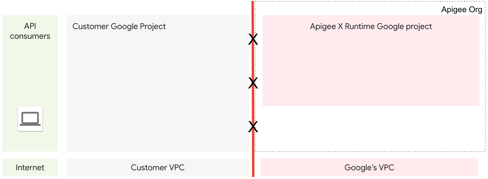
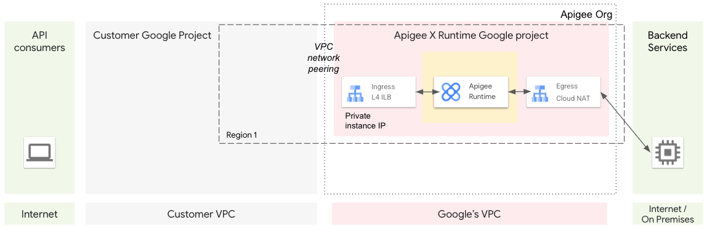
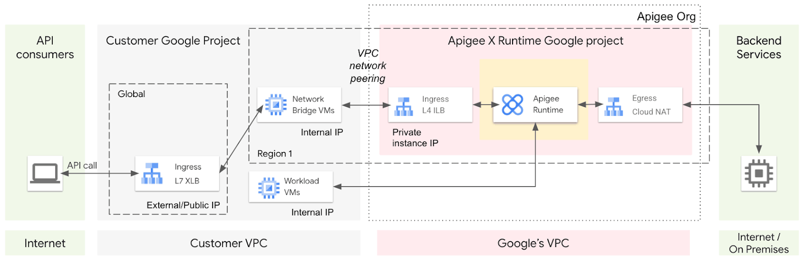
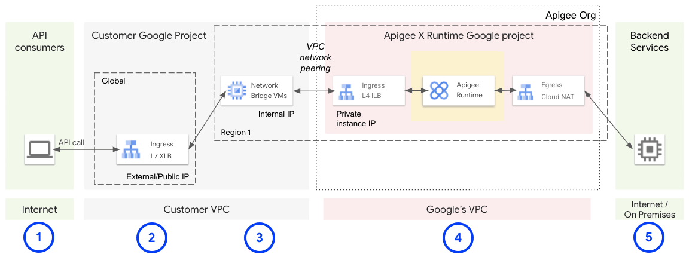
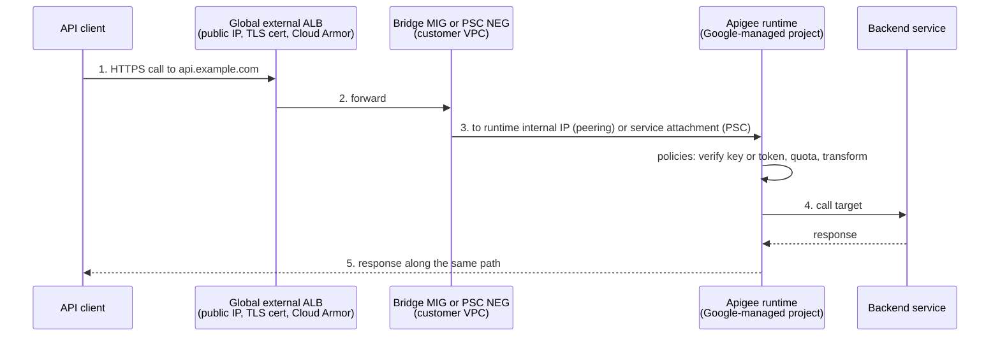

# Apigee

## Summary

Apigee is Google Cloud's full lifecycle API management platform. An *API proxy* sits in front of backend services and applies *policies* (authentication, quotas, caching, transformation, threat protection) without changing the backends; *API products*, *developer apps* and a *developer portal* turn APIs into managed products with keys, plans and analytics. Apigee X runs fully managed by Google; Apigee hybrid keeps a Google-hosted control plane and a runtime you run on Kubernetes. It is a policy-driven control layer for APIs, distinct from the API implementation itself.

## Prerequisites

- [Integration services overview](integration-services-overview.md).
- [VPC Network Peering](../networking/vpc/vpc-network-peering-and-shared-vpc.md), [Private Service Connect](../networking/vpc/private-service-connect.md) and [Application Load Balancers](../networking/load-balancing/application-load-balancers.md).

## Core concepts

### Planes and topology

- **Management (control) plane**, hosted by Google for both X and hybrid: design and manage proxies, policies, products, developers, analytics and deployments.
- **Runtime (data) plane**, which executes proxies:
  - In **Apigee X**, Google hosts and scales the runtime in a Google-managed project and VPC connected to your VPC.
  - In **Apigee hybrid**, you install the runtime on a supported Kubernetes platform (usually GKE), which gives control over placement, upgrades and data locality.
- **Data residency.** Regionalized organizations keep control plane data, runtime and analytics in chosen regions; hybrid gives more control because the runtime runs where you deploy it.

### Building blocks

- **API proxy**: the programmable façade with request and response flows, policies and targets.
- **Policies**: pluggable steps for authentication, quotas, spike arrest, caching, transformation, mediation and content-based security.
- **Shared flows**: reusable policy sequences across proxies.
- **API products**: bundles of proxies with quotas and plans, the unit of access control and monetization.
- **Developers and apps**: consumer identities with API keys and OAuth credentials.
- **Developer portal**: self-service onboarding and documentation (integrated portal on Apigee X).

### Apigee X networking

An Apigee X organization uses two projects: your project and a Google-managed tenant project for the runtime, each with its own VPC. The classic pattern connects them with VPC Network Peering; the runtime receives requests on an internal load balancer reachable at a private IP in the peered range.





A global external Application Load Balancer cannot send traffic directly to an internal IP in another project, even if networks are peered. In the peering pattern, a managed instance group (MIG) of bridge VMs in your VPC forwards requests from the load balancer to the runtime's internal IP. Newer setups use Private Service Connect instead: the external load balancer uses a PSC network endpoint group that points to the Apigee service attachment, so no bridge VMs are needed.



The runtime can call internal IPs in your peered VPC directly, and external IPs through the tenant project's Cloud NAT.

### API proxy call lifecycle





### Capabilities

**Security and governance.**

- Authentication and authorization: API keys, OAuth 2.0 (authorization code, client credentials, refresh tokens), JWT generation and validation, mTLS to backends.
- Threat protection: JSON and XML threat protection, size limits, regular expression checks; Cloud Armor for WAF and DDoS at the load balancer; Advanced API Security for abuse detection.
- Traffic governance: spike arrest, quotas, concurrent rate limits, fault handling, circuit breaking patterns.
- Secrets and identity: IAM and Cloud KMS integration on X; Kubernetes secrets and cluster posture on hybrid.
- Auditability: proxy revisions and Cloud Audit Logs on X; cluster logging on hybrid.

**Traffic management and performance.** Response caching, load balancing and failover across target servers, mediation for legacy backends (SOAP, REST, GraphQL), JSON and XML conversion, header and path rewrites, conditional flows for blue-green or canary routing.

**Observability and analytics.** Built-in API analytics (latency, cache hit rates, usage by developer, app and product), export to BigQuery or Cloud Storage, integration with Cloud Monitoring, Logging and Trace.

**Monetization and portals.** API products with rate plans, charging for access, documentation and keys through the portal.

### Delivery models

| | Apigee X | Apigee hybrid |
| --- | --- | --- |
| Runtime | Google-managed | Customer-managed Kubernetes |
| Best for | Fully managed, internet-scale programs with Google Cloud integration (Cloud Armor, Observability), SLA up to 99.99 % on enterprise tiers | Data locality, outbound-only reach to on-premises, existing Kubernetes operations |
| You operate | Proxies and configuration | Also runtime scaling, patching, availability |

### Pricing

Evaluation (trial), pay-as-you-go (billed by proxy call tiers and add-ons) and subscription tiers (Standard, Enterprise, Enterprise Plus) with more environments, quotas, analytics retention and SLA. Networking (load balancer, egress) adds cost even in evaluation.

TODO: Verify current tiers.

## Worked example

A partner API with keys, quota and spike protection. Proxy request flow (policy XML, untested):

```xml
<!-- VerifyAPIKey: reject calls without a valid app key -->
<VerifyAPIKey name="Verify-Key">
  <APIKey ref="request.header.x-api-key"/>
</VerifyAPIKey>

<!-- SpikeArrest: smooth bursts to at most 20 requests per second -->
<SpikeArrest name="Spike-Arrest">
  <Rate>20ps</Rate>
</SpikeArrest>

<!-- Quota: allowance taken from the API product, per app -->
<Quota name="Product-Quota">
  <Allow countRef="verifyapikey.Verify-Key.apiproduct.developer.quota.limit"/>
  <Interval ref="verifyapikey.Verify-Key.apiproduct.developer.quota.interval"/>
  <TimeUnit ref="verifyapikey.Verify-Key.apiproduct.developer.quota.timeunit"/>
  <Identifier ref="client_id"/>
</Quota>
```

The `Gold` product allows 10,000 calls per day, `Bronze` 1,000; a partner app subscribed to `Bronze` gets HTTP 429 after its 1,000th call that day. Analytics show calls per app for billing.

Reference architectures from the original notes:

- **Public API front door.** External ALB, Apigee X, backends on Cloud Run, GKE or VMs; Cloud Armor (WAF, reCAPTCHA Enterprise), OAuth or JWT at the proxy, quotas and spike arrest, per-product keys.
- **Private east-west mediation.** Internal LB or PSC to Apigee X, peered backends; or a hybrid runtime inside a restricted GKE cluster, for zero egress compliance and on-premises systems.
- **Partner API with monetization.** Products and plans, managed keys, integrated portal, BigQuery export for reporting.
- **SOAP to REST bridge.** XML to JSON transformation, caching of idempotent responses, quotas.

## Trade offs and when to use it

- **Use cases.** Exposing core services to partners and developers as products with SLAs; a security front door for mixed legacy and modern backends; modernization with REST façades over SOAP and gradual decomposition of monoliths; analytics-driven API programs; regulatory and residency needs with hybrid.
- **Limits.** Significant cost and governance overhead (overkill for small internal APIs); an extra hop adds latency (mitigated by caching and connection reuse); hybrid means operating Kubernetes; features differ between Apigee X, hybrid and the older Apigee Edge.
- **Alternatives.** API Gateway or Cloud Endpoints for simple internal APIs, open source gateways (Kong, Tyk); they lack monetization, advanced analytics and the portal.

### Operations and security blueprint

- Separate environments (dev, test, prod); every proxy change is a revision, so rollbacks are a redeploy of the previous revision.
- Keep proxies and shared flows in source control; deploy with the Apigee API or Maven plugins; lint policies and run contract and performance tests in CI.
- Identity: OAuth 2.0 and OIDC with short-lived JWTs; keys rotated in Cloud KMS. Transport: TLS everywhere, mTLS to backends. Edge: Cloud Armor rules. Abuse: spike arrest and quotas per product, anomaly detection on analytics. Content: size limits and schema validation.
- Capacity: X is scaled by Google (choose multi-region where needed); hybrid needs zonal or regional HA design, pod disruption budgets, autoscaling and regular upgrades.

## Common mistakes

- **Treating Apigee as only a reverse proxy** and skipping products, keys and quotas.
- **Quota without spike arrest**: a client can use a day's quota in one second.
- **Backends reachable directly**, bypassing the proxy and its policies.

## Practice

1. Why does the classic Apigee X setup need a bridge MIG, and what replaces it today?
2. What is an API product?
3. When would you choose hybrid over X?

Answers: 1. A global external load balancer cannot target an internal IP in another project; Private Service Connect with a PSC NEG replaces the bridge. 2. A bundle of API proxies with quotas and plans that apps subscribe to; the unit of access and monetization. 3. When the runtime must run in a specific location or on-premises for data residency, or must reach on-premises systems with outbound-only connectivity.

## Further reading

- [Apigee overview](https://docs.cloud.google.com/apigee/docs/api-platform/get-started/what-apigee), Google Cloud documentation. Concepts and components.
- [Apigee X networking options](https://docs.cloud.google.com/apigee/docs/api-platform/get-started/networking-options), Google Cloud documentation. Peering and PSC patterns.
- [Policy reference](https://docs.cloud.google.com/apigee/docs/api-platform/reference/policies/reference-overview-policy), Google Cloud documentation. All policies.
- [Apigee hybrid overview](https://docs.cloud.google.com/apigee/docs/hybrid/latest/what-is-hybrid), Google Cloud documentation. Runtime on your Kubernetes.
