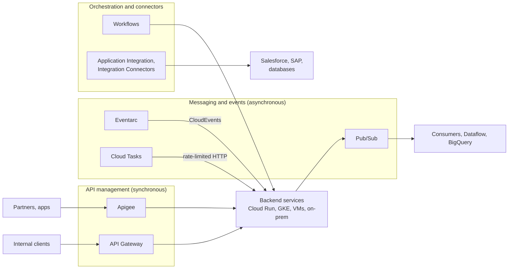

# Integration services overview

## Summary

Integration services connect applications, services and data across cloud, on-premises and SaaS systems. On Google Cloud they fall into three groups: *API management* (Apigee for full lifecycle API programs, API Gateway for simple managed gateways), *messaging and events* (Pub/Sub, Eventarc, Cloud Tasks) and *orchestration and connectors* (Workflows, Application Integration and Integration Connectors). They are the building blocks of service-oriented, microservice and event-driven architectures, and the main decision is between synchronous calls through an API layer and asynchronous communication through events and queues.

## Prerequisites

- [Compute services overview](../compute/compute-services-overview.md).
- HTTP APIs, messaging and event-driven architecture basics.

## Core concepts

### Map of the services



### Products

**Apigee API Management.** Full lifecycle API management: design, security (OAuth 2.0, JWT, API keys), quotas and caching, developer portal, analytics and monetization; hybrid and multicloud runtimes. For enterprise API governance and external or partner APIs; combine with IAM, Cloud Armor and Cloud CDN. See [Apigee](apigee.md).

**API Gateway.** A lightweight, managed gateway defined with an OpenAPI spec, in front of Cloud Run, Cloud Run functions and App Engine; API key and JWT authentication; integrated logging and monitoring. Lower cost and complexity than Apigee for internal or simple APIs; use with Firebase Authentication or service account JWTs.

**Cloud Tasks.** Managed asynchronous task queues with HTTP targets (Cloud Run, App Engine, any endpoint): scheduled and retried execution with exponential backoff, rate limits, deduplication by task name. Use to offload background jobs from front ends and to rate-limit calls to external APIs.

**Pub/Sub.** Serverless publish-subscribe messaging: event ingestion and fan-out, streaming pipelines, push and pull delivery, dead-letter topics, replay with seek; global scale with IAM on topics and subscriptions. The core of event-driven microservices; combine with Dataflow or BigQuery for real-time analytics. See [data analytics services overview](../data-analytics/data-analytics-services-overview.md).

**Eventarc.** Managed event routing using the CloudEvents standard: triggers from Cloud Audit Logs (hundreds of Google Cloud event types), direct events from services such as Cloud Storage, Pub/Sub topics and custom sources, delivered to Cloud Run, GKE or Workflows. Useful for reactive automation (for example respond to an IAM change) and CI/CD triggers.

**Workflows.** Serverless orchestration in YAML or JSON: sequences of steps calling Google Cloud APIs and HTTP services, with branching, loops, parallel steps, retries and error handling; callbacks for human approval. Runs as a service account.

**Application Integration and Integration Connectors.** An integration platform (iPaaS) with a visual designer and prebuilt connectors to SaaS and databases (Salesforce, SAP, ServiceNow, MySQL, PostgreSQL and many more), also usable from Workflows and Apigee. Accelerates B2B flows and legacy modernization.

### Synchronous or asynchronous

| Need | Choose |
| --- | --- |
| Client needs an immediate answer | API through Apigee or API Gateway |
| Many consumers for one event | Pub/Sub |
| React to something that happened in Google Cloud | Eventarc |
| Do work later with retries and rate limits, one consumer | Cloud Tasks |
| Multi-step process with error handling across services | Workflows |
| Connect to SaaS without custom code | Application Integration |

### Summary table

| Product | Purpose | Value |
| --- | --- | --- |
| Apigee | Full API lifecycle management | External, partner and monetized APIs |
| API Gateway | Lightweight API routing and security | Internal and serverless APIs |
| Cloud Tasks | Asynchronous task dispatch | Offloading, retries, rate limits |
| Pub/Sub | Event streaming and decoupling | High throughput, global messaging |
| Eventarc | Event routing | React to Google Cloud and custom events |
| Workflows | Serverless orchestration | Multi-step logic with retries and branching |
| Connectors | Prebuilt integrations | SaaS and hybrid integration |

## Worked example

Order processing: the checkout API (behind API Gateway) writes the order and publishes `order.created` to Pub/Sub. An Eventarc trigger starts a Workflow that reserves stock (Cloud Run), charges the card through a partner API, and on failure compensates by releasing stock. Email sending is put on a Cloud Tasks queue limited to 50 dispatches per second to respect the mail provider's limit. Each service runs under its own service account, and the Workflow's execution history shows exactly which step failed.

```yaml
# workflow.yaml (sketch, untested)
main:
  params: [event]
  steps:
    - reserve:
        call: http.post
        args:
          url: https://stock-service-abc.a.run.app/reserve
          auth: {type: OIDC}
          body: ${event.data}
        result: reservation
    - charge:
        try:
          call: http.post
          args:
            url: https://payments.example.com/charge
            body: ${event.data}
        except:
          as: e
          steps:
            - release:
                call: http.post
                args:
                  url: https://stock-service-abc.a.run.app/release
                  auth: {type: OIDC}
                  body: ${reservation.body}
            - fail:
                raise: ${e}
```

## Trade offs and when to use it

- Asynchronous designs decouple services and absorb spikes, but add eventual consistency and need idempotent consumers.
- Apigee has the most features and costs the most; API Gateway is cheap and simple. Choose by audience (external products versus internal APIs) and features needed.
- Orchestration (Workflows) gives visibility of a process; choreography (events only) gives looser coupling but is harder to trace.

## Common mistakes

- **Synchronous chains of many services**, where one slow service blocks all.
- **Non-idempotent event handlers** with at-least-once delivery.
- **Public APIs without rate limits or authentication.** Secure with IAM, OAuth or API keys and Cloud Armor.

## Practice

1. A service must call a partner API that allows 10 requests per second. Which product helps?
2. What is the difference between Pub/Sub and Cloud Tasks?
3. Which service routes a Cloud Storage "object finalized" event to a Cloud Run service?

Answers: 1. Cloud Tasks with a queue rate limit. 2. Pub/Sub broadcasts messages to any number of subscribers that pull or receive them; Cloud Tasks dispatches each task to one explicit HTTP target with rate limits and scheduling. 3. Eventarc.

## Further reading

- [Choose Cloud Tasks or Pub/Sub](https://docs.cloud.google.com/tasks/docs/comp-pub-sub), Google Cloud documentation. Differences and use cases.
- [Eventarc overview](https://docs.cloud.google.com/eventarc/docs/overview), Google Cloud documentation. Event sources and destinations.
- [Workflows overview](https://docs.cloud.google.com/workflows/docs/overview), Google Cloud documentation. Syntax and connectors.
- [API Gateway overview](https://docs.cloud.google.com/api-gateway/docs/about-api-gateway), Google Cloud documentation. OpenAPI-based gateways.
