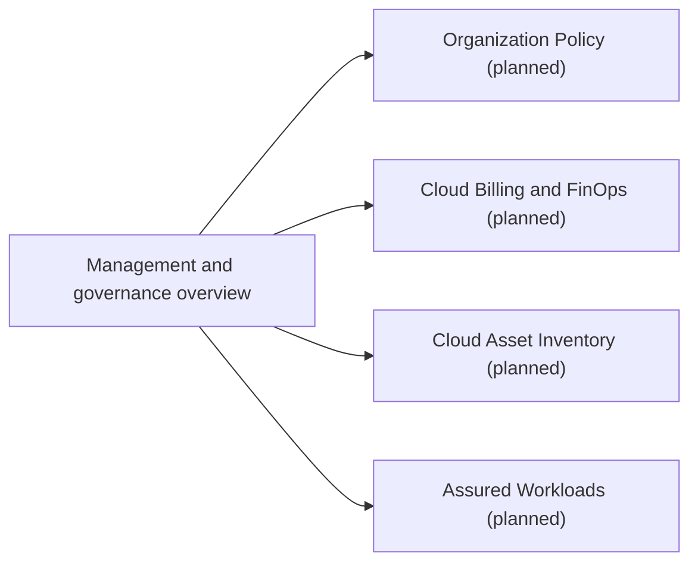

# Management and governance

Structure, policy, inventory, cost and compliance controls for Google Cloud organizations. The resource hierarchy itself is introduced in [foundations](../foundations/resource-hierarchy.md); infrastructure as code is in [developer and DevOps tools](../developer-and-devops-tools/infrastructure-as-code/README.md).

## Map of the area

## Notes in reading order

1. [Management and governance overview](management-and-governance-overview.md): Resource Manager, Billing, IAM, Policy Intelligence, tags, Asset Inventory, quotas, Assured Workloads and Organization Policy.

## Planned topics

- Organization Policy Service and custom constraints
- Cloud Billing, budgets and the billing export
- FinOps and cost optimization on Google Cloud
- Cloud Asset Inventory
- Tags and conditional policies
- Cloud Quotas and capacity planning
- Assured Workloads and data sovereignty
- Landing zone design
