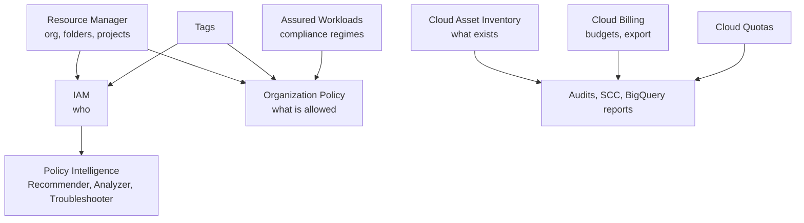

# Management and governance overview

## Summary

Management and governance tools let an organization control how Google Cloud is used at scale: how resources are structured (Resource Manager), who can do what (IAM and Policy Intelligence), which configurations are allowed (Organization Policy, tags), what exists (Cloud Asset Inventory), what it costs (Cloud Billing, budgets, quotas) and which compliance regime applies (Assured Workloads). Infrastructure as code tools make the configuration repeatable. Together they form the guardrails that let many teams move fast without breaking security, compliance or budgets.

## Prerequisites

- [Resource hierarchy](../foundations/resource-hierarchy.md).
- [IAM](../security-and-identity/identity-and-access/iam.md).

## Core concepts

### Goals

Control billing, access and policy; visibility of cost, compliance, structure and resources; consistent secure configuration across projects; simpler auditing, quota management and multi-project operations.

### Guardrail map



### Products

**Cloud Resource Manager.** Manages the hierarchy of organization, folders and projects; IAM and organization policies are set on these nodes and inherited. Group projects by environment or team and apply policies at the highest sensible level to avoid repetition.

**Cloud Billing.** Billing accounts linked to projects; budgets with alert thresholds; export of detailed billing data to BigQuery; cost reports. Budget notifications to Pub/Sub can trigger automated actions (for example stopping non-production resources). Looker Studio or Looker dashboards on the BigQuery export give cost visibility per team, label and service.

**IAM.** Roles (basic, predefined, custom) and least privilege; prefer predefined roles. See [IAM](../security-and-identity/identity-and-access/iam.md).

**Policy Intelligence.** Tools to analyze and right-size access: IAM Recommender (role recommendations based on 90 days of usage), Policy Analyzer (who has access to what), Policy Troubleshooter (why a request was allowed or denied), Policy Simulator (effect of a change before applying it). Run the recommender regularly to remove excess permissions.

**Tags.** Resource Manager tags are key value pairs with their own IAM, attached to organizations, folders, projects and some resources; inherited down the hierarchy. They drive conditional organization policies, IAM conditions and firewall policies, for example "no external IPs on resources tagged `env=prod`". Labels, by contrast, are for cost attribution and filtering.

**Cloud Asset Inventory.** A time-series database of resources and IAM policies across the organization: search, export to BigQuery or Cloud Storage, history of changes and real-time feeds. Used for compliance audits, IAM visibility and drift detection; it also feeds Security Command Center.

**Config Connector and Config Controller.** Manage Google Cloud resources as Kubernetes objects (KRM), with GitOps through Config Sync and validation by Policy Controller. The original notes call this "Cloud Config (formerly Config Controller)"; the product names are Config Connector (the open source controller) and Config Controller (its managed hosting). Best for teams already using Kubernetes tooling.

**Cloud Deployment Manager.** Google's original IaC with YAML, Jinja and Python templates; deprecated in favor of Terraform and Infrastructure Manager. See [Terraform on Google Cloud](../developer-and-devops-tools/infrastructure-as-code/terraform-on-google-cloud.md).

**Cloud Quotas.** Limits on resource usage per project and region (for example CPUs, GPUs, IP addresses) and API rate limits; protect against runaway usage. Quotas can be viewed, adjusted by request, monitored with alerts, and lowered on purpose to sandbox development teams.

**Assured Workloads.** Creates folders configured for a compliance regime (FedRAMP, CJIS, IL4, HIPAA, EU Sovereign Controls and others): data location controls, personnel access restrictions and required organization policies. Combine with VPC Service Controls, Sensitive Data Protection and CMEK for a full regulatory stack.

**Organization Policy Service.** Constraints that restrict configurations across the hierarchy: allowed resource locations, no external IPs, no service account keys, uniform bucket-level access, allowed services, trusted images. List constraints allow or deny values; boolean constraints turn behavior on or off; custom constraints use CEL on resource fields. Policies are inherited and can be overridden where permitted; dry run lets you test them.

### Summary table

| Product | Purpose | Value |
| --- | --- | --- |
| Resource Manager | Hierarchical structure | IAM and policy inheritance |
| Cloud Billing | Billing and budgets | Cost control, exports, alerts |
| IAM | Access control | Least privilege |
| Policy Intelligence | IAM insight | Troubleshooting, right-sizing |
| Tags | Policy-aware metadata | Conditional guardrails |
| Cloud Asset Inventory | Resource and IAM inventory | Audit, discovery, drift |
| Config Connector | Resources as Kubernetes objects | GitOps for infrastructure |
| Deployment Manager | Legacy IaC | Migrate away |
| Cloud Quotas | Usage limits | Prevent overruns |
| Assured Workloads | Compliance regimes | Regulated workloads |
| Organization Policy | Constraints | Central governance |

## Worked example

Guardrails for a new organization (untested):

```bash
# Allow resources only in EU locations, for the whole organization
gcloud resource-manager org-policies allow gcp.resourceLocations in:eu-locations \
  --organization=ORG_ID

# No external IPs on VMs in the prod folder
cat > no-ext-ip.yaml <<'EOF'
name: folders/PROD_FOLDER_ID/policies/compute.vmExternalIpAccess
spec:
  rules:
  - denyAll: true
EOF
gcloud org-policies set-policy no-ext-ip.yaml

# Budget with alerts at 50, 90 and 100 percent, notifications to Pub/Sub
gcloud billing budgets create --billing-account=BILLING_ACCOUNT_ID \
  --display-name="shop-prod monthly" --budget-amount=5000EUR \
  --threshold-rule=percent=0.5 --threshold-rule=percent=0.9 --threshold-rule=percent=1.0 \
  --notifications-rule-pubsub-topic=projects/finops/topics/budget-alerts

# Export all IAM policies for an audit
gcloud asset export --organization=ORG_ID --content-type=iam-policy \
  --bigquery-table=projects/sec-audit/datasets/assets/tables/iam_policies --output-bigquery-force
```

A Cloud Run function subscribed to `budget-alerts` can scale non-production services to zero when 100 percent is reached; budgets alone only notify, they do not cap spending.

## Trade offs and when to use it

- Strict guardrails reduce risk but can block legitimate work; use dry run, exceptions through tags, and clear ownership of policies.
- Central billing export and asset inventory in BigQuery give strong reporting with little effort.
- Assured Workloads restricts available services and regions; use it only where the regime requires it.

## Common mistakes

- **Expecting budgets to stop spending.** They alert; automation must act.
- **Policies set project by project** instead of on folders.
- **Never reviewing IAM.** Use Recommender and Policy Analyzer regularly.
- **Labels used for access control.** Use tags.

## Practice

1. Which tool shows why a user was denied access to a bucket?
2. What is the difference between tags and labels?
3. Does a budget stop resources when it is exceeded?

Answers: 1. Policy Troubleshooter. 2. Tags have IAM and can drive policies; labels are metadata for cost and filtering only. 3. No, it only sends alerts unless automation acts on them.

## Further reading

- [Organization Policy Service overview](https://docs.cloud.google.com/resource-manager/docs/organization-policy/overview), Google Cloud documentation. Constraints and inheritance.
- [Tags overview](https://docs.cloud.google.com/resource-manager/docs/tags/tags-overview), Google Cloud documentation. Tags versus labels.
- [Cloud Asset Inventory overview](https://docs.cloud.google.com/asset-inventory/docs/overview), Google Cloud documentation. Search, export and feeds.
- [Create budgets](https://docs.cloud.google.com/billing/docs/how-to/budgets), Google Cloud documentation. Thresholds and notifications.
- [Assured Workloads overview](https://docs.cloud.google.com/assured-workloads/docs/overview), Google Cloud documentation. Compliance regimes.
