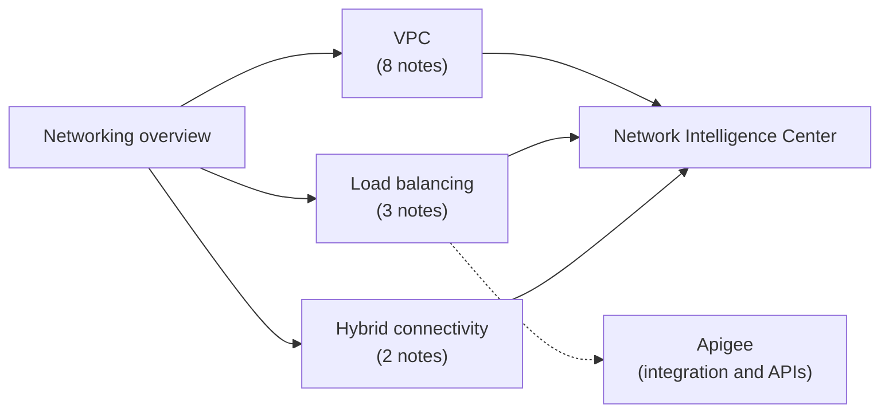

# Networking

Google Cloud networking: VPC networks and firewalls, private access to services, load balancing, hybrid connectivity and network observability. API management with Apigee lives in [integration and APIs](../integration-and-apis/apigee.md), and network security services such as Cloud IDS live in [security and identity](../security-and-identity/README.md).

## Map of the area

Read the overview first, then the VPC subarea, which everything else builds on. Load balancing and hybrid connectivity can be read in either order. Network Intelligence Center comes last because it observes all of them.

## Notes and subareas in reading order

1. [Google Cloud networking overview](google-cloud-networking-overview.md): Google's network, the request path and the core products.
2. [VPC](vpc/README.md): networks, firewall, peering and Shared VPC, Private Google Access, Private Service Connect, Flow Logs, VPC Service Controls and Access Context Manager.
3. [Load balancing](load-balancing/README.md): Application and Network Load Balancers, SSL policies and certificates.
4. [Hybrid connectivity](hybrid-connectivity/README.md): Cloud VPN and Cloud Interconnect.
5. [Network Intelligence Center](network-intelligence-center.md): topology, connectivity tests, performance and firewall insights.

## Planned topics

- Cloud DNS (public, private, forwarding, DNSSEC)
- Cloud CDN and Media CDN
- Cloud Armor
- Network Service Tiers
- Network pricing and egress
- Secure Web Proxy
