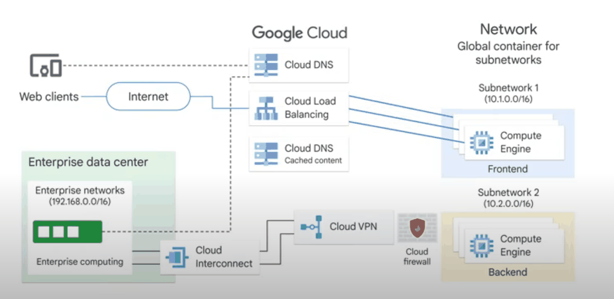
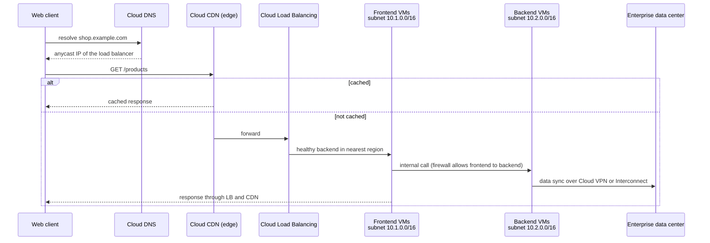
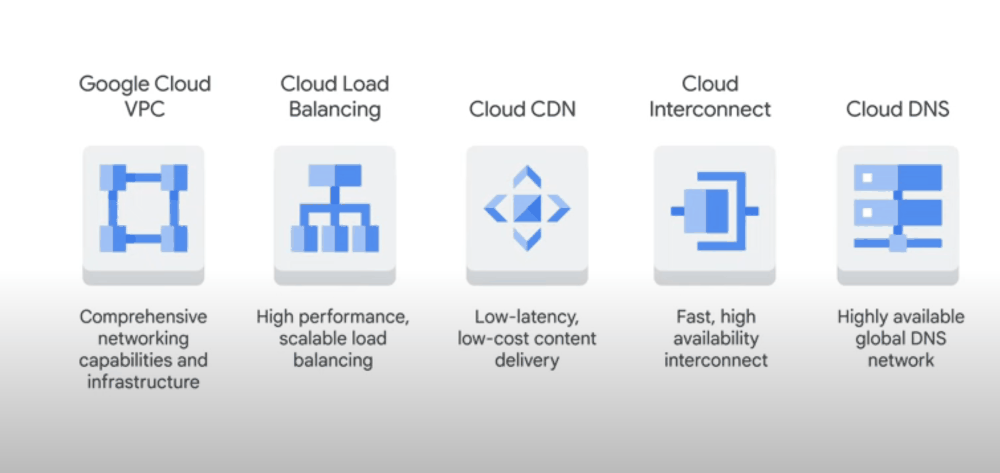
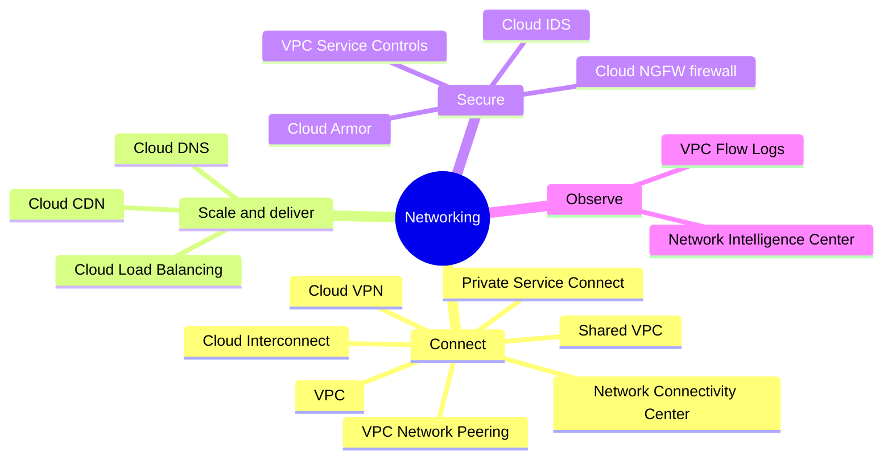

# Google Cloud networking overview

## Summary

Google Cloud networking is built on Google's private, software-defined global network. A *VPC network* is a global resource that holds subnets (regional), routes and firewall rules; VMs and other resources attach to it. Around the VPC sit the edge services that bring users in (Cloud DNS, Cloud CDN, Cloud Load Balancing, Cloud Armor) and the hybrid services that connect other networks (Cloud VPN, Cloud Interconnect). This note shows how the pieces fit together on the path of a single request.

## Prerequisites

- Basic networking: IP addressing, CIDR, routing, DNS, TCP and UDP.
- [Global infrastructure](../foundations/global-infrastructure.md).

## Core concepts

### Network basics

Networks connect computers so they can exchange data. A *local area network (LAN)* connects machines in one location, a *wide area network (WAN)* connects LANs across locations, and most networks connect to the internet so that PCs, phones and servers can reach services. A cloud network does the same in software: there are no cables to plug in, only resources such as networks, subnets, routes and firewall rules defined through an API.

### Properties of Google's network

- **Global private infrastructure.** Google operates one of the largest private networks, with dedicated fiber between its data centers, regions and edge points of presence (PoPs). User traffic enters at the closest PoP.
- **Software-defined networking (SDN).** Routing, load balancing and firewalling are programmed centrally and enforced in a distributed way, close to every VM. There is no single firewall box or router to become a bottleneck.
- **Content delivery.** Cloud CDN caches content at the edge. Requests for uncached content go to Cloud Load Balancing, which picks a healthy backend.
- **Global networks, regional subnets.** A VPC network spans all regions; instances live in regional subnets. Firewall rules, routes and VPN policies are defined at the network level.
- **Isolation.** Networks are isolated from each other unless connected on purpose, and subnets can be separated with firewall rules (for example, frontends cannot reach backend databases directly).
- **Encryption in transit.** Traffic between Google data centers is encrypted.

### The request path

The sequence follows the original description: DNS resolution, a CDN hit or miss, load balancer selection by location and health, frontend to backend calls inside the VPC, and hybrid links to the data center that the frontend subnet cannot reach directly.

### Core products

| Product | Purpose | Note |
| --- | --- | --- |
| VPC | Global private network with regional subnets | [VPC networks](vpc/vpc-networks.md) |
| Cloud Load Balancing | Distribute traffic to backends, global anycast IP | [Load balancing](load-balancing/README.md) |
| Cloud CDN | Edge caching for content behind a load balancer | Planned |
| Cloud Interconnect | Dedicated or partner private links to on-premises | [Cloud Interconnect](hybrid-connectivity/cloud-interconnect.md) |
| Cloud VPN | IPsec tunnels over the internet | [Cloud VPN](hybrid-connectivity/cloud-vpn.md) |
| Cloud DNS | Managed authoritative and private DNS | Planned |

## Worked example

TODO: Build the request path above in a sandbox project (two subnets, a global external Application Load Balancer with Cloud CDN, a firewall rule from the frontend to the backend tag only) and record the `curl -I` response headers that show a cache miss and a cache hit.

## Trade offs and when to use it

- Global VPCs remove the need for inter-region VPNs inside one network, but make network design a shared concern for every region. Plan IP ranges for all regions from the start.
- Edge services (CDN, global load balancing, Cloud Armor) give the best latency and DDoS protection for internet-facing apps, but cost more than regional, Standard Tier setups.

## Common mistakes

- **Thinking of a VPC as regional.** It is global; only subnets are regional.
- **Allowing all internal traffic.** The default network's `default-allow-internal` rule lets every VM talk to every other VM. Segment with firewall rules.
- **Exposing backends directly.** Put internet traffic through a load balancer and keep backends on internal IPs.

## Practice

1. What happens to a request for content that Cloud CDN has not cached?
2. Which network resources are global and which are regional?
3. Name the two hybrid connectivity products and the main difference between them.

Answers: 1. It goes to Cloud Load Balancing, which forwards it to a healthy backend; the response can then be cached. 2. VPC networks, routes and firewall rules are global; subnets are regional. 3. Cloud VPN (encrypted tunnels over the internet) and Cloud Interconnect (private physical or partner links, higher bandwidth).

## Further reading

- [VPC overview](https://docs.cloud.google.com/vpc/docs/overview), Google Cloud documentation. The network model.
- [Hybrid and multicloud architecture patterns](https://docs.cloud.google.com/architecture/hybrid-multicloud-patterns-and-practices), Google Cloud Architecture Center. How networks are connected across environments.
- [Cloud CDN overview](https://docs.cloud.google.com/cdn/docs/overview), Google Cloud documentation. Cache behavior at the edge.
